# STM32 学习笔记

本次学习为我的就业之路最重要的学习，它将直接决定我的就业方向，也是嵌入式方向开发的基础和核心。我将从 STM32 芯片的简介开始，逐步介绍 STM32 的片上资源、外设、中断、定时器、ADC、DMA 等。

本笔记将帮助我快速上手 STM32 芯片，为我 future 的就业打下坚实的基础。本次学习主要用到了 STM32F103C8T6 芯片，我跟着 B 站 UP 主铁头山羊学习 STM32 的库函数，实现对我的作品的制作。

我制作的作品将上传到网站之中，源码将上传到我的 GitHub 仓库中。

- GitHub 仓库地址：[心伤の雨](https://github.com/xinkong-kew)
- 个人网站：[星空笔记](https://www.xinkong.us.ci)
  
# 10月20日

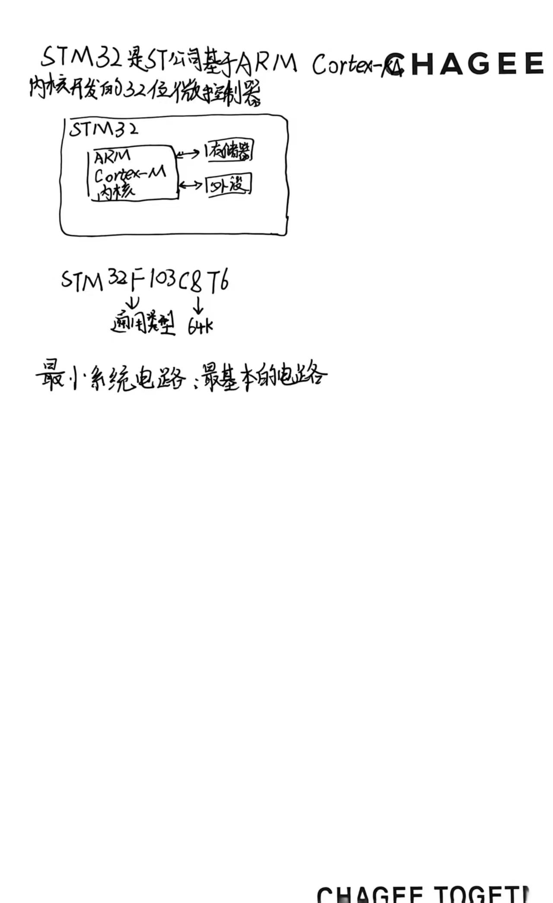

## 1. STM32 芯片简介

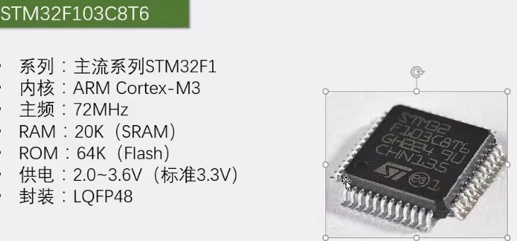

以 STM32F103C8T6 为例：

● 系列：主流系列 STM32F1
● 内核：ARM Cortex-M3
● 主频：72 MHz
● RAM：20K（SRAM）
● ROM：64K（Flash）
● 供电：2.0 ~ 3.6V（标准 3.3V）
● 封装：LQFP48

命名上，F103 中的 103 代表通用型，C8 中的 8 表示 Flash 容量为 64K，T 表示 LQFP 封装，6 表示工业级温度范围。
>重点:芯片的片上资源
## 2. 片上资源 / 外设

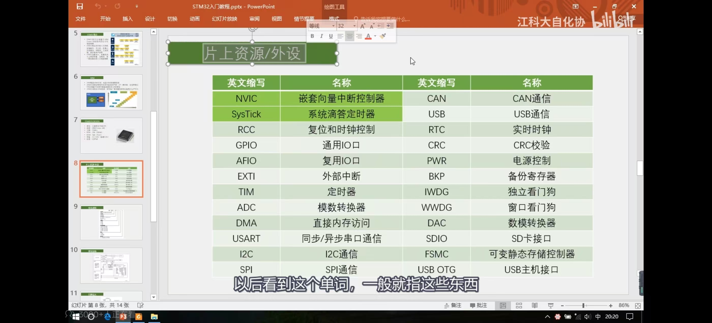

STM32 把常用外设都集成到了芯片内部，看到下面这些英文缩写，一般就是指这些外设：

● NVIC：嵌套向量中断控制器
● SysTick：系统滴答定时器
● RCC：复位和时钟控制
● GPIO：通用 IO 口
● AFIO：复用 IO 口
● EXTI：外部中断
● TIM：定时器
● ADC：模数转换器
● DMA：直接内存访问
● USART：同步/异步串口通信
● I2C：I2C 通信
● SPI：SPI 通信
● CAN：CAN 通信
● USB：USB 通信
● RTC：实时时钟
● CRC：CRC 校验
● PWR：电源控制
● BKP：备份寄存器
● IWDG：独立看门狗
● WWDG：窗口看门狗
● DAC：数模转换器
● SDIO：SD 卡接口
● FSMC：可变静态存储控制器
● USB OTG：USB 主机接口

## 3. 芯片引脚定义

STM32F103C8T6 采用 LQFP48 封装，共 48 个引脚。

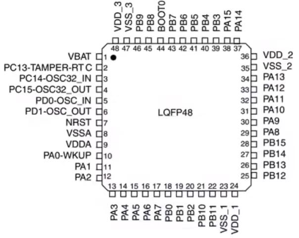

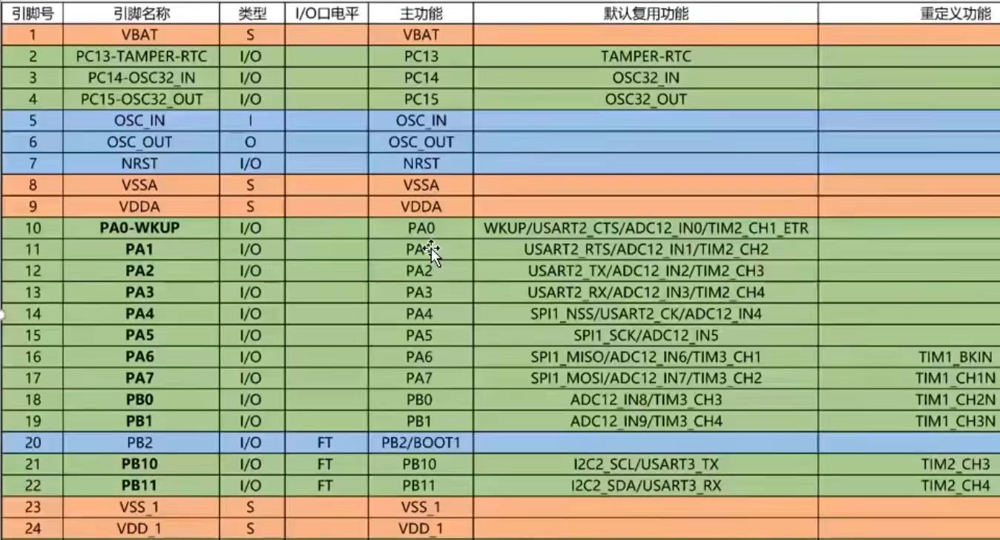

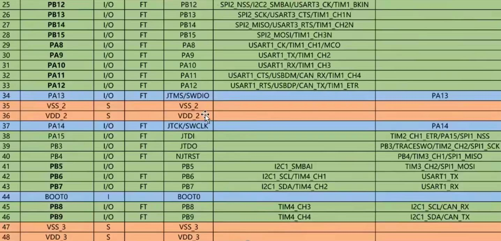

引脚定义表各列含义：

● 引脚号：芯片封装上的引脚编号，从左上角（1 号脚，有个小圆点标记）开始逆时针排列。
● 引脚名称：芯片手册中的引脚名，如 PA0、PB5、VDD_1、VSS_1 等。
● 类型：S 表示电源引脚，I/O 表示输入/输出引脚，I 表示仅输入，O 表示仅输出。
● I/O 电平：FT 表示该引脚可耐 5V 电平（Five-volt Tolerant），其余引脚只能承受 3.3V。
● 主功能：引脚的默认功能，例如 PA0~PA7 是普通 GPIO，VBAT、VDD、VSS 是电源。
● 默认复用功能：引脚复位后默认连接的片上外设功能，例如 PA9 默认复用为 USART1_TX，PA10 默认复用为 USART1_RX。
● 重定义功能：通过 AFIO 重映射后可以切换到的其他外设功能，例如 TIM2_CH1 可以重映射到 PA15。

常见引脚分组：

● 电源引脚：VBAT（备份电源）、VDD（3.3V 数字电源）、VDDA（模拟电源）、VSS/VSSA（地），多个 VDD/VSS 需要全部连接。
● 时钟引脚：PD0-OSC_IN / PD1-OSC_OUT 接外部高速晶振（HSE），PC14-OSC32_IN / PC15-OSC32_OUT 接外部低速晶振（LSE）。
● 复位引脚：NRST，低电平复位。
● 调试引脚：PA13（JTMS/SWDIO）、PA14（JTCK/SWCLK），用于 SWD 下载和调试。
● 启动模式引脚：BOOT0（44 脚）、PB2/BOOT1（20 脚）。
● GPIO 口：PA0 ~ PA15、PB0 ~ PB15、PC13 ~ PC15 等，可按需配置为输入、输出或复用外设。

## 4. 启动模式

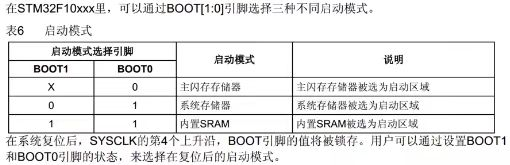

在 STM32F10xxx 中，可以通过 BOOT[1:0] 引脚选择三种不同的启动模式：

● 主闪存存储器：BOOT1 = X，BOOT0 = 0，主闪存存储器被选为启动区域（正常运行程序）。
● 系统存储器：BOOT1 = 0，BOOT0 = 1，系统存储器被选为启动区域（用于串口 ISP 下载）。
● 内置 SRAM：BOOT1 = 1，BOOT0 = 1，内置 SRAM 被选为启动区域（用于调试）。

要点：

● 系统复位后，SYSCLK 的第 4 个上升沿，BOOT 引脚的值会被锁存，之后再改变引脚状态不会影响本次启动。
● 正常运行时 BOOT0 接低电平（接地），从主 Flash 启动；需要串口下载程序时，把 BOOT0 接高电平、BOOT1 接低电平，复位后进入系统存储器中的 Bootloader。
● 若配置正确却无法下载，检查 BOOT0/NRST 的接线是否正确，以及是否已正确复位。

# 10月21日
今天学习了STM32的点灯，成功用寄存器和库函数都实现了点灯功能。

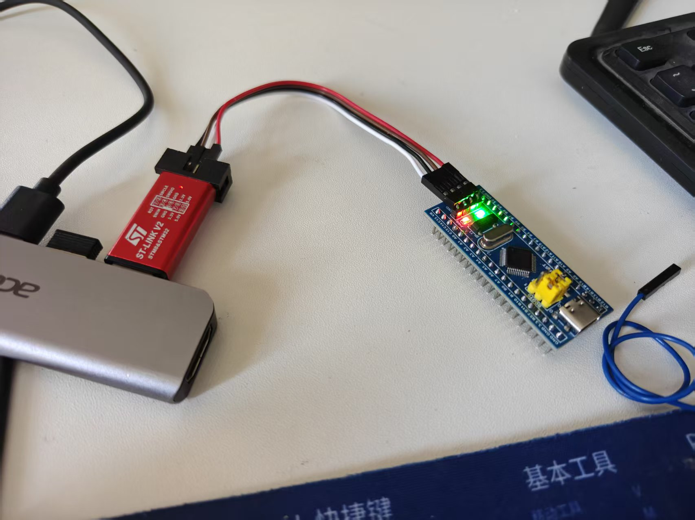

点灯效果：通过控制GPIO输出高低电平，驱动LED灯点亮和熄灭。

---

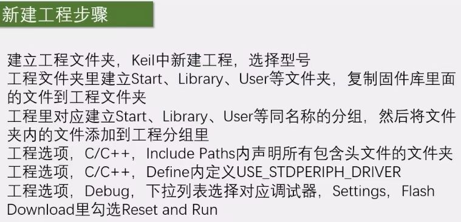

新建工程步骤：在Keil MDK中创建STM32工程，包含芯片选型、添加启动文件、配置调试器、添加库函数等关键步骤。

---

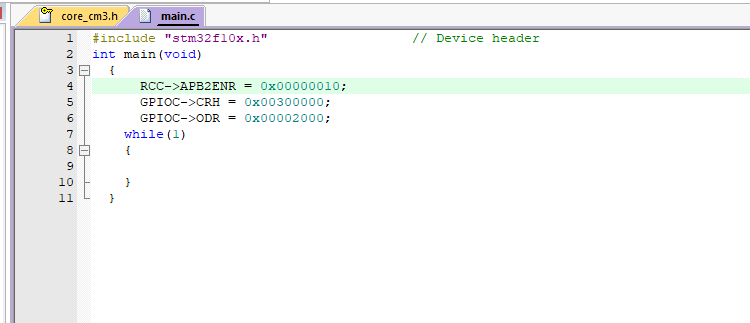

寄存器点灯代码：通过直接操作RCC（复位和时钟控制）寄存器使能GPIO时钟，再配置GPIO的CRL/CRH（端口配置寄存器）设置引脚模式，最后操作ODR（端口输出数据寄存器）控制引脚输出高低电平，实现LED的点亮和熄灭。

---

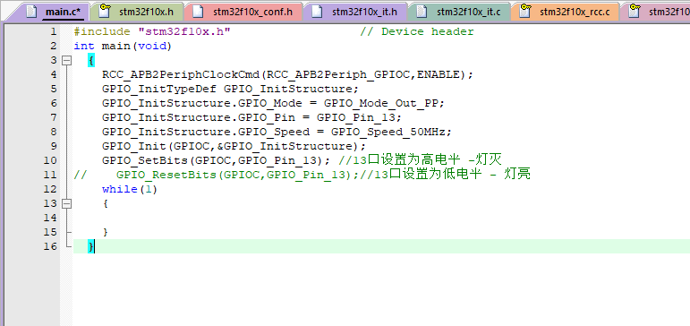

库函数点灯代码：使用STM32标准外设库中的函数，调用RCC_APB2PeriphClockCmd()使能GPIO外设时钟，GPIO_Init()初始化GPIO引脚的工作模式，GPIO_SetBits()/GPIO_ResetBits()设置引脚输出高/低电平，通过库函数封装简化了对寄存器的直接操作。

---

## 5. GPIO 输出详解

GPIO（General Purpose Input/Output，通用输入输出）是 STM32 最基础也是最常用的外设，编程时首先要了解如何控制引脚输出高低电平，才能驱动 LED、蜂鸣器等外部设备。

### 5.1 GPIO 输出基本原理

STM32F103 的 GPIO 引脚通过配置寄存器（CRL/CRH）来设置工作模式，并通过输出数据寄存器（ODR）或置位/复位寄存器（BSRR）来控制引脚输出电平：

● 输出高电平：引脚对外输出 3.3V，驱动能力由引脚最大灌/拉电流决定。
● 输出低电平：引脚对外输出 0V。
● 控制方式：写 GPIO 的输出数据寄存器 ODR，或使用 GPIO_SetBits()/GPIO_ResetBits() 库函数。

### 5.2 GPIO 输出流程（以库函数为例）

```
1. 使能 GPIO 时钟：RCC_APB2PeriphClockCmd(RCC_APB2Periph_GPIOA, ENABLE);
2. 配置引脚模式：GPIO_Init() 设置引脚为推挽输出
3. 控制引脚输出：GPIO_SetBits()/GPIO_ResetBits() 写高低电平
```

### 5.3 GPIO 八种工作模式

STM32 的 GPIO 可以配置为以下 8 种工作模式，每种模式对应输入/输出两种方向，以及不同内部结构（推挽/开漏、上拉/下拉/浮空）：

| 模式分类 | 模式名称 | 库函数宏定义 | 引脚方向 | 内部结构 | 适用场景 |
| --- | --- | --- | --- | --- | --- |
| 输入模式 | 浮空输入 | GPIO_Mode_IN_FLOATING | 输入 | 内部不上拉不下拉，高阻态 | AD 采样前配置、外部电平检测（由外部电路决定电平） |
| 输入模式 | 上拉输入 | GPIO_Mode_IPU | 输入 | 内部接上拉电阻 | 按键检测（按下接地）、读取高电平默认信号 |
| 输入模式 | 下拉输入 | GPIO_Mode_IPD | 输入 | 内部接下拉电阻 | 按键检测（按下接高电平）、读取低电平默认信号 |
| 输入模式 | 模拟输入 | GPIO_Mode_AIN | 输入 | 模拟通路，关闭数字输入 | ADC 采集、DAC 输出电压读取 |
| 输出模式 | 开漏输出 | GPIO_Mode_Out_OD | 输出 | 只能输出低电平，拉高需外部上拉 | 电平转换、I2C 通信、多设备总线共享（线与） |
| 输出模式 | 推挽输出 | GPIO_Mode_Out_PP | 输出 | 可输出高/低电平，驱动能力强 | 驱动 LED、蜂鸣器、普通信号输出 |
| 复用模式 | 复用推挽输出 | GPIO_Mode_AF_PP | 复用输出 | 推挽结构，由外设控制 | USART_TX、SPI_SCK/MOSI、定时器 PWM 输出 |
| 复用模式 | 复用开漏输出 | GPIO_Mode_AF_OD | 复用输出 | 开漏结构，由外设控制 | I2C_SCL/SDA、CAN_TX 等复用开漏信号 |

### 5.4 八种模式详细说明

**输入模式（4 种）**：引脚方向为输入，芯片内部通过施密特触发器读取外部电平信号。

● 浮空输入：内部既不上拉也不下拉，引脚呈高阻态，电平完全由外部电路决定，容易受外界干扰，常用于不会悬空的场景。
● 上拉输入：内部通过一个上拉电阻把引脚默认拉到高电平（3.3V），外部接地时读为低电平，适合按键接地的场景。
● 下拉输入：内部通过一个下拉电阻把引脚默认拉到低电平（0V），外部接高时读为高电平，适合按键接 VCC 的场景。
● 模拟输入：关闭数字输入缓冲器，引脚直接连接到 ADC/DAC 的模拟通道，用于采集模拟电压信号。

**输出模式（2 种）**：引脚方向为输出，由 ODR/BSRR 寄存器控制引脚电平。

● 推挽输出：内部有两个互补的 MOS 管，输出时一个导通、另一个截止，既能输出高电平（强驱动）也能输出低电平，输出电流大，驱动能力强，是最常用的输出模式。
● 开漏输出：输出端只有低边 MOS 管，只能主动输出低电平；要输出高电平必须外接上拉电阻。多个开漏输出可直接并联实现“线与”，常用于 I2C 等总线。

**复用模式（2 种）**：引脚的控制权交给片上外设（如定时器 PWM、串口、I2C），GPIO 寄存器不再直接控制。

● 复用推挽输出：由外设（如 TIM、USART、SPI）驱动推挽输出，如串口发送脚 TX、PWM 输出脚。
● 复用开漏输出：由外设驱动开漏输出，如 I2C、CAN 的收发引脚，同样需要外部上拉。

### 5.5 实际应用举例

● 驱动 LED：一般使用**推挽输出**，设置为 GPIO_Mode_Out_PP，速度可选 GPIO_Speed_50MHz，然后 GPIO_ResetBits() 输出低电平点亮共阳接法的 LED。
● 读取按键：一般使用**上拉输入**或**下拉输入**，让默认电平明确，避免悬空误触发。
● I2C 通信：SDA/SCL 必须使用**复用开漏输出**（GPIO_Mode_AF_OD），并外接上拉电阻，实现双向传输。
● PWM 输出：使用**复用推挽输出**（GPIO_Mode_AF_PP），由定时器产生 PWM 波形。

# 10月22日

## 6. 四大输出模式

GPIO 的输出部分，从**电平驱动方式**上可以分为推挽与开漏，从**控制来源**上可以分为通用与复用，两两组合就构成了四种输出模式：
推挽输出、开漏输出、通用输出、复用输出。
>重点:推挽输出和开漏输出的区别
### 6.1 什么是推挽（Push-Pull）

推挽输出内部由两个互补的 MOS 管（一个 P-MOS 管负责上拉、一个 N-MOS 管负责下拉）组成，工作特点是**既能主动输出高电平，也能主动输出低电平**：

● 输出高电平：P-MOS 导通、N-MOS 截止，引脚由 VDD 电源出电流，驱动能力强。
● 输出低电平：P-MOS 截止、N-MOS 导通，引脚对地放电，可灌入较大电流。
● 由于上下两个管子一个导通一个截止（一个"推"、一个"挽"）配合工作，所以叫推挽输出。
● 优点：驱动能力强、电平稳定、速度快，是点亮 LED、驱动蜂鸣器等最常用的输出模式。

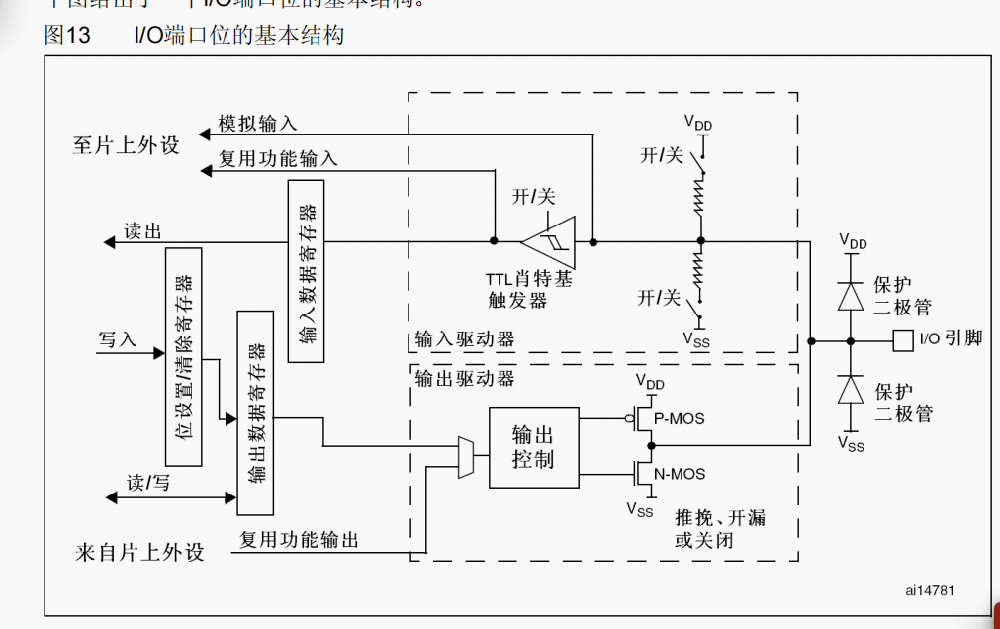

### 6.2 什么是开漏（Open-Drain）

开漏输出内部**只有一个 N-MOS 管**，没有上拉 P-MOS，因此**只能主动输出低电平**；要输出高电平，必须用**外部上拉电阻**或外部电路提供：

● 输出低电平：N-MOS 导通，引脚接地，正常输出 0V。
● 输出高电平：N-MOS 截止，引脚呈**高阻态**，电平由外部上拉电阻决定。
● 因为输出端是"漏极开路"（Drain 悬空），所以叫开漏输出。
● 优点：多个开漏引脚可直接并联实现"线与"；可通过不同上拉电压做电平转换。常用于 I2C、CAN 等总线。

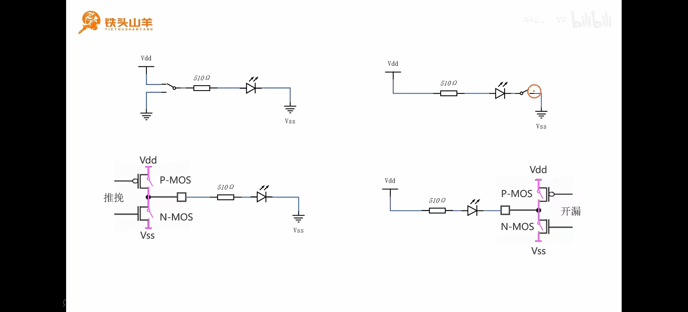

### 6.3 什么是通用（General Purpose）

通用模式指**引脚电平由 GPIO 寄存器（ODR/BSRR）直接控制**的普通 IO 口，即我们可以通过库函数把引脚拉高或拉低，用于点亮 LED、读取按键等基本功能。前面介绍的推挽/开漏输出在没有被外设接管时，就是通用输出。

### 6.4 什么是复用（Alternative Function）

复用模式指**引脚的控制权从 GPIO 移交给片上外设**（如 USART、SPI、I2C、定时器 TIM 等），引脚输出的波形不再由我们手动写寄存器决定，而是由外设自动产生。例如 PWM 输出、串口 TX 等都属于复用输出。

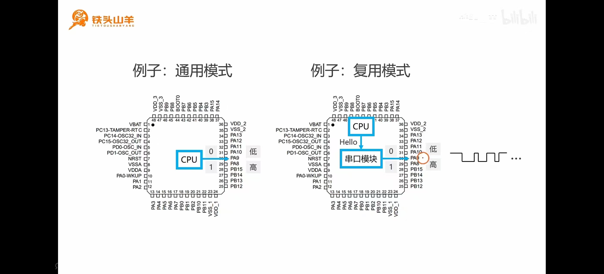

### 6.5 一图看懂四大输出模式

把四大输出模式放到一起对比，区别就在两个维度：**输入还是输出**（通用还是复用）以及**推挽还是开漏**。用"人体"来类比去理解 STM32 内部的协作关系，可以更直观地掌握这些概念。

| 模式 | 库函数宏定义 | 电平控制权 | 输出能力 | 特性 | 典型应用 |
| --- | --- | --- | --- | --- | --- |
| 通用推挽输出 | GPIO_Mode_Out_PP | GPIO 寄存器（ODR/BSRR） | 可主动输出高/低电平 | 驱动能力强、速度快、电平稳定 | 驱动 LED、蜂鸣器、普通信号输出 |
| 通用开漏输出 | GPIO_Mode_Out_OD | GPIO 寄存器（ODR/BSRR） | 只能主动输出低电平，高电平由外部上拉决定 | 可"线与"并联、支持电平转换、需外接上拉 | 电平转换、多设备总线共享 |
| 复用推挽输出 | GPIO_Mode_AF_PP | 片上外设（TIM、USART、SPI 等） | 可主动输出高/低电平 | 由外设自动产生波形、驱动能力强 | USART_TX、SPI_SCK/MOSI、定时器 PWM |
| 复用开漏输出 | GPIO_Mode_AF_OD | 片上外设（I2C、CAN 等） | 只能主动输出低电平，高电平由外部上拉决定 | 由外设自动产生波形、需外接上拉、支持"线与" | I2C_SCL/SDA、CAN_TX 等总线信号 |

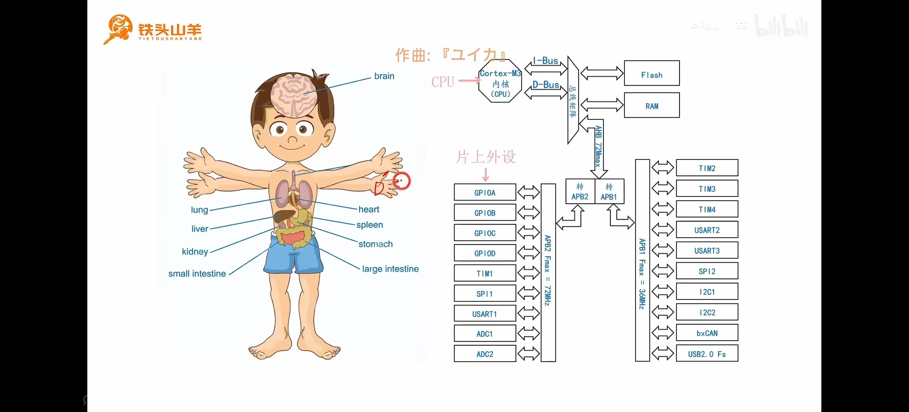

## 7. IO 的最大输出速度

### 7.1 什么是 IO 最大输出速度

IO 引脚电平在 0→1 或 1→0 翻转时，并不是瞬间完成的，而是需要一定时间。**最大输出速度**指的是 GPIO 引脚电平翻转所能支持的最快切换频率。STM32 常见档位有 2MHz、10MHz、50MHz，通过 GPIO_InitStructure.GPIO_Speed 设置。

### 7.2 上升时间、下降时间和保持时间的概念

● **上升时间（Rise Time）**：引脚从低电平上升到高电平（如从 0.1×VDD 到 0.9×VDD）所需的时间。
● **下降时间（Fall Time）**：引脚从高电平下降到低电平所需的时间。
● **保持时间（Hold Time）**：电平稳定在高/低状态所持续的时间，也就是两次翻转之间停留的时间。
● 输出速度越高，电平翻转越快，上升/下降时间越短，波形越接近理想方波。

### 7.3 什么原因限制了 IO 最大输出速度

IO 引脚内部 MOS 管的开关速度、寄生电容的充放电快慢、以及驱动电路的强度，都会限制电平翻转的快慢。可以这样理解：加快写 0/1 的速度、让保持时间越短，需要的上升/下降时间就越短；而上升/下降时间的长短，直接决定了 IO 最大输出速度的高低。

### 7.4 最大输出速度应该如何选择

并非速度越高越好，应根据实际需求选择合适的档位：

● 电平翻转频繁的场合（如高速通信、PWM）：选用 50MHz，保证波形完整。
● 翻转慢的场合（如点亮 LED、读取按键）：选用 2MHz 或 10MHz 即可，速度太高反而会产生电磁干扰（EMI）并增加功耗。
● 原则：够用就好，速度与外部负载匹配即可。

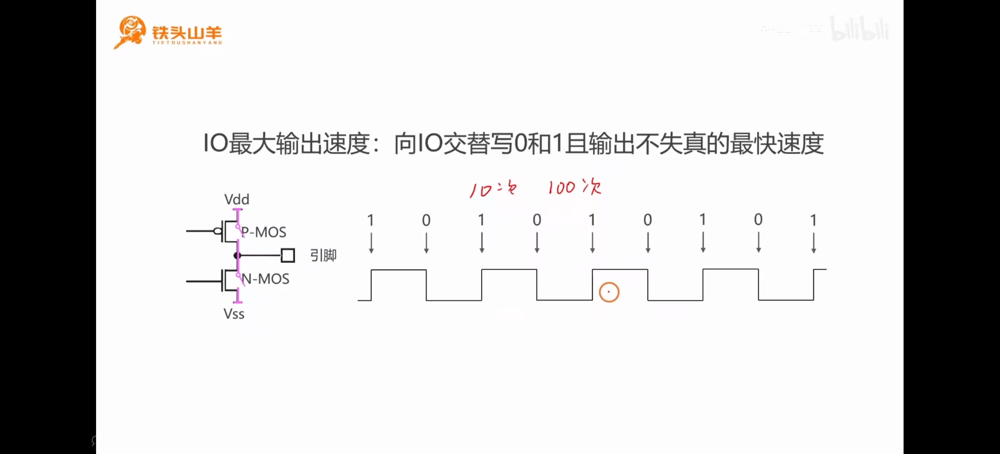

## 8. STM32 板 LED 灯交替闪烁

### 8.1 两种接通方式 - 推挽和开漏

LED 的接通方式有两种：

● **推挽接法**：LED 一端接引脚、另一端接地（共阴），引脚输出高电平点亮。
● **开漏接法**：LED 一端接 VCC、另一端接引脚（共阳），引脚输出低电平点亮。

通过原理图可知，STM32 板上的 LED 灯用的是**开漏接法**，因此写 0 点亮、写 1 熄灭。

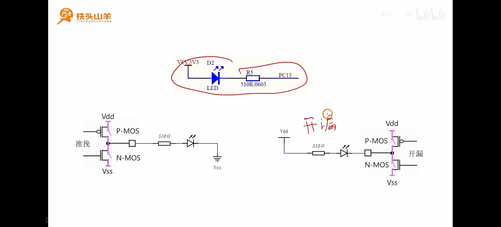

### 8.2 正式写代码

编写 LED 闪烁程序需要三步：**开时钟 → 初始化 IO → 写值**。首先开启时钟，时钟相当于人体的心跳，为引脚提供电平切换的信号，也就是相当于给各个外设部位"充血"，让它们能正常工作。

---

### 8.2.1 晶振——芯片的「心脏起搏器」

**晶振**（Crystal Oscillator）是一个物理元件，利用石英晶体的**压电效应**产生稳定的机械振动，再把振动转化为电信号输出。它的本质相当于人体的**窦房结（心脏起搏器）**：

- 窦房结是位于右心房顶端的一团特殊细胞，它不需要大脑指令，能**自发地、有节律地产生电脉冲**，驱动心脏跳动。同样，晶振只要通电，就能自发地、以固定频率振荡，产生时钟波形。
- 窦房结的放电频率决定了人的静息心率（约 60～100 次/分钟）；晶振的振荡频率则决定了芯片的基准节拍（如 8MHz、32.768kHz）。

**STM32 中的两颗晶振：**

| 晶振类型 | 频率 | 人体类比 | 作用 |
| --- | --- | --- | --- |
| HSE（外部高速晶振） | 8MHz | **运动时的心率** — 剧烈跳动，驱动全身高速运转 | 为 CPU 和外设提供高速工作时钟，经 PLL 倍频后可到 72MHz |
| LSE（外部低速晶振） | 32.768kHz | **睡眠时的心率** — 平稳缓慢，维持最低生命活动 | 为 RTC 实时时钟提供精确计时，保持系统掉电后的日历功能 |

HSE 和 LSE 同时存在，就好比人**运动时心跳加速**、**睡觉时心跳变慢**——STM32 在不同场景下选择不同晶振作为时钟源，既保证性能又节省功耗。

---

### 8.2.2 时钟——芯片的「血液循环系统」

如果说晶振是心脏起搏器，那**时钟**（Clock）就是由这个起搏器驱动的**整个血液循环系统**：

- **心跳产生脉搏波**，通过动脉传遍全身，为每个器官（大脑、肌肉、肾脏）供血供氧。
- **晶振产生时钟信号**，通过 RCC（复位和时钟控制）分频/倍频后，送到每个外设（GPIO、USART、TIM、ADC 等），为它们提供工作的节拍信号。

没有心跳，器官立即坏死；没有时钟，外设就不知道何时采样、何时翻转、何时传输数据——整个芯片陷入"静默"。

**时钟树 = 血管网络：**

| 时钟概念 | 人体类比 | 含义 |
| --- | --- | --- |
| **晶振** | 窦房结（心脏起搏器） | 产生最原始的节拍信号 |
| **HSE** | 运动心率 | 8MHz 高速原始信号 |
| **LSE** | 静息心率 | 32.768kHz 低速原始信号 |
| **PLL（锁相环）** | **肾上腺素** — 让心跳加速 | 把 HSE 的 8MHz 倍频到 72MHz（SYSCLK），使 CPU 全速运转 |
| **AHB 分频器** | **主动脉** | SYSCLK 经分频后送给高速总线上的外设（如 DMA） |
| **APB1 分频器** | **大动脉分支**（流向内脏） | 最高 36MHz，驱动低速外设：USART2-5、SPI2、TIM2-7 等 |
| **APB2 分频器** | **大动脉分支**（流向四肢） | 最高 72MHz，驱动高速外设：GPIO、USART1、SPI1、TIM1 等 |
| **RCC** | **自主神经系统**（调控心率分配） | 控制哪个外设的时钟打开/关闭、决定分频系数 |
| **外部低速晶振（LSE）** | 深度睡眠时的微弱脉搏 | 仅维持 RTC 走时，功耗极低 |

---

### 8.2.3 为什么写代码时必须「先开时钟」？

这就像做手术前必须**先让血液流到对应器官**，否则器官处于缺血坏死状态，任何操作都无效：

- `RCC_APB2PeriphClockCmd(RCC_APB2Periph_GPIOX, ENABLE)` —— 相当于给「手和脚」（GPIO）供血，让它有能量工作。
- 如果漏写这一句，程序的 `GPIO_Init()` 不会报语法错误，但引脚完全不会响应——因为 GPIO 外设根本没获得时钟信号，内部寄存器不工作。
- STM32 默认上电只开启少数必要的时钟，其他外设时钟全部关闭——这是为了**省电**，就像人在安静时四肢血流减少，血液优先供应大脑和心脏。

**一句话总结：晶振是心跳的源头，时钟是血液的流向，RCC 是调控血流的神经中枢。理解了这个人体的三重结构，就理解了 STM32 时钟系统的本质。**

```c
// 1. 开启 GPIOX 时钟
RCC_APB2PeriphClockCmd(RCC_APB2Periph_GPIOX, ENABLE);

// 2. 初始化 IO 引脚，PC13 通用输出开漏模式，2MHz
GPIO_InitStructure.GPIO_Pin   = GPIO_Pin_13;
GPIO_InitStructure.GPIO_Mode  = GPIO_Mode_Out_OD;   // 通用开漏输出
GPIO_InitStructure.GPIO_Speed = GPIO_Speed_2MHz;    // 2MHz
GPIO_Init(GPIOC, &GPIO_InitStructure);

// 3. 向 IO 引脚写值(0/1)，配合延时实现交替闪烁
while (1) {
    GPIO_WriteBit(GPIOC, GPIO_Pin_13, Bit_SET);   // 写 1，LED 灭
    Delay();                                       // 延时
    GPIO_WriteBit(GPIOC, GPIO_Pin_13, Bit_RESET); // 写 0，LED 亮
    Delay();                                       // 延时
}
```

初始化引脚时需要用到的通用结构体配置，以及对引脚写值的库函数，具体如下：

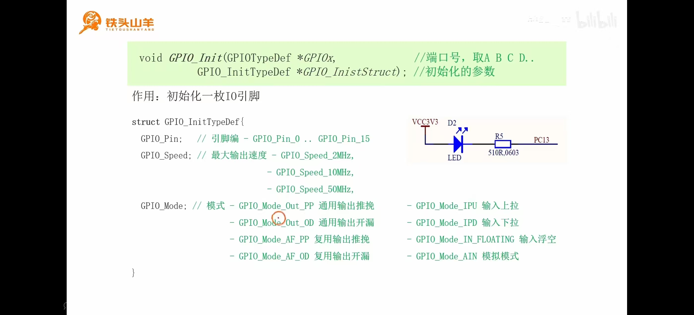

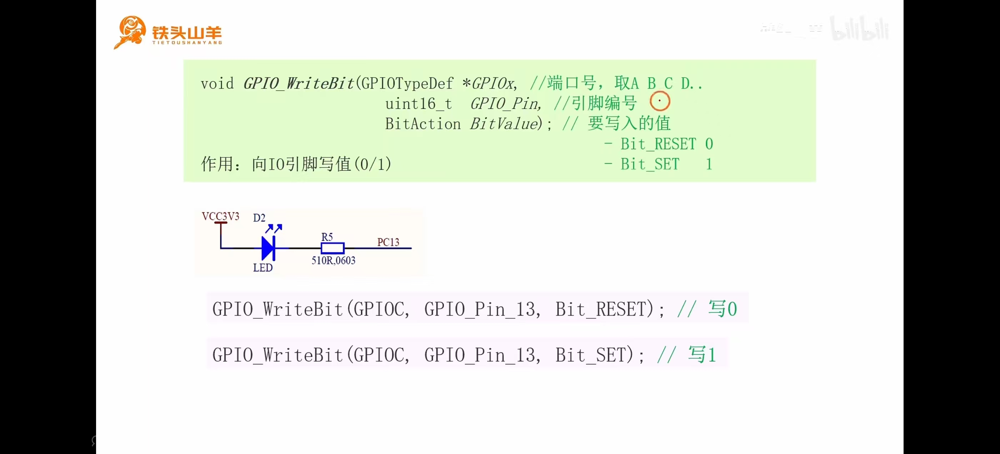

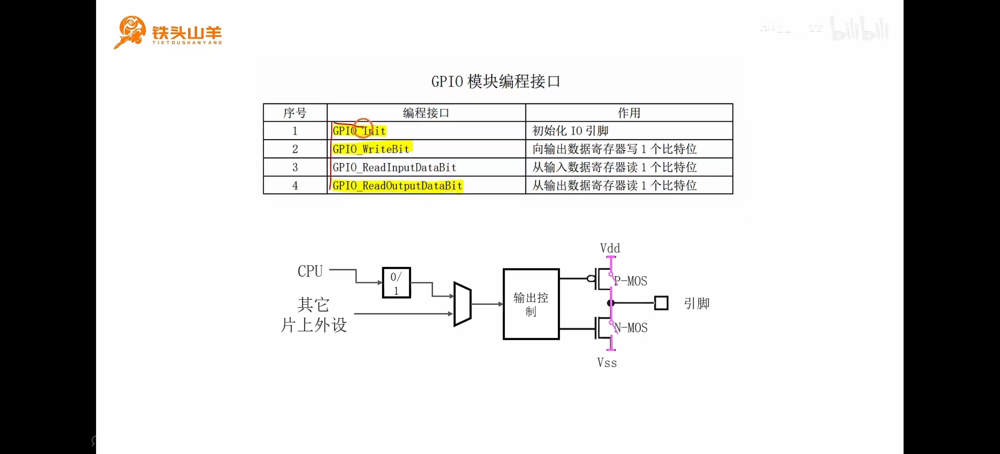

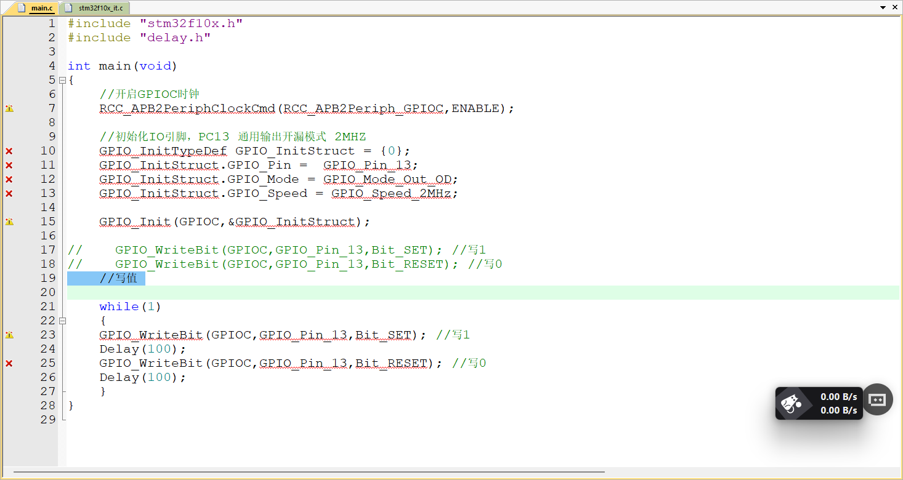

点亮和熄灭之间需要有明显的间隔，通常借助延时函数来控制节奏：

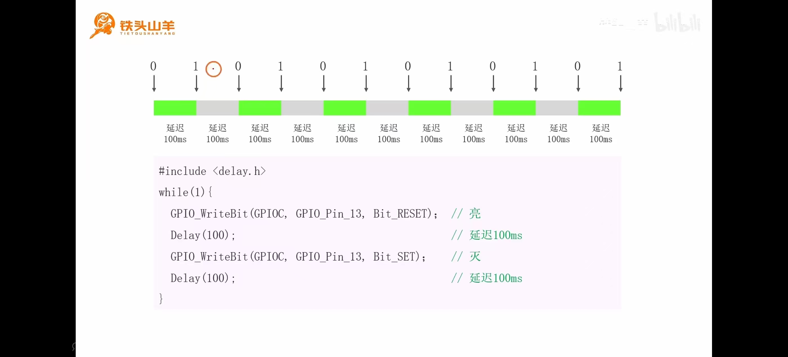

## 9. GPIO 四种输入模式

GPIO 的输入部分包含四种模式：浮空输入、上拉输入、下拉输入、模拟输入。它们的共同点是信号从引脚进入芯片，经过施密特触发器整形后由处理器读取。

>重点:施密特触发器
### 9.1 施密特触发器

施密特触发器是输入通路上的一个整形电路，具有**滞回特性**：上升到某一阈值才翻转输出高电平、下降到另一较低阈值才翻转回低电平。它能**消除信号边沿的抖动和噪声**，使电平判断更稳定、抗干扰能力更强。

### 9.2 浮空输入

浮空输入内部**既不接上拉也不接下拉电阻**，引脚呈高阻态，电平完全由外部电路决定，容易受外界干扰。因此要求外部必须明确给定电平，否则引脚悬空时读到的值不确定。

### 9.3 上拉电阻和下拉电阻

● **上拉输入**：内部通过上拉电阻把引脚默认拉到高电平（3.3V），外部接地时读为低电平。适合按键一端接地的场景。
● **下拉输入**：内部通过下拉电阻把引脚默认拉到低电平（0V），外部接高电平时读为高电平。适合按键一端接 VCC 的场景。
● 作用：让引脚在无外部信号时有一个确定的默认电平，避免悬空导致误触发。

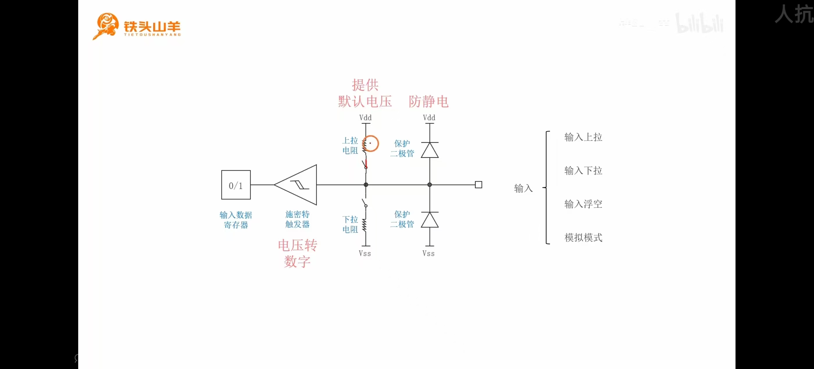

### 9.4 一表看懂四大输入模式

四种输入模式的共同点是信号从引脚进入芯片后，都要经过**施密特触发器**整形，再由处理器读取；它们的区别主要在于内部上拉/下拉电阻和是否连通模拟通路：

| 模式 | 库函数宏定义 | 内部电阻 | 引脚方向 | 数字/模拟通路 | 特性与应用 |
| --- | --- | --- | --- | --- | --- |
| 浮空输入 | GPIO_Mode_IN_FLOATING | 无上拉、无下拉 | 输入 | 走数字通路 | 高阻态、电平由外部电路决定，要求外部必须明确给定电平，易受干扰 |
| 上拉输入 | GPIO_Mode_IPU | 内部上拉电阻 | 输入 | 走数字通路 | 默认拉高到 3.3V，外部接地读低，适合按键一端接地的场景 |
| 下拉输入 | GPIO_Mode_IPD | 内部下拉电阻 | 输入 | 走数字通路 | 默认拉低到 0V，外部接高读高，适合按键一端接 VCC 的场景 |
| 模拟输入 | GPIO_Mode_AIN | 无 | 输入 | 走模拟通路（关闭数字输入） | 读取 ADC/DAC 模拟电压，常用于 AD 采样，一般用不到，不用重点记忆 |

## 10. GPIO 按钮实验

通过读取按键电平（按下引脚电平改变）来识别用户操作，是 GPIO 输入的典型应用。由于手头周边没有 LED 灯和按钮，本次实操没法实际做，代码直接参考截图的示例来理解按键扫描与防抖的逻辑。

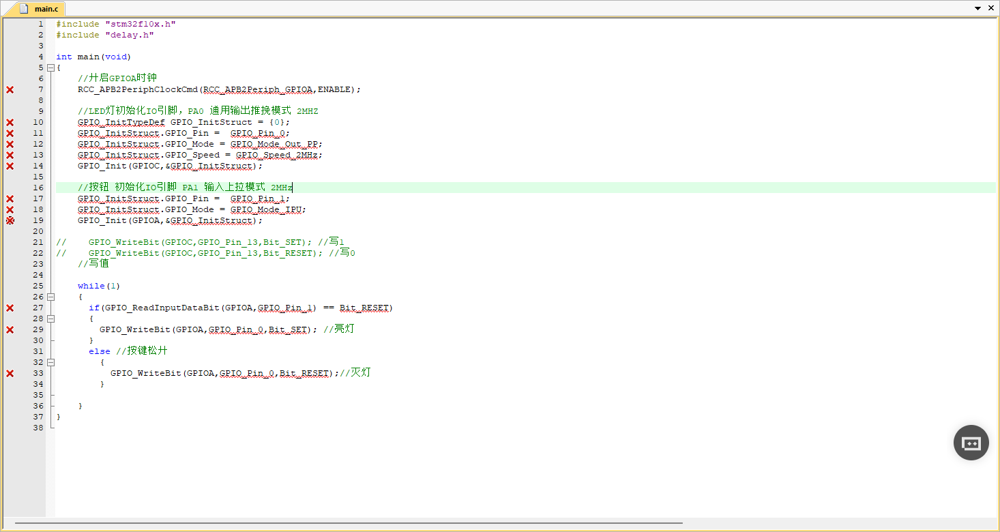
>重点:写代码的一些感想
## 写代码常见误区
首先是我自己的疏忽，代码调用的库函数经常有错误，这不可避免，毕竟我也只是一个初学者，代码需要多加练习，但是现在的我可以直接查看编译的错误信息，快速定位问题所在，从而修改错误的代码，第二个我需要重点的学习是调试函数，现在我没有自己写代码，都是学习视频中的代码，所以这个在后面作品的制作会重点的学习，今天我使用铁头的模板，发现我书写的代码在里面莫名的报错，但是编译和下载可以正常的执行，我也不知道是不是我电脑的问题。反正来日方长，学无止境。
我会把铁头的模板传输到我的github仓库里面，大家按需下载，也可以去铁头视频的连接下载模板解析。
模板下载链接:(https://github.com/xinkong-kew/STM32-Template)
# 10月23日

今天开始串口的学习，串口是 STM32 最重要的外设之一，用于与外部设备进行通信，比如 PC、手机、蓝牙模块、GPS 模块等。几乎所有嵌入式项目都离不开串口——调试打印日志、上位机通信、模块指令交互，都靠它。

> 重点：串口通信是**异步、全双工、点对点**的通信方式，只需要 **Tx（发送）** 和 **Rx（接收）** 两根线 + GND 共地即可通信。

---

## 11. 通信协议

### 11.1 串口通信的基本概念

串口通信（UART/USART）是一种**串行异步通信**协议，数据在一条线上**一位一位地依次传输**。相比并行通信（8 根线同时传 8 位），串口虽然速度慢，但接线简单、抗干扰能力强、成本低。

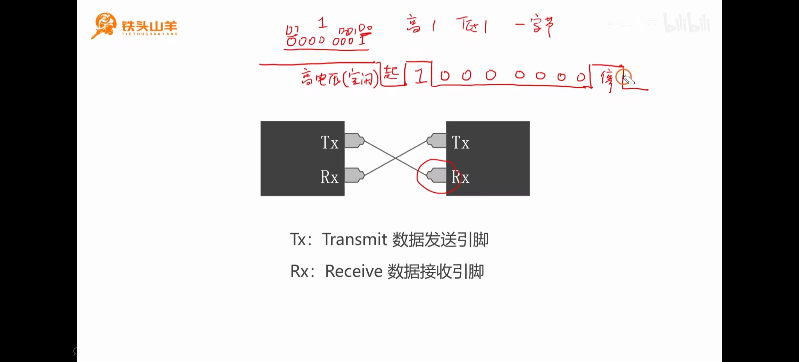

> **Tx（Transmit，发送引脚）**：芯片向外发送数据的引脚，连接到对方设备的 Rx。
>
> **Rx（Receive，接收引脚）**：芯片接收外部数据的引脚，连接到对方设备的 Tx。
>
> **交叉连接原则**：自己的 Tx 接对方的 Rx，自己的 Rx 接对方的 Tx，两边的 GND 必须共地。可以类比为两个人打电话——A 的嘴巴（Tx）对着 B 的耳朵（Rx），B 的嘴巴（Tx）对着 A 的耳朵（Rx）。

### 11.2 数据帧格式

串口通信的数据是按**帧**来组织的，每一帧包含若干个位：

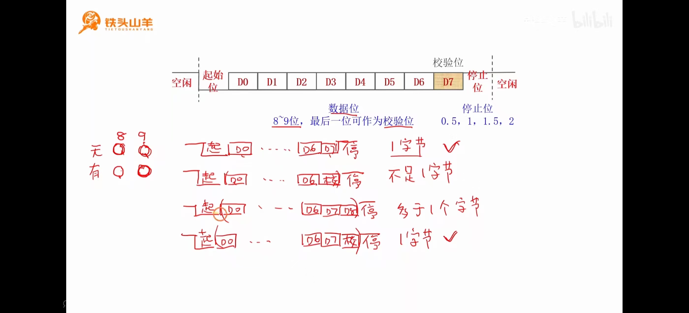

> **起始位（Start Bit）**：1 位，固定为低电平（0V）。当总线上出现一个从高到低的跳变时，表示一帧数据的开始。
>
> **数据位（Data Bits）**：通常为 8 位（也可配置为 9 位），由低位到高位（LSB → MSB）依次发送。1 为高电压，0 为低电压。十进制数会被转换为二进制数再发送；字符串则每个字符先转换为对应的 ASCII 码，再把 ASCII 码按二进制发送。
>
> **校验位（Parity Bit）**：可选，1 位，用于检测传输错误。
>
> **停止位（Stop Bit）**：通常为 1 位（也可配置为 0.5、1.5、2 位），固定为高电平，表示一帧数据结束。下一帧的起始位又会拉低，形成新的开始信号。
>
> **空闲状态**：没有数据传输时，总线保持高电平。

**一帧数据 = 起始位（1）+ 数据位（通常 8）+ 校验位（可选 1）+ 停止位（通常 1）**

### 11.3 校验位

校验位用于检测数据传输过程中是否发生了位翻转错误：

● **奇校验（Odd Parity）**：数据位 + 校验位中「1」的总个数为奇数。如果数据位中已经有奇数个 1，校验位填 0；如果是偶数个 1，校验位填 1。
● **偶校验（Even Parity）**：数据位 + 校验位中「1」的总个数为偶数。代码中 `Even` 表示偶校验，`Odd` 表示奇校验。
● **无校验（No Parity）**：不发送校验位，最常见、最省事的配置。

## 12. USART 模块

### 12.1 USART 模块结构

USART（Universal Synchronous/Asynchronous Receiver/Transmitter，通用同步/异步收发器）是 STM32 内部负责串口通信的外设模块。它可以类比为人体的**嘴巴和耳朵的结合体**——既能"说"（发送数据），也能"听"（接收数据）。

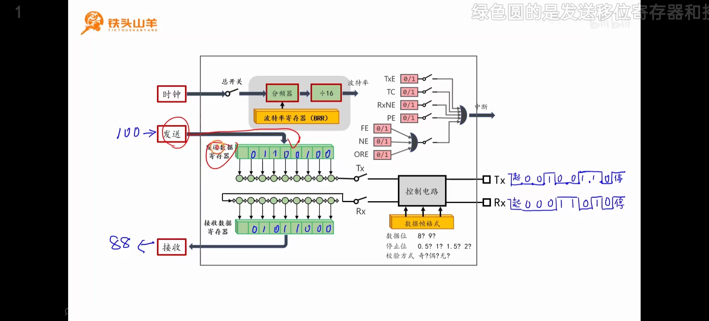

> **TDR（发送数据寄存器）**：用户把要发送的 8 位数据写入这里，硬件自动把它送到移位寄存器。
>
> **RDR（接收数据寄存器）**：移位寄存器接收完一帧后，把 8 位数据存入这里，用户从这儿读取。
>
> **发送移位寄存器**：把 TDR 中的并行 8 位数据，一位一位地串行移出到 Tx 引脚。
>
> **接收移位寄存器**：从 Rx 引脚一位一位地接收串行数据，攒够 8 位后一次性送入 RDR。
>
> **发送流程**：用户写 TDR → 移位寄存器逐位移出 → Tx 引脚发出
>
> **接收流程**：Rx 引脚进入 → 移位寄存器逐位移入 → 满 8 位后存入 RDR → 用户读取

### 12.2 移位寄存器与串并转换

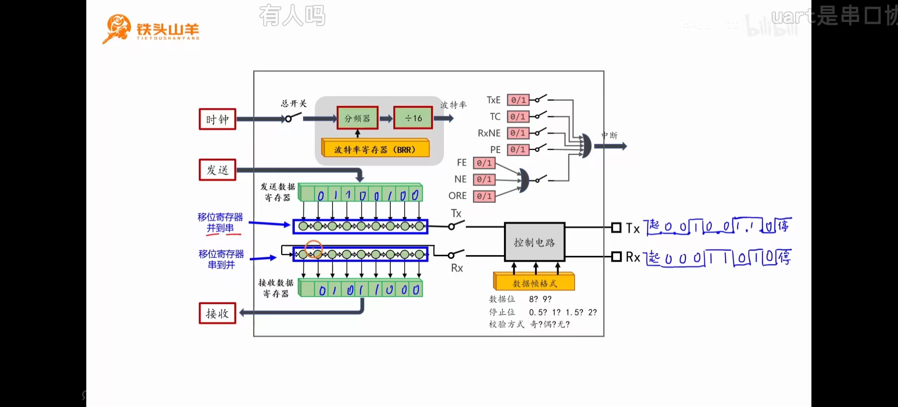

> **移位寄存器（Shift Register）**：USART 模块的核心部件，负责在并行数据和串行数据之间做转换。
>
> **并→串转换（发送时）**：CPU 一次写入 8 位并行数据到 TDR，移位寄存器在时钟驱动下，把 8 位数据从低位到高位逐位移出到 Tx 引脚。
>
> **串→并转换（接收时）**：Rx 引脚上的串行数据逐位进入移位寄存器，在一个个时钟边沿上「向右滑动」，攒满 8 位后，整个字节被一次性锁存到 RDR 中。
>
> **类比**：就像一个 8 节车厢的火车——发送时，8 节车厢里的货物（8 位数据）依次卸到一条传送带上（Tx）；接收时，传送带上的货物依次装入 8 节车厢（移位寄存器），装满后整车拉走（送入 RDR）。

### 12.3 波特率与分频器

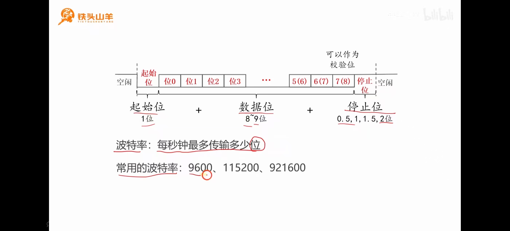

> **波特率（Baud Rate）**：每秒钟传输的码元（位）个数，单位是 bps（bits per second）。常见的波特率有 9600、115200 等。以 115200 为例，每秒能传输 115200 位，即每位占约 8.68μs。
>
> **波特率必须一致**：收发双方必须以相同的波特率通信，否则对方无法正确解析每一位数据。就像两个人用对讲机通话，必须规定好语速，说太快对方听不清，说太慢浪费带宽。
>
> **分频器（Divider）**：用于配置波特率的寄存器，本质上是一个除法器。它把时钟频率除以一个系数得到波特率时钟。公式为：**波特率 = 时钟频率 ÷ 分频系数**。例如 APB2 时钟为 72MHz，要得到 115200 的波特率，分频系数 = 72,000,000 ÷ 115200 ≈ 625。

### 12.4 UART 初始化

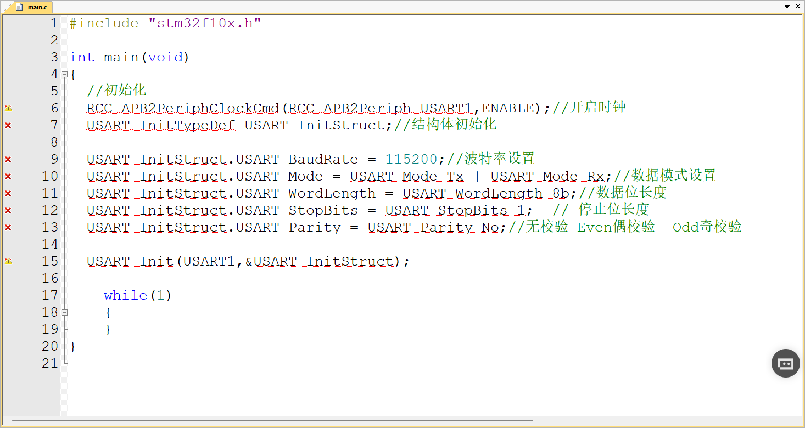

> **UART 初始化**：在使用串口之前，需要配置波特率、数据位长度、校验位、停止位等参数，并调用 `USART_Init()` 函数将这些参数写入 USART 模块的寄存器中。
>
> **关键参数**：波特率（如 115200）、字长（8 位或 9 位）、停止位（1 位或 2 位）、校验位（无/奇/偶）、硬件流控制（一般关闭）、模式（仅发送/仅接收/全双工）。

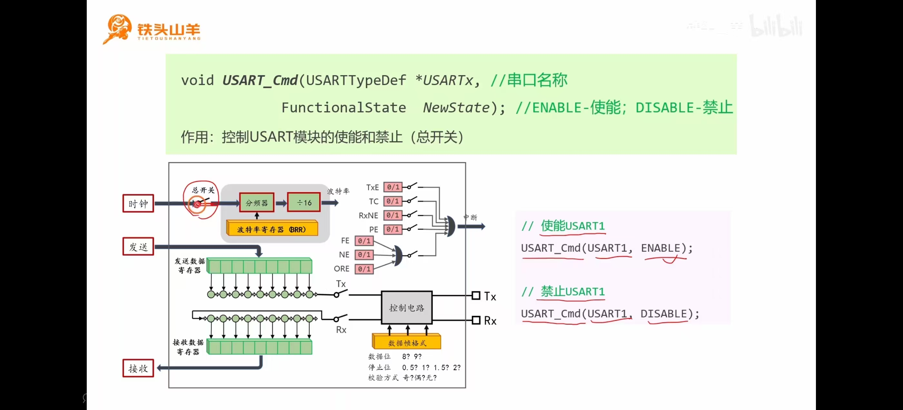

> **USART_Cmd() 库函数**：控制 USART 模块的使能和禁止。`USART_Cmd(USART1, ENABLE)` 相当于打开 USART1 的「总开关」，使能之后模块才能正常工作。类比：初始化配置了嘴巴和耳朵，但要真正开始说话/听声音，还得先按下「通话开关」。

## 13. 串口初始化 IO 口

### 13.1 引脚分布图

（详细可查阅本文档 3.芯片引脚定义部分的引脚分布图，重点关注 PA9/USART1_TX、PA10/USART1_RX 对应的引脚位置）

### 13.2 IO 配置表

串口通信是全双工的，所以 Tx 和 Rx 各有不同的模式要求：

| 引脚 | 模式 | 库函数宏定义 | 选择原因 |
| --- | --- | --- | --- |
| Tx（发送） | 复用推挽输出 | `GPIO_Mode_AF_PP` | 引脚控制权交给 USART 外设，外设自动控制高低电平，推挽保证驱动能力 |
| Rx（接收） | 输入上拉 | `GPIO_Mode_IPU` | 空闲时总线为高电平，上拉保证悬空/断线时读到确定的高电平，防止误接收 |

> **Tx 为什么选复用推挽输出？** 串口是全双工通信，Tx 引脚的电平不由用户手动控制，而是由 USART 外设的移位寄存器自动输出——所以必须用「复用」模式把控制权交给外设。选择推挽是因为 Tx 只需要单方面输出，不存在多设备共享的问题。
>
> **Rx 为什么选输入上拉？** 串口空闲时总线保持高电平，上拉输入保证在对方没有连接（断线）的情况下，Rx 读到的是确定的高电平，不会因为悬空而产生随机的干扰信号。

### 13.3 Rx/Tx 初始化代码

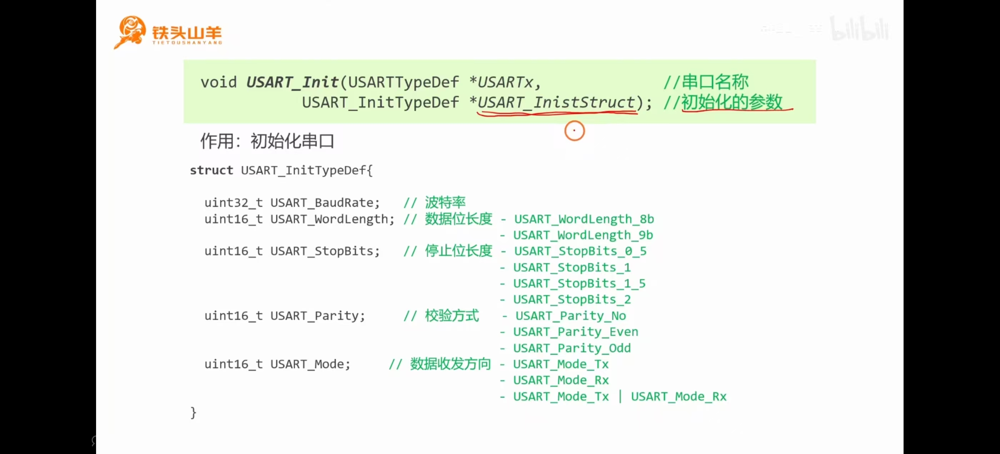

> **GPIO_Init() 初始化 Rx/Tx 引脚**：除了 USART 模块本身的配置外，还需要用 `GPIO_Init()` 把 PA9 和 PA10 两个引脚分别配置为复用推挽输出（Tx）和上拉输入（Rx）。同时要记得先开启 GPIOA 和 USART1 的时钟。三步走：**开启时钟 → GPIO 初始化 → USART 初始化**。

### 13.4 Rx/Tx 重映射

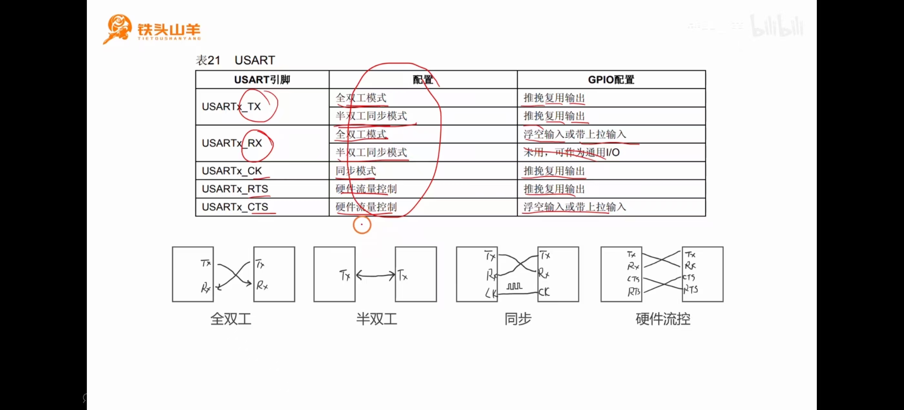

> **重映射（Remap）**：默认情况下 USART1 的 Tx/Rx 固定在 PA9/PA10，但 STM32 允许通过 AFIO 的「重映射」功能，把 USART1 的引脚映射到其他位置（如 PB6/PB7），以解决不同外设之间的引脚冲突。
>
> **重映像图表**：列出了各 USART 的默认引脚位置和重映射后的可选引脚位置，在画 PCB 或分配资源时非常实用。

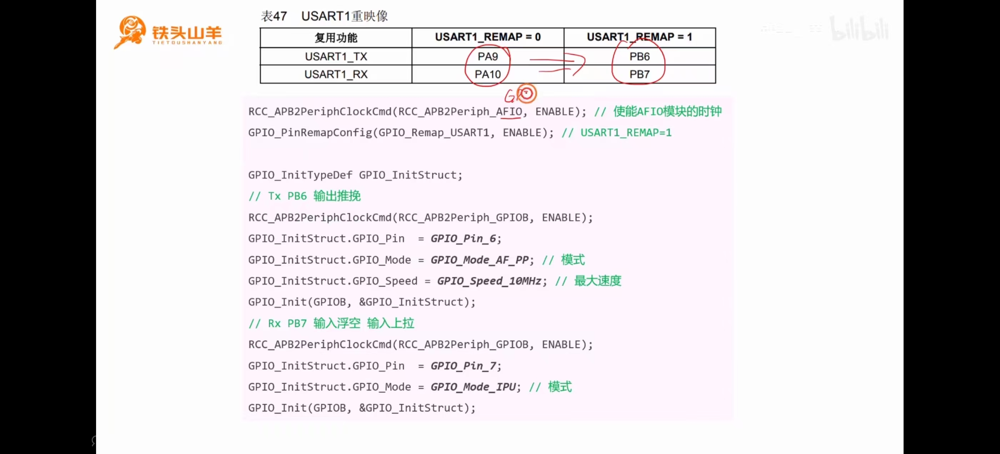

> **重映射代码**：调用 `GPIO_PinRemapConfig()` 函数将 USART1 的引脚功能重新映射到备用引脚。例如 `GPIO_PinRemapConfig(GPIO_Remap_USART1, ENABLE)` 将 USART1 从 PA9/PA10 重映射到 PB6/PB7。注意重映射前必须先使能 AFIO 时钟。

## 14. 串口发送数据

### 14.1 发送流程

数据发送是顺序进行的——每次只能发送一个字节，等这个字节发完之后才能发下一个：

**发送流程**：CPU 把 8 位数据写入 TDR → 移位寄存器自动把数据逐位移到 Tx 引脚 → 全部移出后硬件置位相关标志 → CPU 检测到标志后写入下一个字节。

### 14.2 两个重要标志位：TxE 和 TC

> 重点：发送数据时必须关注以下两个标志位

● **TxE（发送数据寄存器空，Transmit Data Register Empty）**：当 TDR 中的数据被转移到移位寄存器后，TDR 变为空，TxE = 1。此时可以向 TDR 写入下一个字节。这是最常用的发送判断标志。
● **TC（发送完成，Transmission Complete）**：当发送完成后，不仅 TDR 为空，而且移位寄存器也为空，即最后一个位已经发到了 Tx 引脚上，TC = 1。TC 比 TxE 更严格——TxE = 1 只说明 TDR 空了，但移位寄存器可能还在往外移位；TC = 1 表示真正「说完」了。
● **何时用 TxE，何时用 TC？** 连续发多个字节时用 TxE（流水线发，不等移位寄存器全部清空）；发完最后一句要确认结束或切换 RS485 收发方向时用 TC。

### 14.3 发送代码实现

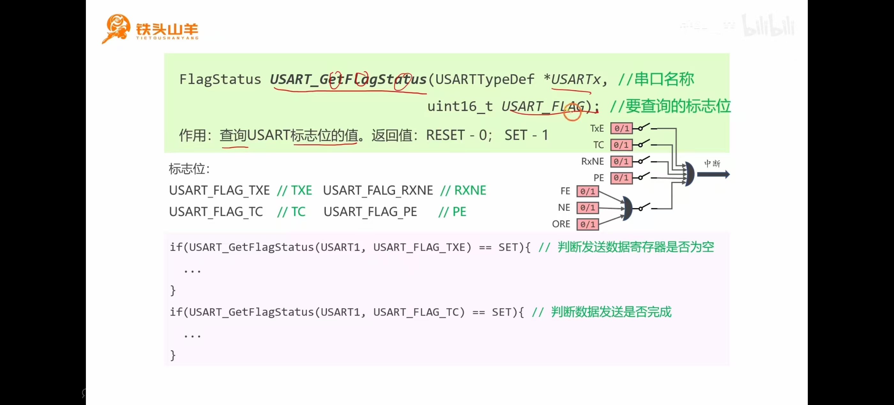

> **USART_GetFlagStatus()**：获取 USART 模块的标志位状态。`USART_GetFlagStatus(USART1, USART_FLAG_TXE)` 返回 TxE 是否为 1，以此判断是否可以发送下一个字节。
>
> **USART_SendData()**：将 8 位数据写入发送数据寄存器 TDR。`USART_SendData(USART1, data)` 把 `data` 发出去。注意：调用前必须先检查 TxE 标志位，确保 TDR 为空。

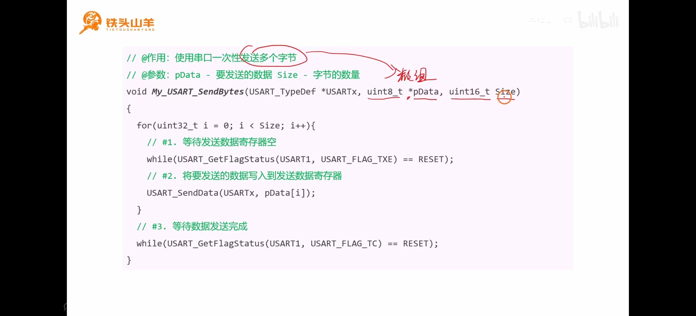

> **发送单字节**：`USART_SendData(USART1, 0x55)` 发送十六进制数 0x55（二进制 01010101），常用于测试波形。
>
> **发送字符串**：自己编写一个函数，逐字节遍历字符串，每次等待 TxE = 1 后写入一个字符，直到遇到字符串结束符 `\0`。这样可以一次性发送多个字节的多字符消息。

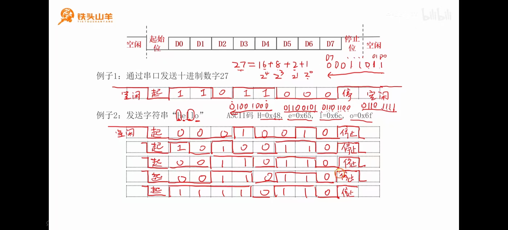

> **发送效果**：串口发送的数据可以在 PC 端的串口调试助手中显示。通过观察发送的原始数据和接收到的数据是否一致，可以验证串口通信是否正常。

### 14.4 uint8_t 数据类型详解

在串口发送函数中频繁见到 `uint8_t`，这里详细说明：

● **uint8_t**：定义在 `<stdint.h>` 中，表示**无符号 8 位整数**（0 ~ 255）。等价于 STM32 库中的 `u8` 或标准 C 的 `unsigned char`。
● **为什么用 uint8_t？** 串口每次发送的数据恰好是 8 位（一个字节），使用 `uint8_t` 能精确匹配数据宽度，避免隐式类型转换带来的不确定行为。
● **相关类型**：`uint16_t`（16 位）、`uint32_t`（32 位）、`int8_t`（有符号 8 位）等，都是跨平台的精确宽度整数类型。

## 15. 格式化打印字符串

在实际项目中，我们经常需要像 C 语言的 `printf()` 一样格式化输出调试信息（如变量值、状态提示）。STM32 上可以通过重写底层字符输出函数来实现这一功能。

### 15.1 重写 fputc 函数

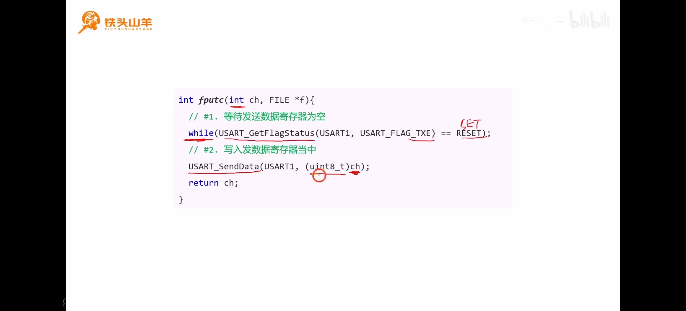

> **fputc() 函数**：标准 C 库中 `printf()` 最终会调用 `fputc()` 来输出每一个字符。重写 `fputc()`，让它把字符通过串口发出，就能在不改变 `printf()` 调用方式的前提下，把格式化字符串输出到串口。
>
> **实现方式**：在 `fputc()` 内部等待 TxE = 1，然后 `USART_SendData(USART1, ch)` 发送字符，最后 return ch。这样 `printf("Hello %d\r\n", 123)` 就能在串口助手上看到 "Hello 123"。
>
> **需勾选 MicroLIB**：在 Keil 工程选项 Target → Use MicroLIB，因为 MicroLIB 是简化的 C 库，配合重写的 `fputc()` 使用。

### 15.2 获取时间戳并输出当前时间

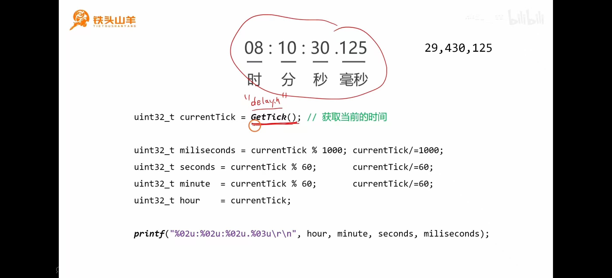

> **时间戳转换**：将时间戳（自 1970-01-01 以来的秒数）转换为可读的日期时间格式（年-月-日 时:分:秒），再通过串口 `printf()` 输出，方便在调试时为每条日志打上时间标记。

## 16. 串口接收数据

### 16.1 接收流程与 RxNE 标志位

接收也是依次进行的——每次接收一个字节，等这个字节接收完成后才能读取下一个：

**接收流程**：Rx 引脚电平变化 → 检测到起始位（下降沿）→ 逐位接收数据进入移位寄存器 → 满 8 位后转入 RDR → 硬件置位 RxNE → CPU 读取 RDR。

> 重点：RxNE 标志位

● **RxNE（接收数据寄存器非空，Receive Data Register Not Empty）**：当 RDR 中有新数据可以读取时，RxNE = 1。读取 RDR 后，RxNE 自动清 0。`RxNE = 1` 表示有新数据到了，`RxNE = 0` 表示已被读取或没有新数据。

### 16.2 接收数据代码实现

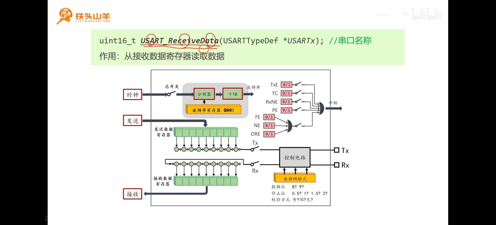

> **USART_ReceiveData()**：从 USART 模块的接收数据寄存器 RDR 中读取接收到的 8 位数据。`uint8_t data = USART_ReceiveData(USART1)` 获取一个接收字节。注意：调用前必须先检查 RxNE 标志位，确保 RDR 中有有效数据。

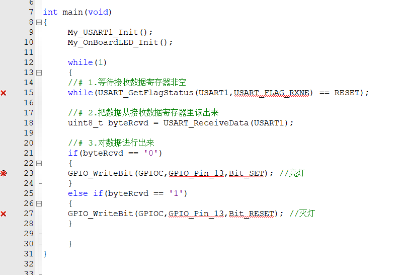

> **通过串口接收指令控制 LED 灯**：这是串口接收的典型应用。PC 端发送一个字符（如 `'1'` 开灯、`'0'` 关灯），STM32 接收后判断字符内容，控制 GPIO 引脚输出高低电平来点亮或熄灭 LED。这展示了「上位机指令 → 串口传输 → 下位机执行」的经典控制模式。

### 16.3 其余标志位一览

除 RxNE 外，还有以下标志位用于检测异常情况（一般用不到，不需要重点记忆）：

| 标志位 | 名称 | 含义 | 置位条件 |
| --- | --- | --- | --- |
| PE | 校验错误 | 接收数据的校验位与预期不符 | 检测到奇偶校验不匹配 |
| FE | 帧格式错误 | 接收到了无效的数据帧 | 停止位不是高电平 |
| NE | 噪声错误 | 接收线上检测到噪声干扰 | 采样时发现位中间有毛刺 |
| ORE | 溢出错误 | 因过载导致数据丢失 | 上一个接收数据未被读取，新数据又到了 RDR |

---

## 17. 封装

### 17.1 为什么要封装函数

● **避免重复性工作**：串口发送/接收的底层操作（检查标志位、调用寄存器函数）每次都要写相同的代码，封装成函数后一行调用即可。
● **提高代码复用性**：封装好的串口函数可以在不同项目中直接复用，不用每次都重写。
● **便于维护**：如果需要修改发送逻辑（如增加超时机制），只需改动封装函数内部，调用方不受影响。
● **提高可读性**：`USART_SendString("Hello")` 比三行 `while(USART_GetFlagStatus...` + `USART_SendData...` 清晰得多。

### 17.2 串口发送函数

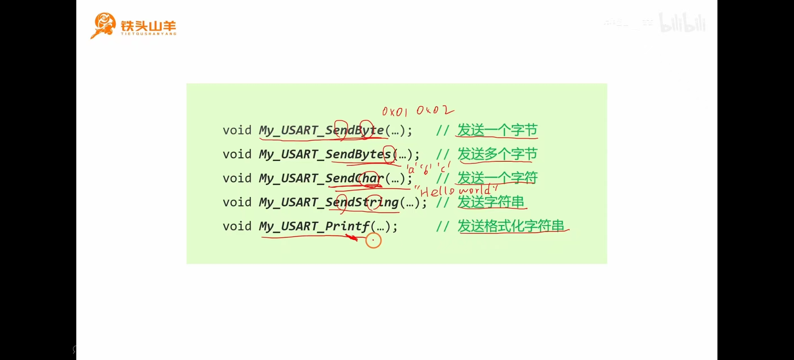

> **常用串口发送函数封装**：
> - `USART_SendByte()`：发送单个字节
> - `USART_SendString()`：发送字符串（逐字节发送直到 `\0`）
> - `USART_SendArray()`：发送指定长度的字节数组
> - `USART_SendNumber()`：发送整数的十进制字符串形式

### 17.3 串口接收函数

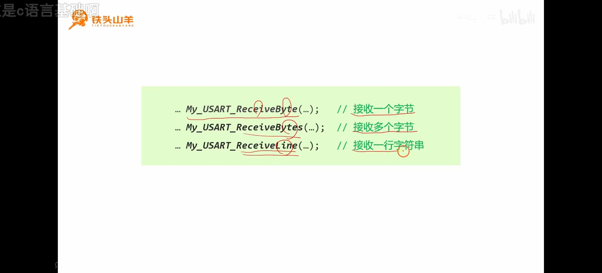

> **常用串口接收函数封装**：
> - `USART_ReceiveByte()`：接收单个字节（阻塞等待）
> - `USART_ReceiveString()`：接收字符串直到特定结束符
> - `USART_ReceiveWithTimeout()`：带超时的接收，避免程序一直卡在等待上

### 17.4 常见的串口发送函数

在实际开发中，常用的串口发送函数通常被封装为一个独立的模块（如 `serial.c` / `serial.h`），包含以下功能：

● **字节发送**：最基础的发送单位。
● **字符串发送**：发送调试信息、提示文本。
● **数组发送**：发送二进制数据块，适用于自定义协议。
● **格式化发送**：通过重写 `fputc()` 后直接使用 `printf()`，灵活度最高，开发调试最常用。

> 总结：串口通信贯穿整个嵌入式开发——调试用 `printf` 输出变量值、上位机下发指令控制硬件、蓝牙/WiFi 模块的 AT 指令交互，全都离不开它。今天的串口发送和接收是整个通信体系的基础，后续 DMA、中断等内容都会在此基础上展开。
# 10月27日

由于学校有事以及自身原因，给自己小放了三天假期。今天重新开始学习，进入 I2C 通信的世界。I2C 是嵌入式开发中极其重要的总线协议，几乎所有传感器、存储器、显示屏都通过它来与 MCU 交互。

> 重点：I2C 通信

---

## 18. I2C 通信概述

I2C（Inter-Integrated Circuit，集成电路间总线）是由 Philips（现 NXP）公司开发的一种**同步、半双工、多主多从**的串行通信总线。它仅用两根线就能连接数十上百个设备，是嵌入式领域使用最广泛的通信协议之一。

### 18.1 串口的缺点与 I2C 的优势

串口通信（UART）虽然简单易用，但存在明显的局限性：

| 对比维度 | UART（串口） | I2C |
| --- | --- | --- |
| 连接设备数量 | 仅能连接 3 个设备（一发一收一GND） | 理论上可连接 127 个设备（7 位地址） |
| 接线数量 | 最少 3 根（Tx、Rx、GND） | 仅需 2 根（SCL、SDA）+ GND |
| 通信方式 | 异步、全双工 | 同步、半双工 |
| 总线类型 | 点对点 | 多主多从，总线共享 |
| 典型应用 | 调试打印、蓝牙/串口模块 | 传感器、EEPROM、OLED 屏、RTC 等 |

> **I2C 的最大优势**：一根总线上可以挂载大量从设备，每个设备有唯一的 7 位地址，主机通过地址来选择与谁通信——就像快递员在一个小区（总线）里根据门牌号（地址）逐户送达包裹。

### 18.2 I2C 总线的电路结构

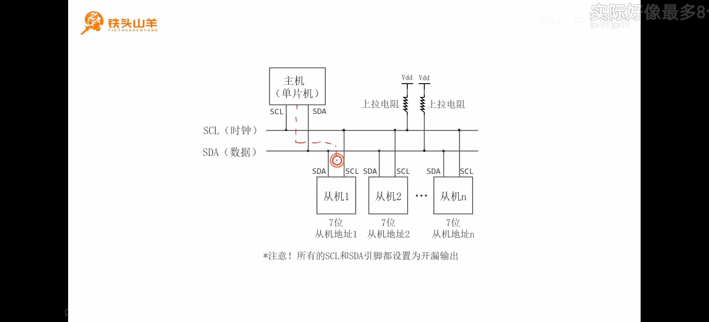

> **电路结构核心要点**：
>
> ● **SCL（Serial Clock，串行时钟线）**：由主机产生，单向传输时钟信号。所有设备共享同一根 SCL 线，在时钟的驱动下同步收发数据。
> ● **SDA（Serial Data，串行数据线）**：双向数据线，主机和从机都可以在这根线上发送或接收数据。但同一时刻只能有一个设备在发送。
> ● **上拉电阻 Rp**：SCL 和 SDA 必须各接一个上拉电阻到 VCC（通常 4.7kΩ）。这是 I2C 电路中最关键的元件——没有上拉电阻，总线完全无法工作。
> ● **所有设备的 SCL/SDA 引脚必须配置为开漏输出**：这是实现总线共享的核心设计，任何设备只能把总线拉低，不能强行拉高，拉高由上拉电阻完成。

### 18.3 时钟线与数据线

● **SCL（时钟线）**：单向的，由主机生成并发送给所有从机。从机在 SCL 的每个脉冲沿上采样 SDA 的电平。SCL 由主机控制，从机在某些情况下可以「拉住 SCL 为低」（Clock Stretching），告诉主机「我还没准备好，请等我一下」。
● **SDA（数据线）**：双向的，主机和从机都能在上面发送高低电平。总线空闲时，SDA 被上拉电阻拉到高电平，任何设备要发 0 就拉低 SDA，要发 1 就释放（高阻态，由上拉电阻拉高）。
● **重要提醒**：所有的 SCL 和 SDA 引脚都必须设置为**复用开漏输出**（`GPIO_Mode_AF_OD`），且必须外接上拉电阻。

### 18.4 逻辑「线与」——I2C 的精髓

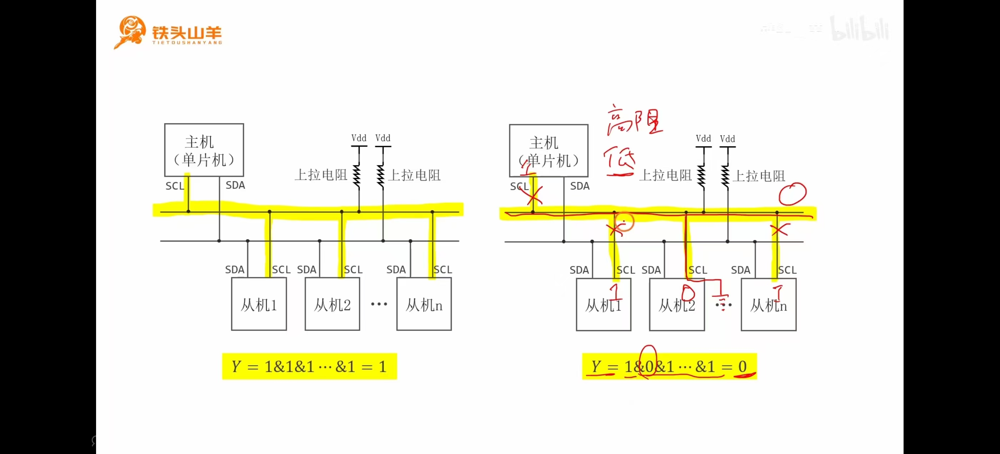

> **逻辑线与（Wired-AND）** 是理解 I2C 工作方式的关键概念：
>
> ● 总线上所有设备的 SDA（和 SCL）引脚都是**开漏输出**——只有拉低（N-MOS 导通）和高阻态（N-MOS 截止）两种状态，没有主动拉高的能力。
> ● 当所有设备都释放总线（高阻态），上拉电阻把总线拉高 → **总线呈高电平（1）**。
> ● 当总线上**任意一个**设备拉低总线，总线立即被拉低 → **总线呈低电平（0）**。
> ● 这形成了天然的逻辑与关系：**只要有一个设备输出 0，总线就是 0；必须全部设备输出 1，总线才是 1**。
>
> **为什么 I2C 必须用开漏？**
> 如果用了推挽输出，当两个设备同时一个输出高、一个输出低时，VCC 和 GND 之间会形成短路，瞬间烧毁引脚。开漏输出从根本上避免了这种「短路冲突」——谁都没本事拉高，只有拉低的能力，谁拉低总线跟谁走。

### 18.5 主机与从机如何相互发送数据

I2C 的数据发送机制可以这样理解：

● 总线上有多个设备，每个设备都有能力把 SDA 拉低（输出 0），但都没本事拉高。
● **谁想发数据，就把 SDA 在对应时刻拉低或释放**；不想发数据的设备，释放 SDA（高阻态），不参与。
● 由于「线与」逻辑的存在——任何设备拉低，总线就是低；全部释放，总线才被上拉电阻拉高——所以**总线最终呈现的电平，就是那个唯一在「说话」的设备输出的值**。
● 发送 0：主动拉低 SDA → 总线为低。
● 发送 1：释放 SDA（高阻态）→ 上拉电阻拉高 → 总线为高。

---

## 19. I2C 通信协议

### 19.1 数据帧格式

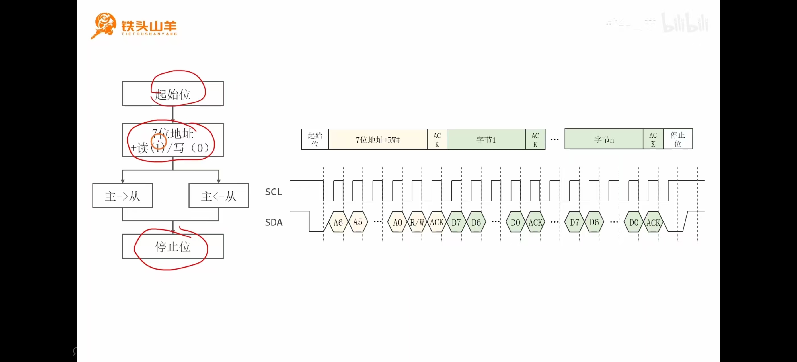

> **I2C 一帧完整数据的结构**：
>
> ```
> 起始位 | 从机地址(7位) + R/W(1位) | ACK | 数据1(8位) | ACK | 数据2(8位) | ACK | ... | 停止位
> ```
>
> ● **起始位（Start Condition）**：1 位，标志一次通信的开始。
> ● **地址帧**：7 位从机地址 + 1 位读写方向（R/W），共 8 位。R/W = 0 表示主机写数据到从机，R/W = 1 表示主机从从机读数据。
> ● **ACK/NACK**：每个地址帧和数据帧之后都有 1 位应答位，占第 9 个时钟周期。
> ● **数据帧**：每个数据帧 8 位，可以连续发送多个数据帧，每发一个都要等对方的 ACK。
> ● **停止位（Stop Condition）**：1 位，标志本次通信结束。
>
> **与串口的对比**：串口一次只能传输一个字节，发完就结束；I2C 一次通信可以传输多个字节，直到主机发出停止位才结束。

### 19.2 起始位和停止位

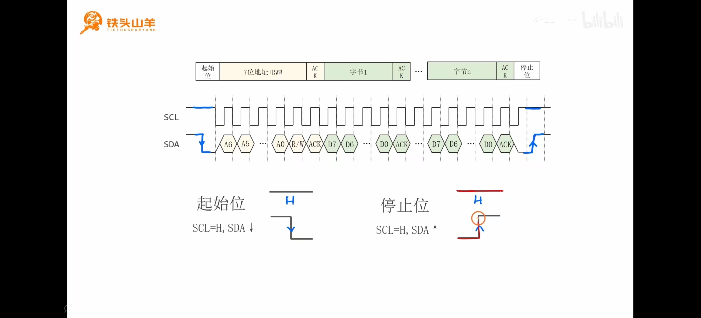

> **起始位（Start）**：当 SCL 为高电平时，SDA 从高电平切换到低电平（下降沿）。这是 I2C 总线上最重要的信号——它告诉所有从机：「注意了，通信开始！」产生起始位后，总线被认为「忙」（BUSY = 1）。
>
> **停止位（Stop）**：当 SCL 为高电平时，SDA 从低电平切换到高电平（上升沿）。它告诉所有从机：「本次通信结束，总线释放。」产生停止位后，总线恢复「空闲」（BUSY = 0）。
>
> **记忆口诀**：起始 = SCL 高时 SDA 降（↓），停止 = SCL 高时 SDA 升（↑）。起始像「绿灯亮」，停止像「红灯亮」。
>
> **注意**：起始位和停止位都由主机产生。在起始位和停止位之间，总线被主机「占用」，其他设备不能发起通信。

### 19.3 寻址与应答（ACK/NACK）

● **寻址**：位于起始位之后、数据传输之前。主机在总线上广播 7 位从机地址 + 1 位 R/W 位。所有从机都在监听，只有地址匹配的那个从机才会响应。
● **R/W 位（读写位）**：0 表示主机要写入数据到从机，1 表示主机要从从机读取数据。
● **ACK（Acknowledge，应答）**：接收方在第 9 个时钟周期把 SDA 拉低，表示「收到了」。有应答返回低电压（0）。
● **NACK（Not Acknowledge，非应答）**：接收方在第 9 个时钟周期保持 SDA 为高电平，表示「没收到」或「不想再接收了」。没有应答保持高电压（1）。

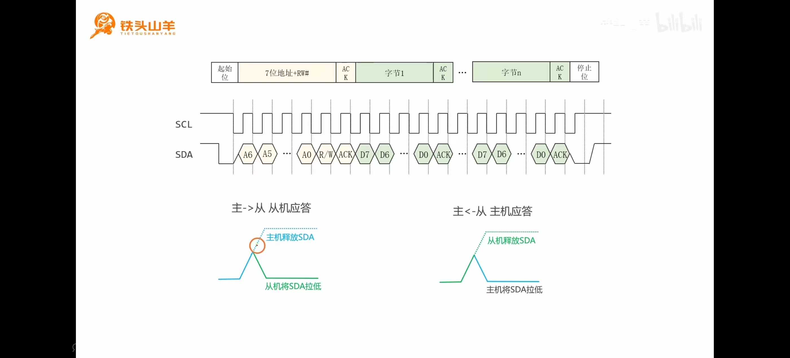

> **ACK 的工作流程**：
>
> 1. 发送方发送 8 位数据（地址或数据字节）
> 2. 发送方释放 SDA（设为高阻态），让接收方控制
> 3. 接收方在第 9 个 SCL 时钟周期内将 SDA 拉低 → ACK（应答成功）
> 4. 如果接收方不拉低 → NACK（应答失败或无应答）
>
> **NACK 的两种情况**：
> - 地址帧后收到 NACK：说明总线上没有该地址的从设备，主机应发停止位结束通信。
> - 数据帧后收到 NACK：说明从机不想再接收更多数据，主机应发停止位结束通信。

### 19.4 数据传输

● 数据传输紧跟地址帧之后，每个数据字节同样是 8 位，高位在前（MSB first）。
● 每发送完一个 8 位数据字节，接收方都必须回复一个 ACK 位。
● 主机可以连续发送多个数据字节，每个字节之间用 ACK 隔开，直到主机发出停止位。
● 数据传输末尾的应答位同样用来判断从机是否成功收到了数据。

---

## 20. I2C 模块的使用方法

### 20.1 I2C 模块介绍

I2C 是 STM32 的一个片上外设模块，不需要外部芯片，直接集成在 MCU 内部。STM32F103C8T6 包含 2 个 I2C 外设：I2C1 和 I2C2。

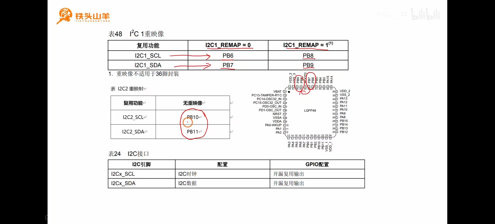

> **I2C 引脚分布**：
>
> - I2C1：SCL → PB6，SDA → PB7（默认引脚）
> - I2C2：SCL → PB10，SDA → PB11（默认引脚）
>
> **引脚重映射**：当默认引脚与其他外设冲突时，可以通过 AFIO 重映射功能将 I2C 的引脚切换到备用位置。上图为 I2C 的可选引脚映像图。

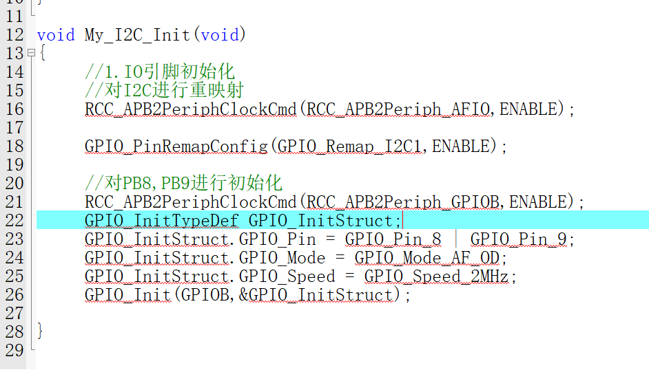

> **I2C 重映射代码**：
> ```c
> RCC_APB2PeriphClockCmd(RCC_APB2Periph_AFIO, ENABLE);   // 开启 AFIO 时钟
> GPIO_PinRemapConfig(GPIO_Remap_I2C1, ENABLE);           // 重映射 I2C1
> ```
> 重映射前必须先使能 AFIO 时钟，否则重映射不生效。`GPIO_Remap_I2C1` 将 I2C1 从 PB6/PB7 重映射到 PB8/PB9。

### 20.2 I2C 的几种模式


> I2C 协议定义了四种速度模式：

| 模式 | 最高速率 | STM32F103 支持 | 应用场景 |
| --- | --- | --- | --- |
| 标准模式（Standard） | 100 kbit/s | ✅ 支持 | 大多数传感器、RTC、EEPROM |
| 快速模式（Fast） | 400 kbit/s | ✅ 支持 | OLED 屏、高速传感器 |
| 快速增强模式（Fast Plus） | 1 Mbit/s | ❌ 不支持 | 高速数据传输 |
| 高速模式（High Speed） | 3.4 Mbit/s | ❌ 不支持 | 极高速数据传输 |

> **STM32F103 只支持标准模式和快速模式**。实际使用中，标准模式 100kHz 已满足绝大多数场景；OLED 屏幕等需要较高刷新率的设备才使用快速模式 400kHz。
>
> **快速模式下的时钟占空比**：在快速模式下，可以设置 SCL 时钟信号的高低电平时间比例（占空比）。STM32 提供两种占空比选项：
> - `I2C_DutyCycle_2`：T_low / T_high = 2:1（低电平时间长，更宽松）
> - `I2C_DutyCycle_16_9`：T_low / T_high = 16:9（接近 1:1，速度更快）
>
> 一般选择 `I2C_DutyCycle_2`，给从设备更充足的响应时间，兼容性更好。

### 20.3 I2C 模块的初始化


> **I2C_Init() 函数**：`void I2C_Init(I2C_TypeDef* I2Cx, I2C_InitTypeDef* I2C_InitStruct)`
>
> 该函数用于初始化 I2C 外设，需要传入 I2C 外设编号和初始化结构体。结构体成员包括：
>
> | 参数 | 含义 | 典型值 |
> | --- | --- | --- |
> | `I2C_Mode` | I2C 模式 | `I2C_Mode_I2C`（标准 I2C 模式） |
> | `I2C_ClockSpeed` | 时钟速度（波特率） | 100000（100kHz）或 400000（400kHz） |
> | `I2C_DutyCycle` | 占空比（仅快速模式有效） | `I2C_DutyCycle_2` |
> | `I2C_Ack` | 应答使能 | `I2C_Ack_Enable` |
> | `I2C_AcknowledgedAddress` | 本机应答地址长度 | `I2C_AcknowledgedAddress_7bit` |
> | `I2C_OwnAddress1` | 本机地址（从机模式时用到） | 0x00 ~ 0x7F |


> **完整的 I2C 初始化代码步骤**（与串口类似的三步走）：
>
> 1. **开启 GPIO 和 I2C 时钟**：`RCC_APB1PeriphClockCmd(RCC_APB1Periph_I2C1, ENABLE)` ——注意 I2C1 挂在 APB1 总线上（最高 36MHz），和 GPIO 挂在不同的时钟总线上。
> 2. **初始化 GPIO 引脚**：SCL 和 SDA 都配置为复用开漏输出（`GPIO_Mode_AF_OD`），这是 I2C 的硬件要求。
> 3. **初始化 I2C 外设**：配置 `I2C_InitStructure` 结构体，调用 `I2C_Init(I2C1, &I2C_InitStructure)`。
> 4. **使能 I2C**：`I2C_Cmd(I2C1, ENABLE)` 打开 I2C 外设的「总开关」。

---

## 21. I2C 写数据（主机发送）

I2C 主机发送数据的完整流程可以概括为：**起始 → 地址 → 数据 → 停止**，每一步都需要检查对应的标志位来确认操作是否完成。


> **I2C 模块内部结构图解析**：
>
> ● **数据寄存器（DR）**：收发共用的 8 位数据寄存器。发送时把数据写入 DR，硬件自动把数据送入移位寄存器逐位发出；接收时移位寄存器收完 8 位后存入 DR，用户从这里读取。
> ● **数据控制寄存器**：负责数据收发时的逻辑控制，管理数据的输入和输出流向。
> ● **时钟控制寄存器（CCR）**：配置 SCL 时钟频率。通过设置分频系数，把 APB1 时钟分频得到所需的波特率时钟。
> ● **自身地址寄存器（OAR）**：当 STM32 作为从机时，这个寄存器存储本设备的 I2C 地址，用于识别主机是否在呼叫自己。
> ● **状态寄存器（SR = Status Register）**：包含所有标志位（BUSY、SB、ADDR、AF、TxE、RxNE 等），用户通过读取 SR 来了解当前通信状态。每个标志位对应 SR 寄存器中的一个二进制位。

### 21.1 第一步：发送起始位


> **I2C_GenerateStart() 函数**：`void I2C_GenerateSTART(I2C_TypeDef* I2Cx, FunctionalState NewState)`
>
> 该函数用于在 I2C 总线上产生一个起始条件（SCL 高时 SDA 下降沿）。调用后，硬件自动在总线上产生起始信号。
>
> ● **BUSY 标志位（总线忙标志）**：0 = 总线空闲，1 = 总线忙。在发送起始位之前，应检查 BUSY 位确保总线空闲。
> ● **SB 标志位（起始位标志）**：0 = 不是起始位 / 起始位未产生，1 = 起始位已成功产生。调用 `I2C_GenerateStart()` 后，需要等待 `while(!I2C_CheckEvent(I2C1, I2C_EVENT_MASTER_MODE_SELECT))` 来确认 SB = 1。
>
> **写代码时的顺序**：
> ```c
> while(I2C_GetFlagStatus(I2C1, I2C_FLAG_BUSY));    // 等待总线空闲
> I2C_GenerateSTART(I2C1, ENABLE);                    // 发送起始位
> while(!I2C_CheckEvent(I2C1, I2C_EVENT_MASTER_MODE_SELECT)); // 等待 SB=1
> ```

### 21.2 第二步：发送从机地址


> **发送地址的代码**：`I2C_Send7bitAddress(I2C1, Addr, I2C_Direction_Transmitter)`
>
> 该函数发送 7 位从机地址 + R/W 位（共 8 位）。`I2C_Direction_Transmitter` 表示主机发送（R/W = 0）。
>
> **为什么用 `Addr & 0xFE`（I2C_SendData 方式时）？**
>
> 如果使用 `I2C_SendData()` 手动发送地址，地址值需要先清除最后一位（R/W 位）。因为 I2C 的地址帧中，7 位地址占据高 7 位（bit7~bit1），最低位（bit0）是 R/W 位。`Addr & 0xFE`（二进制 11111110）的作用就是把 bit0 清零：
> - 例如从机地址是 `0x78`（二进制 01111000），`0x78 & 0xFE = 0x78`（bit0 本就是 0，不变）
> - 例如从机地址是 `0x79`（二进制 01111001），`0x79 & 0xFE = 0x78`（bit0 从 1 变 0）
> - 简而言之：**清零 R/W 位，确保发送的是「写」指令**
>
> ● **ADDR 标志位（地址匹配标志）**：1 = 已发送完地址并且收到了从机的 ACK，0 = 尚未收到应答。等待 `while(!I2C_CheckEvent(I2C1, I2C_EVENT_MASTER_TRANSMITTER_MODE_SELECTED))` 来检测 ADDR = 1。
> ● **AF 标志位（应答失败）**：1 = 应答失败（从机没有拉低 SDA），0 = 应答成功（从机正确拉低了 SDA）。如果 AF = 1，说明总线上没有该地址的从设备，应发送停止位结束通信。

### 21.3 第三步：发送数据


> **I2C_SendData() 函数**：`void I2C_SendData(I2C_TypeDef* I2Cx, uint8_t Data)`
>
> 该函数把一个字节（8 位）写入 I2C 的数据寄存器 DR。写入后，硬件自动把数据逐位移出到 SDA 线上。
>
> ● **TxE 标志位（发送寄存器空）**：当数据寄存器 DR 中的数据被转移到移位寄存器后，DR 变空，TxE = 1。此时可以写入下一个字节。
> ● **发送多个字节时**：每发送一个字节，都要等待 TxE = 1（或使用 `I2C_EVENT_MASTER_BYTE_TRANSMITTED` 事件宏），然后再写下一个字节。
> ● **最后一个字节发送后**：除了等待 TxE，还要等待 **BTF（字节传输完成标志）**，确认移位寄存器也空了，数据真正发出去了。

### 21.4 第四步：发送停止位


> **I2C_GenerateStop() 函数**：`void I2C_GenerateSTOP(I2C_TypeDef* I2Cx, FunctionalState NewState)`
>
> 该函数在 I2C 总线上产生一个停止条件（SCL 高时 SDA 上升沿），标志本次通信结束。停止位发送后，BUSY 标志自动清零。
>
> **注意**：必须在上一个字节完全发送完成（包括 ACK）之后才能发送停止位，否则从机可能收不到最后一个数据。

### 21.5 自定义发送数据函数


> **自定义封装函数**：将上述四步（起始 → 地址 → 数据 → 停止）封装成一个统一的多字节发送函数，方便项目中复用：
>
> ```c
> void I2C_WriteBytes(uint8_t DevAddr, uint8_t RegAddr, uint8_t *pData, uint8_t len) {
>     // 1. 发送起始位
>     I2C_GenerateSTART(I2C1, ENABLE);
>     // 2. 发送从机地址（写方向）
>     I2C_Send7bitAddress(I2C1, DevAddr, I2C_Direction_Transmitter);
>     // 3. 发送寄存器地址
>     I2C_SendData(I2C1, RegAddr);
>     // 4. 循环发送数据
>     for (int i = 0; i < len; i++) {
>         I2C_SendData(I2C1, pData[i]);
>     }
>     // 5. 发送停止位
>     I2C_GenerateSTOP(I2C1, ENABLE);
> }
> ```
> 这个函数可以一次性向 I2C 设备的指定寄存器地址写入任意长度的数据，是操控 OLED 屏幕、传感器配置等场景中最常用的 I2C 函数模板。

### 21.6 OLED 屏配置


> **OLED 显示屏的 I2C 配置**：OLED 屏幕（如 0.96 寸 SSD1306）是最常见的 I2C 实践设备。通过 I2C 总线向 OLED 发送命令和数据，可以绘制文字、图形和动画。配置步骤包括：
> - 确定 OLED 的 I2C 从机地址（通常为 `0x78` 或 `0x7A`，取决于模块上的电阻焊接）
> - 初始化 OLED 的寄存器序列（对比度、显示模式、扫描方向等）
> - 将显示缓冲区的数据通过 I2C 逐字节发送给 OLED 的 GDDRAM
>
> OLED 的配置是 I2C 通信最直观的实战案例，把之前所学的起始位、地址发送、数据发送、停止位全流程串联起来。
# 10月29日

今天继续 I2C 通信的学习，重点是 I2C 主机读取从机数据（I2C Read），以及用 I2C 驱动 OLED 显示屏实现画面显示。I2C 读数据的流程比写数据更复杂一些，需要仔细理解 ACK 与 STOP 的发送时机。

---

## 22. I2C 读数据（主机接收）

### 22.1 封装库函数——发地址时改成读模式

>重点：R/W 位决定读写方向

I2C 写数据和读数据的前两步（起始位 + 地址位）代码非常相似，**唯一不同点在于地址位的 R/W 位**：

● 发送（写）数据时，R/W = 0 → `I2C_Send7bitAddress(I2C1, Addr, I2C_Direction_Transmitter)` 或 `Addr & 0xFE`
● 接收（读）数据时，R/W = 1 → `I2C_Send7bitAddress(I2C1, Addr, I2C_Direction_Receiver)` 或 `Addr | 0x01`

`Addr | 0x01` 的作用是把地址的最低位（bit0）强制置为 1，即读模式：
- `0x78 | 0x01 = 0x79`（读 `0x78` 地址的从机）
- `0x7A | 0x01 = 0x7B`（读 `0x7A` 地址的从机）

### 22.2 ACK 与 NAK——接收时的应答策略

>重点：主机接收时的 ACK/NAK 控制策略

读数据时，每收到一个字节，**主机**（不是从机）需要决定是否发送 ACK：

| 当前字节 | 主机动作 | 原因 |
| --- | --- | --- |
| 接收第一个字节（不是最后一个） | 发 ACK（拉低 SDA） | 告诉从机：「我收到了，继续发下一个」 |
| 接收最后一个字节 | 发 NAK（释放 SDA） | 告诉从机：「收完了，不要再发了」 |
| NAK 发完后 | 发 STOP | 告诉从机：「通信结束」 |

**硬件操作细节**：
- ACK/NAK 在接收字节的第 9 个时钟周期发出
- 发 NAK 的方法：在接收倒数第二个字节之后、接收最后一个字节之前，通过 `I2C_AcknowledgeConfig(I2C1, DISABLE)` 关闭 ACK，然后等最后一个字节接收完再发 STOP
- STOP 作用在正在被接收的字节之后，等当前字节的 ACK/NAK 周期完全结束，再在总线上造一个 STOP 条件

### 22.3 接收一个字节的过程

**完整流程**：

1. 发送起始位 → 发送从机地址（R/W = 1，读模式）
2. 收到从机的 ACK → ADDR 标志置 1
3. **清除 ADDR 标志**（必须先读 SR1，再读 SR2）
4. 设置 NAK（因为只收 1 个字节）：`I2C_AcknowledgeConfig(I2C1, DISABLE)`
5. 等待 RxNE = 1（接收数据寄存器非空）
6. 读取数据：`data = I2C_ReceiveData(I2C1)`
7. 发送 STOP 结束通信

**接收一个字节的代码**：
```c
// 读取从机的一个字节
uint8_t I2C_ReadByte(uint8_t Addr) {
    uint8_t data;
    
    // 1. 发送起始位 + 从机地址（读模式）
    I2C_GenerateSTART(I2C1, ENABLE);
    while(!I2C_CheckEvent(I2C1, I2C_EVENT_MASTER_MODE_SELECT)); // 等 SB=1
    I2C_Send7bitAddress(I2C1, Addr, I2C_Direction_Receiver);     // R/W=1
    while(!I2C_CheckEvent(I2C1, I2C_EVENT_MASTER_RECEIVER_MODE_SELECTED)); // 等 ADDR=1
    
    // 2. 清除 ADDR（必须按顺序读 SR1 → SR2）
    I2C_ReadRegister(I2C1, I2C_Register_SR1);
    I2C_ReadRegister(I2C1, I2C_Register_SR2);
    
    // 3. 设置 NAK（只收 1 个字节就结束）
    I2C_AcknowledgeConfig(I2C1, DISABLE);
    
    // 4. 等待接收 + 读取
    while(!I2C_GetFlagStatus(I2C1, I2C_FLAG_RXNE));
    data = I2C_ReceiveData(I2C1);
    
    // 5. 发送 STOP
    I2C_GenerateSTOP(I2C1, ENABLE);
    
    return data;
}
```

### 22.4 清除 ADDR 标志——为什么必须先读 SR1 再读 SR2？

>重点：ADDR 必须顺序读 SR1→SR2 才能清除

这段代码很多人不理解为什么要写：
```c
I2C_ReadRegister(I2Cx, I2C_Register_SR1);
I2C_ReadRegister(I2Cx, I2C_Register_SR2);
```

**原理**：当主机发送完从机地址并收到应答（ACK）后，硬件自动将 SR1 中的 ADDR 位置 1，通知软件「地址阶段完成了，可以开始通信了」。此时硬件会**锁住 SCL 线为低电平**，等待软件清除 ADDR 后才能继续。ST 官方参考手册明确规定：**清除 ADDR 的唯一方式就是按顺序先读 SR1，再读 SR2** ——这个特定双读操作触发硬件自动清零 ADDR。这个规定写死在芯片硬件里，所以代码里必须这么做。

### 22.5 接收两个字节的过程

收两个字节时，关键在于**在什么时候关闭 ACK** ——要在收到最后一个字节之前关闭：

1. 起始位 + 地址位（读模式）
2. ADDR 标志置 1 → 清除 ADDR（读 SR1 + SR2）
3. 等 RxNE = 1 → 读第 1 个字节（`I2C_ReceiveData()`）
4. **关闭 ACK**：`I2C_AcknowledgeConfig(I2C1, DISABLE)`
5. 等 RxNE = 1 → 读第 2 个字节（最后一个）
6. 发送 STOP

**接收两个字节的代码**：
```c
// 读取从机的两个字节
void I2C_Read2Bytes(uint8_t Addr, uint8_t *data1, uint8_t *data2) {
    // 起始 + 地址（读模式）
    I2C_GenerateSTART(I2C1, ENABLE);
    while(!I2C_CheckEvent(I2C1, I2C_EVENT_MASTER_MODE_SELECT));
    I2C_Send7bitAddress(I2C1, Addr, I2C_Direction_Receiver);
    while(!I2C_CheckEvent(I2C1, I2C_EVENT_MASTER_RECEIVER_MODE_SELECTED));
    
    // 清除 ADDR
    I2C_ReadRegister(I2C1, I2C_Register_SR1);
    I2C_ReadRegister(I2C1, I2C_Register_SR2);
    
    // 收第 1 个字节
    while(!I2C_GetFlagStatus(I2C1, I2C_FLAG_RXNE));
    *data1 = I2C_ReceiveData(I2C1);
    
    // 关闭 ACK → 下一个字节是最后一个
    I2C_AcknowledgeConfig(I2C1, DISABLE);
    
    // 收第 2 个字节（最后一个）
    while(!I2C_GetFlagStatus(I2C1, I2C_FLAG_RXNE));
    *data2 = I2C_ReceiveData(I2C1);
    
    // STOP
    I2C_GenerateSTOP(I2C1, ENABLE);
}
```

### 22.6 接收大于两个字节的过程

收 N 个字节时的通用逻辑：
- 前 N-1 个字节：ACK 保持开启，每收一个字节都回 ACK，告诉从机「继续发」
- 第 N 个字节：在收到第 N-1 个字节后、第 N 个字节之前关闭 ACK
- 收到第 N 个字节后（此时从机收到的是 NAK）→ 发送 STOP

### 22.7 OLED 屏点亮测试

在掌握了 I2C 写数据和读数据之后，通过向 OLED 发送初始化序列和显示数据，就能把屏幕点亮并显示内容。OLED 的点亮测试是 I2C 通信最经典的实战案例——把起始位、地址发送、数据发送、停止位、ACK/NAK 机制全部串起来。

---

## 23. OLED 显示器

### 23.1 OLED 显示器的基本原理

>重点：GDDRAM 每一位映射一个像素点

OLED（Organic Light Emitting Diode，有机发光二极管）是自发光显示技术，每个像素自己发光，不需要背光层。以最常见的 0.96 寸 OLED（SSD1306 驱动芯片，128×64 分辨率）为例：

**显示原理**：
- 驱动芯片 SSD1306 内部有一块 1KB 大小的 GDDRAM（图形显示数据 RAM），大小正好是 128 × 64 / 8 = 1024 字节
- GDDRAM 被分为 8 页（Page0 ~ Page7），每页对应屏幕上的 8 行像素，每页有 128 列
- 一列对应一个字节（8 个 bit），一个 bit 对应一个像素——bit0 在最上面，bit7 在最下面
- 写 0 → 像素熄灭（黑色），写 1 → 像素点亮（白色）
- MCU 通过 I2C 总线把数据逐字节写入 SSD1306 的 GDDRAM，屏幕硬件自动刷新显示

**GDDRAM 组织结构**：

| 页码 | 对应行 | 列范围 |
| --- | --- | --- |
| Page 0 | 第 0~7 行 | 0~127 列 |
| Page 1 | 第 8~15 行 | 0~127 列 |
| Page 2 | 第 16~23 行 | 0~127 列 |
| ... | ... | ... |
| Page 7 | 第 56~63 行 | 0~127 列 |

### 23.2 画笔和画刷——图形库中的基础概念


> **画笔（Pen）**：在图形绘制中，画笔用于绘制图形的**轮廓线和边框**。类比于现实中的铅笔或钢笔——它影响线条的颜色（黑白模式下是 0 或 1）、粗细、形状。当你画一个空心矩形时，矩形的四条边线就是画笔绘制的。
>
> **画刷（Brush）**：画刷用于填充图形的**内部区域**。类比于现实中的油漆刷——它决定了填充区的颜色和样式。当你画一个实心圆时，圆内部的填充色就是画刷来实现的。
>
> **画笔和画刷的区别**：
> - 画笔管「边线」——空心矩形的四条边框、空心圆的圆弧
> - 画刷管「填充」——实心矩形的内部、实心圆的内部区域

在 OLED 图形库（如铁头山羊封装的 OLED 库）中，画笔和画刷是底层绘图函数的基础参数。例如：
- `OLED_DrawRectangle(x, y, w, h, Pen)` 用画笔 Pen 画空心矩形边框
- `OLED_FillRectangle(x, y, w, h, Brush)` 用画刷 Brush 画实心矩形
- 画笔和画刷的设置决定了显示效果——在黑白 OLED 上，画笔值 0 或 1 决定像素是否点亮

> 说明：后面的学习内容主要是调用封装好的 OLED 图形库函数进行画图操作（画点、画线、画矩形、显示字符等），底层原理就是通过 I2C 向 GDDRAM 写入对应的字节数据。因为画图使用的都是已有封装的库函数，所以本笔记主要记录核心原理，后续的实战代码在电脑中练习即可。

## 24. I2C 通信全流程总结

经过 10月27日 和 10月29日 两天的学习，I2C 通信的核心知识点已经全部覆盖。以下是 I2C 主机发送和接收的完整对比：

| 步骤 | 主机发送（Write） | 主机接收（Read） |
| --- | --- | --- |
| 1 | 发送起始位 | 发送起始位 |
| 2 | 发送从机地址（R/W = 0，写） | 发送从机地址（R/W = 1，读） |
| 3 | 等 ADDR 标志 → 清除 ADDR | 等 ADDR 标志 → 清除 ADDR |
| 4 | 发送数据字节 | 等待 RxNE → 接收数据字节 |
| 5 | 每发一个字节等从机回复 ACK | 每收一个字节主机回复 ACK（最后一个回 NAK） |
| 6 | 发送 STOP | 发 NAK 后 → 发送 STOP |

### 24.1 一张表看完所有有关 I2C 的标志位

>重点：SR1 和 SR2 标志位是调试 I2C 的关键

I2C 通信中，状态寄存器 SR1 和 SR2 的标志位是所有判断逻辑的核心。以下是 STM32F10x 中 I2C 最常用的标志位汇总：

**SR1（状态寄存器 1）**：

| 标志位 | 位 | 含义 | 置 1 条件 | 清除方式 |
| :-: | :-: | :-: | :-: | :-: |
| SB | 0 | 起始位已发送 | 主机发送 START 后 | 读 SR1 + 写 DR |
| ADDR | 1 | 地址已发送/匹配 | 主模式发完地址收到 ACK；从模式地址匹配 | 先读 SR1 → 再读 SR2 |
| BTF | 2 | 字节传输完成 | 数据收发完成（DR 和移位寄存器都空或满） | 读/写 DR |
| ADD10 | 3 | 10 位地址头已发送 | 10 位地址模式下 | 读 SR1 + 写 DR |
| STOPF | 4 | 停止条件检测 | 从模式下检测到 STOP | 读 SR1 + 写 CR1 |
| RxNE | 6 | 接收数据寄存器非空 | DR 收到新数据 | 读 DR |
| TxE | 7 | 发送数据寄存器空 | DR 为空，可以写新数据 | 写 DR |
| BERR | 8 | 总线错误 | 检测到错误的 START/STOP | 写 0（SR1.8写0） |
| ARLO | 9 | 仲裁丢失 | 主机仲裁失败 | 写 0（SR1.9写0） |
| AF | 10 | 应答失败 | 未收到从机的 ACK | 写 0（SR1.10写0） |

**SR2（状态寄存器 2）**：

| 标志位 | 位 | 含义 |
| :-: | :-: | :-: |
| MSL | 0 | 主/从模式指示：1 = 主模式，0 = 从模式 |
| BUSY | 1 | 总线忙：1 = 总线正在通信中，0 = 空闲 |
| TRA | 2 | 收发模式：1 = 正在发送，0 = 正在接收 |
| GENCALL | 4 | 广播呼叫地址匹配 |

**I2C 通信中的常见调试流程**：

- 发送数据前：检查 BUSY = 0（总线空闲） → 发 START → 等 SB = 1 → 发地址 → 等 ADDR = 1 → 清 ADDR → 等 TxE = 1 → 写 DR → 等 BTF = 1 → 发 STOP
- 接收数据前：检查 BUSY = 0 → 发 START → 等 SB = 1 → 发地址（读）→ 等 ADDR = 1 → 清 ADDR → 等 RxNE = 1 → 读 DR → 判断是否最后一个字节 → 发 STOP

---

# 11月1日

今天正式开始 SPI 总线的学习，希望在这次学习中学会 SPI 总线的所有知识。

---

## 25. SPI 通信概述

### 25.1 什么是 SPI

>重点：SPI 是全双工同步串行通信，四线制主从架构

SPI（Serial Peripheral Interface，串行外设接口）是由 Motorola 公司提出的一种**全双工、同步、串行**通信协议。与 I2C 相比，SPI 速度更快、协议更简单，但占用的引脚也更多。

**SPI 的核心特点**：

| 特性 | SPI | I2C（对比） |
| --- | --- | --- |
| 通信方式 | 全双工（同时收发） | 半双工（同一时刻只能收或发） |
| 同步/异步 | 同步（有时钟线 SCLK） | 同步（有时钟线 SCL） |
| 信号线数量 | 4 根（SCLK、MOSI、MISO、NSS） | 2 根（SCL、SDA） |
| 主从架构 | 一主多从，通过 NSS 片选 | 多主多从，通过地址区分 |
| 传输速度 | 通常几 MHz ~ 几十 MHz | 标准 100kHz / 快速 400kHz |
| 协议复杂度 | 简单（无应答机制） | 中等（有 ACK/NAK 应答机制） |

### 25.2 SPI 的四根信号线

>重点：MOSI/MISO/SCLK/NSS 四线各司其职

| 信号线 | 全称 | 方向 | 作用 |
| --- | --- | --- | --- |
| **SCLK** | Serial Clock | 主机 → 从机 | 时钟信号，由主机产生，所有数据的收发都靠它同步节奏 |
| **MOSI** | Master Out Slave In | 主机 → 从机 | 主机发送数据给从机的通道 |
| **MISO** | Master In Slave Out | 从机 → 主机 | 从机发送数据给主机的通道 |
| **NSS** | Slave Select | 主机 → 从机 | 片选信号，主机拉低某个 NSS 来选中对应的从机进行通信 |

**SPI 的全双工原理**：MOSI 和 MISO 是**两条独立的物理线**，所以主机在通过 MOSI 发送数据的同时，可以通过 MISO 接收从机发来的数据——这就是「全双工」。对比 I2C 只有一根 SDA 数据线，发送和接收必须分时进行（半双工）。
### 25.3 SPI 总线的电路结构


> **主机与从机的连接方式**：SPI 是一主多从的总线，主机通过独立的 NSS 片选线来选择与哪一个从机通信。图中可以看出 SCLK、MOSI、MISO 是**总线共用**的，只有 NSS 是每个从机独占一根——主机拉低哪个 NSS，就选中哪个从机。
>
> **SCLK（时钟线）**：由主机产生并控制节奏，所有从机都听这个时钟信号同步收发。
>
> **MOSI（主出从入）**：主机 → 从机的单向数据通道，主机发数据走这条线。
>
> **MISO（主入从出）**：从机 → 主机的单向数据通道，从机发数据走这条线。
>
> **NSS（片选线）**：低电平有效，主机拉低某根 NSS = 选中该从机。同一时刻只能有一个从机的 NSS 为低电平。

### 25.4 SPI 总线的波形图


> **NSS 片选信号**：在通信开始前拉低，通信结束后拉高，标志着一次完整的数据传输会话。
>
> **SCLK 时钟波形**：由主机产生，每个时钟脉冲传输 1 个 bit 的数据。时钟的上升沿或下降沿是数据采样的时刻点。
>
> **MOSI/MISO 数据波形**：在时钟边沿的配合下，数据一位一位地串行传输。注意图中 MOSI 和 MISO 是同时变化的——这就是全双工：每一拍主机发一位、从机也回一位，互不干扰。

### 25.5 极性和相位

>重点：CPOL 和 CPHA 决定 SPI 的四种工作模式


> **极性（CPOL，Clock Polarity）**：决定时钟在空闲状态下是高电平还是低电平。
> - **低极性（CPOL = 0）**：时钟空闲时为低电平，通信开始后时钟跳变为高电平再跳变回来
> - **高极性（CPOL = 1）**：时钟空闲时为高电平，通信开始后时钟跳变为低电平再跳变回来
> - 两种极性的时钟信号**完全相反**


> **相位（CPHA，Clock Phase）**：决定数据采样发生在时钟的哪个边沿。
> - **第一相位（CPHA = 0）**：在第一个时钟跳变沿（上升/下降取决于 CPOL）采样数据
> - **第二相位（CPHA = 1）**：在第二个时钟跳变沿采样数据
>
> **极性与相位的关系**：CPOL 决定「长什么样」，CPHA 决定「什么时候看」。两者组合出的四种模式决定了从机和主机是否「说得上话」——从机只支持某一种模式，主机必须匹配。

### 25.6 SPI 的四种时钟模式

>重点：四种模式 = 2×CPOL × 2×CPHA


> **四种模式由 CPOL 和 CPHA 的排列组合产生**：

| 模式 | CPOL | CPHA | 空闲时钟电平 | 数据采样沿 | 常见应用 |
| --- | --- | --- | --- | --- | --- |
| Mode 0 | 0 | 0 | 低电平 | 第一个上升沿 | 大多数 SPI Flash（含 W25Q64） |
| Mode 1 | 0 | 1 | 低电平 | 第二个下降沿 | 部分传感器 |
| Mode 2 | 1 | 0 | 高电平 | 第一个下降沿 | 部分 ADC |
| Mode 3 | 1 | 1 | 高电平 | 第二个上升沿 | 与 W25Q64 兼容的模式之一 |

> **实际选型提示**：W25Q64 支持 Mode 0 和 Mode 3。如果选 Mode 0（CPOL=0, CPHA=0），空闲时钟为低、数据在第一个上升沿采样；如果选 Mode 3（CPOL=1, CPHA=1），空闲时钟为高、数据在第二个上升沿采样。

### 25.7 比特位的传输顺序


> **MSB First（高位先行）**：先传输一个字节的最高位（bit7），依次到最低位（bit0）。这是最常用的方式，也是 W25Q64 要求的格式。
>
> **LSB First（低位先行）**：先传输最低位（bit0），依次到最高位（bit7）。少数设备使用。
>
> 可以类比为说话的顺序——你是先说「千」再说「百」（MSB First），还是先说「个」再说「十」（LSB First）。

### 25.8 数据宽度


> **数据宽度**指每传输一组数据是多少个 bit，STM32 的 SPI 支持两种：
> - **8 位数据宽度**：每次传输一个字节（8 bit），最常用
> - **16 位数据宽度**：每次传输两个字节（16 bit），适合与 16 位 ADC/DAC 通信
>
> W25Q64 的数据手册明确要求使用 8 位数据宽度，所以在配置 SPI 时必须选择 8 bit。

---

## 26. 按钮消抖原理

在实验中，按键按下和松开时会产生机械抖动，导致电平在短时间内反复跳变，如果不处理，一次按键可能被识别为多次触发。通过软件延时消除这种抖动称为「消抖」。


> **抖动波形**：图中可以看到，按键按下和松开的瞬间电平不是平滑变化的，而是有一个高频的抖动区间。这个抖动通常持续 5~20ms。
>
> **消抖原理**：检测到按键状态变化后，不立即响应，而是等待抖动过去后再读取一次确认。这是一种「过滤」思想——不是阻止抖动发生，而是等它自己过去。


> **消抖代码的核心**：在检测到按键按下后，延迟一段短时间（通常 10ms），等抖动过后再次读取按键状态，如果仍然为按下，才确认为有效按键。
>
> **为什么是 10ms？**：按键的机械抖动通常持续 5~20ms，取 10ms 是经验值，既能滤除抖动，又不会让用户感到明显的延迟。


> **按钮初始化参数**：消抖功能在 GPIO 初始化配置中通常通过设置上拉/下拉电阻、输入模式等参数来实现。图中展示了铁头山羊模板中按钮初始化的参数配置方式。

---

## 27. IO 引脚的初始化（SPI 外设相关）

### 27.1 W25Q64 模块

>重点：W25Q64 是 64Mb（8MB）的 SPI Flash 存储器


> **W25Q64** 是华邦（Winbond）公司生产的一款 SPI 接口的 Flash 存储芯片，容量为 64Mb（8MB）。在 STM32 系统中，STM32 内部的 Flash 相当于「C 盘」——存储程序代码；W25Q64 外部 Flash 相当于「移动硬盘」——可以把单独的数据（如字库、日志、图片资源）存储在 W25Q64 内，掉电不丢失。
>
> **主从机连线**：图中 STM32 作为主机，W25Q64 作为从机。W25Q64 的 6 个有效引脚与 STM32 的 SPI 引脚一一对应连接：
> - CS（Chip Select）→ NSS（片选）
> - DO（Data Out）→ MISO（主机读取 Flash 的数据）
> - DI（Data In）→ MOSI（主机写入 Flash 的数据）
> - CLK → SCLK（时钟）
> - VCC → 3.3V，GND → GND

### 27.2 W25Q64 的存储结构

>重点：Flash 按页编程、按扇区/块擦除，这是 NOR Flash 的物理特性决定的


> **W25Q64 的存储层级**（8MB = 64Mb）：

| 层级 | 容量 | 数量 | 说明 |
| --- | --- | --- | --- |
| **页（Page）** | 256 字节 | 32,768 页 | 编程（写入）的最小单位，一次最多写一页 |
| **扇区（Sector）** | 4KB（16 页） | 2,048 扇区 | 擦除的最小单位之一 |
| **块（Block）** | 64KB（16 扇区 / 256 页） | 128 块 | 大块擦除的单位 |
| **全片（Chip）** | 8MB | 1 片 | 整片擦除 |

> **为什么以扇区进行擦除？**
>
> Flash 存储器的物理特性决定了：写入操作只能把「1」变成「0」，不能把「0」变回「1」。要想把「0」恢复成「1」，就必须通过擦除操作。而擦除操作是在物理层面一次性对一整块存储单元施加高压清除——NOR Flash 的擦除粒度最小就是 4KB（一个扇区）。这是硬件物理结构决定的，无法精细到单个字节。就像用橡皮擦——不能只擦一笔画中的一个像素，必须整片区域一起擦。
>
> **为什么以页进行编程？**
>
> 编程（写入）操作同样受物理限制：一次编程操作只能对 256 字节的页缓冲区进行。如果只改了 1 个字节，也需要先把整个扇区读出来 → 修改那 1 个字节 → 擦除整个扇区 → 把修改后的整页数据写回去。这就是 Flash 操作的经典范式——「读取-修改-写回」。
>
> **Flash 写入流程总结**：
> 1. 读取目标扇区全部数据到 RAM 缓冲区
> 2. 在缓冲区中修改需要变更的字节
> 3. 擦除目标扇区（全变 0xFF）
> 4. 将缓冲区数据按页（每次 ≤256 字节）逐页写回

### 27.3 SPI 内部模块图


> **SPI 模块内部结构**：图中展示了 STM32 内部 SPI 外设的框图结构。核心部分包括：
> - **移位寄存器**：SPI 收发数据的核心，发送时把并行数据一位一位移出到 MOSI，接收时从 MISO 一位一位移入拼成并行数据
> - **波特率发生器**：由 PCLK（APB 总线时钟）分频产生 SCLK 时钟
> - **控制逻辑**：处理 NSS 片选信号、CRC 校验、DMA 请求等
> - 发送和接收共用一个移位寄存器——每个时钟周期 MOSI 移出一位的同时 MISO 移入一位，这就是全双工的本质

### 27.4 SPI 重映射


> **重映射的作用**：STM32 的外设引脚默认映射到固定的 GPIO 引脚上。如果这些引脚被其他功能占用，可以通过重映射（Remap）把外设功能「搬」到另一组引脚上。
>
> **SPI1 的默认引脚**：NSS → PA4，SCK → PA5，MISO → PA6，MOSI → PA7。
>
> **关于 NSS**：NSS 引脚在 STM32 作为主机时通常不需要占用一个物理引脚——可以用软件内部管理（软 NSS），也可以用任意 GPIO 作为片选。只有当 STM32 作为从机时，NSS 引脚才必须连接到主机的片选信号。

### 27.5 SPI 引脚配置


> **SPI 引脚配置参数**：SPI 的 SCK、MOSI、MISO 引脚需要配置为**复用推挽输出**（Alternate Function Push-Pull），而 NSS 如果是软件管理就不需要配置为复用功能。图中展示了 SPI1 四根线的具体 GPIO 参数配置。
>
> **为什么用复用推挽输出？**：SPI 引脚不是普通的 GPIO 输入输出，而是受 SPI 外设内部硬件控制的，必须配置为复用功能才能让 SPI 硬件接管这些引脚。

### 27.6 模块最大输出速率


> **W25Q64 最大时钟速率**：W25Q64 最高可支持 80MHz 的 SPI 时钟频率，但实际使用中受限于：
> - 面包板和杜邦线的信号质量——高频时容易出现信号反射和串扰，导致数据出错
> - STM32F103 的 APB2 时钟最高 72MHz，SPI1 的二分频后最高 36MHz
>
> **实操选择 2MHz**：由于面包板无法承受 80MHz 的高频信号，实际实验中选择 2MHz 的分频速率，确保数据传输稳定可靠。

---

# 11月2日
---

## 28. SPI 模块初始化

### 28.1 SPI 初始化函数及参数


> **SPI_Init() 初始化结构体**：使用 `SPI_InitTypeDef` 结构体配置 SPI 的工作参数，主要包括：
> - **SPI_Direction**：通信方向（全双工/半双工/只发/只收）
> - **SPI_Mode**：主模式还是从模式
> - **SPI_DataSize**：数据宽度（8 bit 或 16 bit）
> - **SPI_CPOL / SPI_CPHA**：极性和相位（四种模式的选择）
> - **SPI_NSS**：NSS 片选管理方式（硬件/软件）
> - **SPI_BaudRatePrescaler**：波特率预分频器（决定 SCLK 频率）
> - **SPI_FirstBit**：比特传输顺序（MSB First 或 LSB First）

### 28.2 通信方向选择


> **四种通信方向**：
> - **全双工（2 线双向）**：MOSI 和 MISO 两根独立数据线，同时收发——这是最常用的模式
> - **半双工（1 线双向）**：只用 MOSI 一根线，分时收发，节省引脚
> - **只发送（单工发）**：只用 MOSI 向外发数据，不接收
> - **只接收（单工收）**：只用 MISO 接收数据，不发送
>
> W25Q64 实验中选全双工模式，因为既需要向 Flash 发指令（MOSI），又需要读取 Flash 返回的数据（MISO）。

### 28.3 数据宽度、极性和相位的选择


> **W25Q64 的约束条件**（来自数据手册）：
> - 极性可以选高极性（CPOL=1）也可以选低极性（CPOL=0）
> - 相位可以选第一相位（CPHA=0）也可以选第二相位（CPHA=1）
> - 但存在约束：**选第一相位必须配低极性（Mode 0），选第二相位必须配高极性（Mode 3）**
> - 数据宽度选 8 bit
> - 比特传输顺序选 MSB First（高位先传）
>
> 这是 W25Q64 硬件决定的，不是随意搭配的。Mode 0 (CPOL=0, CPHA=0) 和 Mode 3 (CPOL=1, CPHA=1) 是 W25Q64 支持的两种模式。

### 28.4 NSS 设置

>重点：主机模式下需用软件内部管理 NSS，防止硬件自动变从机

当 STM32 作为 SPI 主机时，如果不给 NSS 引脚接高电压，硬件默认会把 STM32 当作从机来使用（NSS 为低 = 被选中为从机），导致通信异常。有 2 种解决方法：

1. **外接高电压**：把 NSS 引脚通过上拉电阻接到 VCC，硬件上拉为高电平
2. **软高电压（软件内部管理）**：通过库函数让单片机内部自动给 NSS 输出高电平

```c
SPI_NSSInternalSoftwareConfig(SPI1, SPI_NSSInternalSoft_Set);  // 内部软 NSS 输出 1
```

推荐方法 2，不额外占用外部引脚资源。

---

## 29. SPI 数据收发

### 29.1 数据收发的特点


> **双向同时进行**：SPI 发送数据和接收数据是**同时**发生的——时钟的每一个脉冲，MOSI 移出一位的同时 MISO 移入一位。即使主机只想读数据，也必须先发送一个字节（通常是无效数据）来产生时钟，从机才能回传数据。
>
> **移位寄存器闭环**：主机和从机的移位寄存器在 SCLK 的驱动下形成一个「环路」——主机移位寄存器的高位通过 MOSI 进入从机的低位，从机移位寄存器的高位通过 MISO 进入主机的低位，经过 8 个时钟周期，两个移位寄存器完成交换。

### 29.2 数据收发的库函数


> **SPI_I2S_SendData(SPIx, Data)**：往 SPI 的发送数据寄存器 DR 写一个数据帧，触发数据发送
>
> **SPI_I2S_ReceiveData(SPIx)**：从 SPI 的接收数据寄存器 DR 读取收到的数据帧
>
> **注意事项**：
> - 发送数据前需要等待 `SPI_I2S_GetFlagStatus(SPIx, SPI_I2S_FLAG_TXE)` 变为 SET（发送缓冲空）
> - 接收数据前需要等待 `SPI_I2S_GetFlagStatus(SPIx, SPI_I2S_FLAG_RXNE)` 变为 SET（接收缓冲非空）
> - SPI 无应答机制（不像 I2C 的 ACK），所以只要按时钟节奏收发即可，协议简单但可靠性不如 I2C

### 29.3 数据收发代码及流程


> **标准收发流程**：
> 1. 拉低 NSS（片选从机）
> 2. 等待 TXE = 1 → 写数据到 DR → 硬件自动开始 SPI 传输
> 3. 等待 RXNE = 1 → 读 DR 获取从机返回的数据
> 4. 拉高 NSS（释放从机）
>
> 图中展示了铁头山羊封装的 `SPI_SwapByte()` 函数，它同时完成了「发一个字节、收一个字节」的操作——因为 SPI 每发一位必然也收一位。

---
## 30. 总结学习感受

至此 SPI 总线的所有知识点都学习完了，SPI 总线感觉像是 USART 的扩展——多了时钟线、少了应答机制、速度更快、全双工。

后面还有一个写代码就不展示了，我会放在我的 [心伤の雨](https://github.com/xinkong-kew) 仓库中保存，希望 5 年后或者 10 年后看着这些青春的回忆会有不一样的感慨吧，到时候应该不像我这样迷茫。

---

# 11月3日

现在正式开启中断的学习。

---

## 31. 中断的概念

>重点：中断是单片机应对突发事件的机制

中断可以一句话总结：**单片机正在执行主程序时，突然来了一个紧急事件，CPU 暂停当前工作先去处理事件，处理完再回来继续执行主程序。**

一个形象的类比：你正在写作业（主程序），突然电话响了（中断请求），你放下笔接电话（执行中断服务函数），接完电话继续写作业（返回主程序）。如果不接电话（没有中断），你只能写完作业再回拨（轮询），可能错过重要信息。

### 31.1 编程实例——串口控制闪灯速度


> **实例说明**：通过串口发送数据来控制 LED 的闪烁速度。如果不使用中断，主程序必须等待 LED 闪完一整轮才能去检查串口有没有新数据——这期间串口收到的数据可能已经丢失。
>
> **引入中断的改进**：每收到一个串口字节，硬件自动触发中断，CPU 立即暂停闪灯去读取串口数据并更新闪灯参数，然后继续闪灯。这样数据不会丢失，响应也更及时。
>
> **轮询 vs 中断**：
> - 轮询：CPU 主动轮流查询各设备状态，简单但浪费 CPU 时间、可能漏数据
> - 中断：设备主动通知 CPU，CPU 被动响应，高效但需要正确配置优先级

---

## 32. 中断优先级

### 32.1 中断优先级的概念


> **为什么需要优先级**：当多个中断同时到来时，CPU 需要决定先处理哪一个。就像医院急诊——心脏骤停（高优先级）比手指划伤（低优先级）先处理。
>
> **优先级用数字表示**：数字越小，优先级越高。在 STM32 中，0 是最高优先级。
>
> **STM32 的中断优先级有两个维度**：
> - **抢占优先级（Preempt Priority）**：决定了谁可以打断谁。高抢占优先级的中断可以打断低抢占优先级的中断服务程序
> - **子优先级（Sub Priority）**：当多个中断同时到达且抢占优先级相同时，子优先级决定排队顺序

### 32.2 STM32 怎么表示中断优先级


> **Cortex-M3 内核的中断处理流程**：图中展示了从外设产生中断请求到 CPU 响应中断的完整路径——外设请求 → NVIC 仲裁 → CPU 响应。
>
> **中断结构框图中的关键环节**：
> - 外设产生中断事件后，通过中断请求线送到 NVIC
> - NVIC 根据优先级分组规则进行比较和仲裁
> - 仲裁胜出的中断被送到 Cortex-M3 内核
> - 内核进行上下文保存（压栈）→ 执行中断服务函数 → 恢复现场（出栈）


> **NVIC（Nested Vectored Interrupt Controller，嵌套向量中断控制器）**：ARM Cortex-M 内核中的中断管理模块，可以理解为「中断管理员」。
>
> **NVIC 的核心作用**：
> - **中断开关**：允许/禁止某一个中断通道
> - **优先级分组**：将 4 个优先级比特位分为抢占优先级和子优先级两部分
> - **中断仲裁**：当多个中断同时请求时，根据抢占优先级和子优先级决定谁先执行
>
> **4 个比特位的含义**：STM32F103 使用 4 位来表示中断优先级，这 4 位通过「优先级分组（PRIGROUP）」在抢占优先级和子优先级之间分配。


> **中断服务函数的命名规则**：STM32 标准外设库为每个中断源分配了固定的中断函数名（在启动文件 `startup_stm32f10x_md.s` 中定义），如 `USART1_IRQHandler`、`EXTI0_IRQHandler` 等。函数名必须完全匹配，否则中断发生时会跳转到默认的空处理函数。

### 32.3 抢占优先级和中断嵌套


> **抢占优先级**：决定中断是否可以嵌套。当 CPU 正在执行某个中断服务函数时，如果来了一个抢占优先级更高的新中断，CPU 会暂停当前中断，先去执行更高优先级的中断。
>
> **中断嵌套的条件**：
> - 新中断的**抢占优先级必须更高**（数字更小）
> - 如果抢占优先级相同或更低，新中断只能排队等待
> - 嵌套可以多层——但每层嵌套都会消耗栈空间，需要注意栈溢出
>
> **抢占优先级的规则**：数字越小，抢占优先级越高（0 是最高优先级）。

### 32.4 子优先级和中断排队


> **子优先级**：当多个中断的抢占优先级相同、同时到达时，子优先级决定谁排在前面。子优先级**不能**打断正在执行的中断，只能决定同时到达时的排队顺序。
>
> **抢占优先级 vs 子优先级**：
> - 抢占优先级 = 「谁能插队」——数字小的可以打断数字大的
> - 子优先级 = 「排队时谁站前面」——同时来的时候，数字小的排在队伍前面

---

## 33. 中断实验

### 33.1 USART 模块中的逻辑或门


> **逻辑或门**：图中月牙形的符号就是逻辑或门——只要任意一个输入的标志位为 1，输出就是 1，就会触发中断。
>
> **中断屏蔽开关**：每个标志位到逻辑或门之间还有一个开关（中断使能位），断开开关就可以让这个标志位不参与触发中断。例如，只想在「接收完成」时触发中断而「发送完成」不触发，就可以只打开 RXNE 的开关、关闭 TXE 的开关。
>
> **逻辑或门的含义**：正如其名——「或」运算——任意一个开关接通且标志位为 1，中断就触发。这是硬件层面的「条件汇总」。

### 33.2 控制标志位开关的库函数


> **USART_ITConfig() 函数**：用于打开或关闭 USART 特定中断源，如：
> ```c
> USART_ITConfig(USART1, USART_IT_RXNE, ENABLE);   // 打开接收中断
> USART_ITConfig(USART1, USART_IT_TXE, DISABLE);    // 关闭发送中断
> ```
> 相当于操作图中的中断屏蔽开关——ENABLE 接通，DISABLE 断开。

### 33.3 NVIC 分组设置库函数


> **NVIC_PriorityGroupConfig()**：设置优先级分组方式。4 个优先级比特位的分配方案决定了抢占优先级和子优先级各占几位。
>
> **5 种分组方案**：

| 分组 | 抢占优先级位数 | 子优先级位数 | 抢占优先级数 | 子优先级数 |
| --- | --- | --- | --- | --- |
| NVIC_PriorityGroup_0 | 0 位 | 4 位 | 1 级（无抢占） | 16 级 |
| NVIC_PriorityGroup_1 | 1 位 | 3 位 | 2 级 | 8 级 |
| NVIC_PriorityGroup_2 | 2 位 | 2 位 | 4 级 | 4 级 |
| NVIC_PriorityGroup_3 | 3 位 | 1 位 | 8 级 | 2 级 |
| NVIC_PriorityGroup_4 | 4 位 | 0 位 | 16 级（无子优先级） | 1 级 |

### 33.4 NVIC 初始化库函数


> **NVIC_InitTypeDef 结构体**：初始化一个中断通道时需要填写：
> - **NVIC_IRQChannel**：中断通道号，如 `USART1_IRQn`（USART1 的中断通道号）
> - **NVIC_IRQChannelPreemptionPriority**：抢占优先级值（范围取决于分组方案）
> - **NVIC_IRQChannelSubPriority**：子优先级值（范围取决于分组方案）
> - **NVIC_IRQChannelCmd**：ENABLE 或 DISABLE
>
> 图中展示了标准的外设中断初始化参数模板，实际配置时根据应用需求设置合适的优先级数值。

---

> 自此中断的基础内容已经学习完了，但是我感觉中断的内容远不止如此这些，学习的东西还有很多，现在只是学习了一个皮毛。后续还需要深入学习外部中断（EXTI）、定时器中断、DMA 传输中断等更高级的中断应用。

---

## 34. EXTI（外部中断和事件控制器）

### 34.1 EXTI 模块介绍

>重点：EXTI 捕捉 GPIO 输入信号的变化边沿并产生中断


> **EXTI 类比**：把 GPIO 引脚想象成手指，EXTI 就是手指周围挂着的铃铛——手指一动（电平变化），铃铛就响（触发中断），CPU 就知道该去处理了。
>
> **EXTI 的核心功能**：捕捉 GPIO 引脚输入信号的变化，在上升沿或下降沿（或双边沿）触发中断。一句话总结：捕捉输入信号的变化并产生中断。
>
> **与 NVIC 的关系**：EXTI 是中断检测的第一站（边沿检测），NVIC 是中断仲裁的最后一站（优先级判断）。信号经 EXTI 检测 → EXTI 向 NVIC 发出请求 → NVIC 裁决后送给 CPU。

### 34.2 EXTI 线

>重点：EXTI 线通过 AFIO 复用器将多个 GPIO 引脚映射到同一条 EXTI 中断线


> **20 条 EXTI 线**：EXTI 模块一共有 20 条 EXTI 线（EXTI0~EXTI19），可以同时对 20 个输入信号的上升沿和下降沿进行捕获。
>
> **前 16 条（EXTI0~EXTI15）**：分别对应 GPIO 的 Pin0~Pin15。每条 EXTI 线通过 AFIO 复用器（数据选择器）可以选择连接到 PAx、PBx、PCx 等中的某一个——但不能同时连接多个。例如 EXTI0 可以选 PA0 或 PB0 或 PC0……但同一时刻只能选一个。
>
> **后 4 条（EXTI16~EXTI19）**：分别用于 PVD 输出、RTC 闹钟、USB 唤醒、以太网唤醒，属于特殊功能线。


> **EXTI 线与中断的对应关系**：EXTI0~EXTI4 每条线有自己独立的中断向量（EXTI0_IRQn ~ EXTI4_IRQn），而 EXTI5~EXTI9 共用一个中断向量（EXTI9_5_IRQn），EXTI10~EXTI15 也共用一个（EXTI15_10_IRQn）。
>
> 这意味着 EXTI5 到 EXTI9 中的任意一条触发中断都会进入同一个中断服务函数，需要在函数内进一步判断具体是哪条线触发的。

### 34.3 EXTI 线的内部结构


> **左侧为 EXTI 模块整体**：展示了 20 条 EXTI 线的编号排列和它们如何连接到 NVIC。
>
> **右侧为单条 EXTI 线的内部结构**，从左到右依次是：
> - **边沿检测电路**：包含上升沿触发选择寄存器和下降沿触发选择寄存器——可以只对上升沿敏感、只对下降沿敏感、或双边沿都触发（两个都开）
> - **软件中断事件寄存器**：允许通过软件模拟产生一次中断，不依赖外部引脚变化
> - **中断屏蔽寄存器**：相当于一个开关——第 0~20 位分别对应 EXT0~EXT19，置 1 则允许该 EXTI 线产生中断，置 0 则屏蔽
> - 最终输出给 NVIC 的是一根中断请求信号线

---

## 35. EXTI 应用——按钮实验

### 35.1 复用器为 EXTI 线选择 IO 引脚的库函数


> **GPIO_EXTILineConfig()**：AFIO 复用器为 EXTI 线选择具体的 GPIO 引脚。
> ```c
> GPIO_EXTILineConfig(GPIO_PortSourceGPIOA, GPIO_PinSource0);  // EXTI0 → PA0
> ```
> 注意：AFIO 复用器在 AFIO 模块内部，所以需要**提前开启 AFIO 模块的时钟**：
> ```c
> RCC_APB2PeriphClockCmd(RCC_APB2Periph_AFIO, ENABLE);
> ```
>
> 初始化参数结构体 `EXTI_InitTypeDef` 包含：
> - **EXTI_Line**：选择哪条 EXTI 线（EXTI_Line0 ~ EXTI_Line19）
> - **EXTI_Mode**：选择中断模式还是事件模式（通常用 EXTI_Mode_Interrupt）
> - **EXTI_Trigger**：触发沿选择——EXTI_Trigger_Rising（上升沿）、EXTI_Trigger_Falling（下降沿）、EXTI_Trigger_Rising_Falling（双边沿）
> - **EXTI_LineCmd**：ENABLE 或 DISABLE

### 35.2 开启 EXTI 线的库函数


### 35.3 获取和清除 EXTI 线标志位的库函数


> **EXTI_GetITStatus()**：获取指定 EXTI 线的中断标志位状态（SET 或 RESET），在中断服务函数中用于判断是哪条线触发了中断。
>
> **EXTI_ClearITPendingBit()**：清除指定 EXTI 线的中断标志位。**进入中断服务函数后必须先清除标志位**，否则退出后会再次进入中断（因为标志位还是 1），导致死循环。

---

# 11月4日

昨天学完了中断和外部中断（EXTI），感觉 EXTI 是中断的进阶，多了 EXTI 线可以控制具体给哪个引脚进行中断控制。

今天学习时钟，这个让我熟悉又不熟悉的存在——熟悉是以前学的每一个模块都有它的身影，不熟悉是具体的概念真不知道。

---

## 36. 时钟和时钟树

### 36.1 时钟和时钟树的概念

>重点：时钟是单片机的「心跳」，驱动所有外设同步工作


> **时钟类比**：时钟可以比作人的心跳，不断产生规律的时钟脉冲。只有时钟工作时，其它模块（GPIO、USART、SPI、I2C 等）才能同步运行——没有时钟脉冲，外设就像没电一样停摆。
>
> **时钟信号的本质**：一个周期性翻转的高低电平方波，频率越高单位时间内能做的事情越多（但功耗也越大），频率越低越省电（但处理速度越慢）。


> **时钟树（Clock Tree）**：单片机用一棵「树」来形象描述整个时钟系统。树根是时钟源（源头），树干是系统时钟 SYSCLK（主路径），树枝是各条总线（AHB/APB1/APB2）分到各个外设。时钟信号从树根出发 → 经过倍频/分频 → 最终送到每个外设模块。
>
> **时钟树设计的意义**：所有外设都要有时钟才能工作。STM32 的时钟树允许灵活地开启/关闭每个外设的时钟——需要用的时候打开，不需要的时候关上，以此兼顾性能和省电。

### 36.2 分频器、锁相环和复用器


> **分频器（Prescaler）**：把输入的时钟频率除 N。例如 72MHz 进 → 2 分频 → 36MHz 出。分频器的作用是「降速」——某些外设（如 APB1 上的外设）不能跑太高频率。
>
> **锁相环（PLL，Phase Locked Loop）**：把输入的时钟频率乘 N。例如 8MHz 进 → ×9 倍频 → 72MHz 出。PLL 的作用是「超频」——内部晶振（HSI）只有 8MHz，通过 PLL 倍频才能达到 72MHz 的系统时钟。
>
> **复用器（MUX，Multiplexer）**：多选一的开关。例如系统时钟的来源可以是 HSI、HSE 或 PLL，通过 MUX 选择其中一路送给 SYSCLK。

### 36.3 树根——时钟源


> **树根比作心脏**：时钟源是整个时钟系统的起点，正如心脏是血液循环的起点。
>
> **STM32F103C8T6 有 4 个时钟源**：
>
> **内部（芯片内部生成，不需要外接元件）**：
> - **HSI（High Speed Internal）**：内部高速 RC 振荡器，8MHz，精度较低但方便，芯片上电默认使用
> - **LSI（Low Speed Internal）**：内部低速 RC 振荡器，约 40kHz，供独立看门狗和 RTC 使用
>
> **外部（需外接晶振到芯片引脚）**：
> - **HSE（High Speed External）**：外部高速晶振，最小系统板上那颗**银白色**晶振，通常 8MHz，精度高且频率稳定
> - **LSE（Low Speed External）**：外部低速晶振，最小系统板上那颗**黑色**晶振，32.768kHz（正好是 2^15），专供 RTC 实时时钟

### 36.4 树干——系统时钟 SYSCLK


> **系统时钟 SYSCLK 有 3 个来源**（通过 MUX 选择）：
>
> | 来源 | 特点 | 适用场景 |
> | --- | --- | --- |
> | **HSI**（内部高速 8MHz） | 精度低、频率固定、频率低、无需外部元件 | 追求方便、对精度要求不高 |
> | **HSE**（外部高速晶振） | 精度高、频率与外部晶振相同（通常 8MHz） | 追求高精度 |
> | **PLL**（锁相环倍频） | 灵活，SYSCLK 可变，最高 72MHz | 追求高性能（最常用） |

> 实际开发中，最常用的配置是 HSE(8MHz) → PLL ×9 → SYSCLK = 72MHz。

### 36.5 树枝——三根总线


> **三根总线承接 SYSCLK 并分给各个外设**：
>
> | 总线 | 全称 | 功能 | 所属外设举例 |
> | --- | --- | --- | --- |
> | **AHB** | Advanced High-performance Bus | 高性能总线，传输速率最高 | FCLK（内核时钟）、HCLK（AHB 总线时钟） |
> | **APB1** | Advanced Peripheral Bus 1 | 低速外设总线，最高 36MHz | I2C、USART2~5、SPI2/I2S2、定时器 TIM2~7 |
> | **APB2** | Advanced Peripheral Bus 2 | 高速外设总线，最高 72MHz | GPIO、USART1、SPI1、定时器 TIM1 |


> **总线与时钟树的对应**：图中红色标注展示了三根总线在时钟树中的实际位置。SYSCLK 先经过 AHB 预分频器（HCLK）→ AHB 总线上挂载内核、DMA、SRAM、Flash → 再经 APB1/APB2 预分频器 → 分别供给 APB1 和 APB2 上挂载的所有外设。
>
> **最大频率限制**：APB1（PCLK1）最高 36MHz，APB2（PCLK2）最高 72MHz。配置时如果 PCLK1 超过 36MHz 需要额外分频。

---

## 37. 时钟树编程

### 37.1 时钟树的初始状态


> **初始状态**：刚给单片机上电或刚按下复位键、还没有执行任何初始化代码的时刻，时钟树处于默认配置：
> - SYSCLK 的来源默认是 **HSI**（内部 8MHz）
> - APB1（PCLK1）默认 = HCLK = 8MHz
> - APB2（PCLK2）默认 = HCLK = 8MHz
> - 大部分外设时钟处于**关闭**状态（灰色）
>
> 如果想跑到 72MHz，必须通过代码重新配置时钟树——切换到 HSE + PLL。

### 37.2 时钟树的编程接口（库函数）


> **时钟配置主要用到的库函数**：
> - `RCC_HSEConfig()`：配置 HSE 外部高速时钟
> - `RCC_PLLConfig()`：配置 PLL 锁相环的输入源和倍频系数
> - `RCC_SYSCLKConfig()`：选择 SYSCLK 的来源
> - `RCC_HCLKConfig()`：配置 AHB 分频器（HCLK）
> - `RCC_PCLK1Config()`：配置 APB1 分频器（PCLK1，最高 36MHz）
> - `RCC_PCLK2Config()`：配置 APB2 分频器（PCLK2，最高 72MHz）
> - `RCC_APB1PeriphClockCmd()` / `RCC_APB2PeriphClockCmd()`：开启/关闭具体外设的时钟
>
> **时钟树上颜色的含义**：
> - **灰色底色**：默认状态下该模块时钟是**关闭**的
> - **绿色底色**：默认状态下该模块时钟是**开启**的

### 37.3 开启 HSE（外部高速时钟源）


> **开启 HSE 的步骤**：
> ```c
> RCC_HSEConfig(RCC_HSE_ON);                          // 1. 开启 HSE
> while (RCC_GetFlagStatus(RCC_FLAG_HSERDY) == RESET); // 2. 等待 HSE 稳定起振
> ```
> 外部晶振从通电到稳定振荡需要一段时间（通常几毫秒），所以要轮询 `HSERDY` 标志位等待起振完成。

### 37.4 配置 PLL（锁相环）


> **PLL 配置的三要素**：
> - **时钟源**：HSE（8MHz 晶振）或 HSI/2（4MHz）
> - **倍频系数**：2~16 倍
> - 例如 `RCC_PLLConfig(RCC_PLLSource_HSE_Div1, RCC_PLLMul_9)` = HSE(8MHz) ×9 = 72MHz
>
> 配置完后同样需要等待 PLL 锁定：
> ```c
> RCC_PLLCmd(ENABLE);
> while (RCC_GetFlagStatus(RCC_FLAG_PLLRDY) == RESET);
> ```

### 37.5 配置 AHB 分频器（HCLK）、APB1 分频器（PCLK1）、APB2 分频器（PCLK2）


> **三根总线的分频配置**：
> ```c
> RCC_HCLKConfig(RCC_SYSCLK_Div1);    // AHB  = SYSCLK ÷ 1 = 72MHz（不分频）
> RCC_PCLK1Config(RCC_HCLK_Div2);     // APB1 = AHB ÷ 2   = 36MHz（最高 36MHz，必须 2 分频）
> RCC_PCLK2Config(RCC_HCLK_Div1);     // APB2 = AHB ÷ 1   = 72MHz（不分频，最高 72MHz）
> ```
> **注意 APB1 必须 ≤ 36MHz**，所以 72MHz 的 HCLK 要给 APB1 做 2 分频。

### 37.6 选择 SYSCLK 的来源（选择锁相环）


> **切换 SYSCLK**：
> ```c
> RCC_SYSCLKConfig(RCC_SYSCLKSource_PLLCLK);           // 选择 PLL 作为 SYSCLK
> while (RCC_GetSYSCLKSource() != 0x08);               // 等待切换完成
> ```
> 切换时钟源后需要轮询确认切换成功，因为硬件切换不是瞬间完成的。

### 37.7 编程实现代码


> 图中展示了完整的时钟初始化函数的代码汇总——从开启 HSE → 等待稳定 → 配置 PLL 倍频至 72MHz → 等待 PLL 锁定 → 配置三根总线分频 → 选择 PLL 为 SYSCLK → 等待切换完成。这是一条标准的 STM32F103 72MHz 时钟配置流水线。

### 37.8 配置指令预取和访问延迟


> **指令预取（Prefetch）**：在内核与 Flash 之间加了一个缓冲区，提前把下一条要执行的指令从 Flash 读到缓冲区里，这样 CPU 取指令不用每次都等慢速的 Flash，访问速度大大加快。
>
> **访问延迟（Latency）**：Flash 的读取速度跟不上 CPU 主频——当 SYSCLK > 24MHz 时必须设置等待周期。SYSCLK 越高，需要的等待周期越多：
>
> | SYSCLK 频率 | 需要的等待周期 |
> | --- | --- |
> | 0 ~ 24MHz | 0 WS（0 Wait State） |
> | 24 ~ 48MHz | 1 WS |
> | 48 ~ 72MHz | 2 WS |
>
> ```c
> FLASH_PrefetchBufferCmd(FLASH_PrefetchBuffer_Enable);  // 开启预取
> FLASH_SetLatency(FLASH_Latency_2);                      // 72MHz 配 2 个 WS
> ```

### 37.9 片上外设开关和复位库函数


> **开启外设时钟**：
> ```c
> RCC_APB2PeriphClockCmd(RCC_APB2Periph_GPIOA, ENABLE);   // 开启 GPIOA 时钟
> RCC_APB2PeriphClockCmd(RCC_APB2Periph_USART1, ENABLE);  // 开启 USART1 时钟
> RCC_APB1PeriphClockCmd(RCC_APB1Periph_I2C1, ENABLE);    // 开启 I2C1 时钟（在 APB1 上）
> ```
>
> **使用外设前必须开时钟**——这是 STM32 的第一原则。任何一个外设（GPIO、USART、SPI、I2C、定时器等）在使用之前，都必须先通过对应的 `RCC_xxxPeriphClockCmd()` 函数打开它在总线上的时钟。否则外设寄存器无法读写，代码不会报错但外设毫无反应。
>
> **复位外设**（配合时钟关闭一起使用）：
> ```c
> RCC_APB2PeriphResetCmd(RCC_APB2Periph_USART1, ENABLE);  // 复位 USART1
> ```
> 复位可以将外设的所有寄存器恢复到默认值，适用于外设异常时恢复。
---

# 11月5日

今天开始定时器的学习，这个篇章是整个学习中最长的学习，我之前在抖音上面看到过相关的概念，希望可以理解的通透一些。
---

## 38. 定时器-时基单元

### 38.1 定时器的简介

>重点：STM32F103 有三类定时器，功能逐级递进


> **定时器数量和分类**：F1 系列芯片最多有 14 个定时器模块，分为三类：
>
> | 类型 | 型号 | 位数 | 核心功能 |
> | --- | --- | --- | --- |
> | **高级定时器** | TIM1、TIM8 | 16 位 | 通用定时器所有功能 + 死区时间控制 + 刹车功能（电机控制专用） |
> | **通用定时器** | TIM2~TIM5 | 16 位（TIM2/5 为 32 位） | 定时 + 输入捕获 + 输出比较 + PWM 生成 |
> | **基本定时器** | TIM6、TIM7 | 16 位 | 只有最基本的定时功能，无输入输出通道 |
>
> 三种定时器的关系就像手机版本——基本定时器是「基础款」（只能计时），通用定时器是「标准款」（加了 PWM/捕获/比较），高级定时器是「旗舰款」（再加死区控制和刹车功能，专为电机而生）。通用定时器和基本定时器本质上都是高级定时器阉割了一些功能后的版本。

### 38.2 定时器内部模块图


> **定时器内部主要模块**：
> - **时基单元（Time-base Unit）**：PSC（预分频器）+ CNT（计数器）+ ARR（自动重装载寄存器），定时器的核心发动机
> - **输入捕获通道**：捕捉外部信号的变化边沿，用于测量脉冲宽度、频率等
> - **输出比较通道**：比较 CNT 和 CCR 的值，根据比较结果输出变化信号，生成 PWM 等
> - **从模式控制器**：接收其他定时器的触发信号，实现定时器级联同步

### 38.3 时基单元的内部结构

>重点：预分频器 + 计数器 + 自动重装载寄存器 = 时基单元


> **时基单元的三个核心寄存器**：
>
> | 寄存器 | 缩写 | 位数 | 作用 |
> | --- | --- | --- | --- |
> | **预分频器** | PSC | 16 位 | 把输入时钟频率降速——「每一拍有多长」 |
> | **计数器** | CNT | 16 位 | 当前计数值，从 0 到 ARR 不断累加 |
> | **自动重装载寄存器** | ARR | 16 位 | 计数器的上限值，CNT 到达 ARR 后归零并触发溢出 |
>
> **定时时间计算公式**：
> ```
> 溢出时间 = (PSC + 1) × (ARR + 1) / 定时器输入时钟频率
> ```
> 例如：时钟 72MHz，PSC=71→72 分频（72MHz÷72=1MHz），ARR=999→1000 计数，溢出时间 = 72×1000/72000000 = 0.001 秒 = 1ms。


> **时基单元类比手表**：PSC 是手表的「齿轮减速比」——把快速转动的秒针（72MHz 时钟）减速成合适的速度；CNT 是「当前时间」——不断走动；ARR 是「闹钟设定值」——到达后触发提醒。就像一个表盘，秒针每转一圈（CNT 从 0→ARR），闹铃就响一次（溢出中断）。

### 38.4 上计数、下计数、中心对齐


> **三种计数模式**：

| 模式 | CNT 运动轨迹 | 溢出事件触发时机 | 典型应用 |
| --- | --- | --- | --- |
| **向上计数** | 0 → ARR → 归零 → 重复 | CNT 到达 ARR 时 | 最常用，PWM 模式 1/2 |
| **向下计数** | ARR → 0 → 重装 ARR → 重复 | CNT 到达 0 时 | 较少使用 |
| **中心对齐** | 0 → ARR → 0 → 重复 | 峰值（ARR）和谷值（0）各一次 | 对称 PWM，电机控制 |

### 38.5 时钟来源

>重点：定时器的时钟源来自内部时钟 CK_INT，最多可达 72MHz

定时器的时钟来源默认是内部时钟（CK_INT）。对于挂载在 APB1 上的定时器（TIM2~TIM7），当 APB1 预分频系数 ≠ 1 时，定时器时钟 = APB1×2；对于挂载在 APB2 上的定时器（TIM1、TIM8），同理。这是因为当 APB 预分频 ≠ 1 时，送往定时器的时钟会被硬件自动双倍补偿，确保定时器最高能跑到 72MHz。

### 38.6 寄存器预加载

>重点：影子寄存器实现「缓冲」，新值在下次溢出时才生效


> **影子寄存器**：PSC、ARR、RCR 背部的阴影就是影子寄存器（Shadow Register）。当写入这些寄存器时，数据先存进影子区，等到下一次定时器溢出事件发生时，影子区的值才真正装载到工作寄存器中生效。
>
> **预加载的好处**：如果 CNT 正在计数时突然改了 ARR，没有影子的情况下可能造成计数值错乱；有了影子寄存器，修改会在下一轮计数开始时才生效，保证整个周期的一致性。


> **ARR 预加载的使能**：
> ```c
> TIM_ARRPreloadConfig(TIM1, ENABLE);  // 启动 ARR 预加载
> ```
> 开启后，修改 ARR 不会立即生效，而是在下一次更新事件时装载。关闭预加载（DISABLE）则立即生效。

---

## 39. 自制延迟函数

### 39.1 记录当前时间


> **定时器用作计时器**：让定时器以固定频率（如 1MHz）运行，通过读取 CNT 的值就能知道当前经过了多少微秒。`TIM_GetCounter(TIMx)` 可获取当前 CNT 值，配合溢出次数累加，实现长时间计时。

### 39.2 延迟函数雏形


> **延迟函数的思路**：
> ```c
> void DelayMs(uint32_t ms) {
>     uint32_t start = GetTick();          // 记录当前时间
>     while ((GetTick() - start) < ms);    // 等待达到指定毫秒
> }
> ```
> 优点：基于硬件定时器，精度远高于空循环延时（`for(i=0;i<100000;i++)`），且不受编译优化影响。

### 39.3 初始化时基单元


> **TIM_TimeBaseInit() 初始化参数**：
> - **TIM_Prescaler**：预分频值。如 71 表示 72 分频（71+1），72MHz → 1MHz
> - **TIM_Period**：自动重装值（ARR）。如 999 表示计数 1000 次（999+1），1MHz÷1000 = 1ms
> - **TIM_RepetitionCounter**：重复计数器（RCR），仅高级定时器有。用于控制溢出多少次才算一次更新事件
> - **TIM_CounterMode**：计数方向——向上/向下/中心对齐

### 39.4 配置中断


> **定时器中断配置**：先使能定时器的更新中断（`TIM_ITConfig(TIMx, TIM_IT_Update, ENABLE)`），再配置 NVIC——设置中断优先级分组和使能中断通道。

### 39.5 配置中断响应函数


> **TIMx_IRQHandler() 模板**：
> ```c
> void TIM1_UP_IRQHandler(void) {
>     if (TIM_GetITStatus(TIM1, TIM_IT_Update) != RESET) {
>         TIM_ClearITPendingBit(TIM1, TIM_IT_Update);  // 先清标志位
>         // 用户代码：每 1ms 执行一次
>     }
> }
> ```
> 进入中断后必须先判断标志位再清除，否则退出后标志位还在会导致反复进中断。
---

## 40. 输出比较

### 40.1 输出比较的简介

>重点：输出比较通过比较 CNT 和 CCR 的值来控制引脚输出方波


> **输出比较（Output Compare）的作用**：通过定时器去产生精确定时的方波信号，经 GPIO 引脚把方波信号输出到外部电路。输出比较是 PWM、呼吸灯、电机控制的基石。
>
> **一句话总结**：CNT 不断计数，当 CNT 的值与 CCR（捕获/比较寄存器）的值相等时，硬件自动执行预设的动作（置高、置低、翻转等），从而在引脚上产生精确的方波信号。

### 40.2 基本工作原理

>重点：PWM = 输出比较的一种特例，ARR 决定频率，CCR 决定占空比


> **PWM（Pulse Width Modulation，脉冲宽度调制）**：利用数字信号输出模拟效果的技术。方波周期固定，通过调节高电平的占比（占空比）来等效不同的模拟电压。例如 3.3V 电压、50% 占空比，等效电压 = 3.3V × 50% = 1.65V——这就是呼吸灯变亮变暗的原理。
>
> **占空比（Duty Cycle）**：一个周期内高电平时间占整个周期的比例。公式：
> ```
> 占空比 = 高电平时间 / 周期时间 × 100%
> ```
> 在 STM32 中，占空比 = CCR / (ARR + 1)。例如 ARR=999，CCR=500，占空比 = 500/1000 = 50%。


> **输出比较的内部工作原理**：每个定时器有 4 个输出比较通道（CH1~CH4），每通道配一个 CCR 寄存器。CNT 不断计数，当 CNT = CCR 时，硬件自动根据模式配置执行动作——置高、置低或翻转——从而在 OC 引脚上生成方波。

### 40.3 8 种工作模式

>重点：PWM1 和 PWM2 模式最常用，区别仅在于有效电平的方向


> **输出比较的 8 种模式**：

| 模式 | 名称 | 行为描述 |
| --- | --- | --- |
| 000 | 冻结（Frozen） | OC 引脚状态不随比较结果改变 |
| 001 | 匹配时置有效电平 | CNT=CCR 时，OC 引脚输出有效电平 |
| 010 | 匹配时置无效电平 | CNT=CCR 时，OC 引脚输出无效电平 |
| 011 | 匹配时翻转（Toggle） | CNT=CCR 时，OC 引脚电平翻转 |
| 100 | 强制低电平 | OC 引脚强制输出低电平 |
| 101 | 强制高电平 | OC 引脚强制输出高电平 |
| 110 | **PWM 模式 1** | 向上计数：CNT<CCR 时有效，CNT≥CCR 时无效 |
| 111 | **PWM 模式 2** | 向上计数：CNT<CCR 时无效，CNT≥CCR 时有效 |

> **OCxRef（输出比较通道 x 参考信号）**：定时器内部的比较结果信号，经过极性选择后再送到外部引脚。一般用 PWM1 模式即可满足大多数需求。


> **正常输出与互补输出**：高级定时器（TIM1、TIM8）每个通道除了正常的 OCx 输出，还有一个互补输出 OCxN（反相输出）。互补输出主要用于电机驱动 H 桥——上下桥臂需要一对互补的 PWM 信号来避免同时导通（直通短路）。

### 40.4 极性选择


> **极性（Polarity）**：在 OC 信号送到外部引脚之前，还可以选择要不要反转。
> - **高电平有效（Active High）**：不反转，OC 输出的高电平 = 有效电平
> - **低电平有效（Active Low）**：反转，高→低、低→高
>
> 在 PWM1 模式下，极性为高有效时：CNT<CCR → 输出高，CNT≥CCR → 输出低。极性为低有效时则反过来。
# 11月7日

又是一年冬，今天是立冬，祝大家立冬快乐呀，好像也就只有我这一个人在经营这个网站，都没人看我的，哈哈哈，今天又要开始学习了。

---

## 41. 呼吸灯实验

### 41.1 呼吸灯原理

>重点：正弦波调制 CCR 值，产生渐亮渐灭的呼吸效果

呼吸灯的原理是不断改变 PWM 的占空比，让 LED 的亮度随正弦波曲线从暗到亮再变暗。核心公式：
```c
float duty = 0.5 * (sin(2π × t) + 1);  // duty 在 0~1 之间正弦变化
uint16_t ccr1 = duty * 1000;             // 映射到 0~1000（ARR=999）
TIM_SetCompare1(TIM1, ccr1);             // 更新 CCR，改变占空比
```
在一个正弦周期内，CCR 从 0→1000→0 变化，LED 就会从熄灭→最亮→熄灭，形成呼吸效果。

### 41.2 TIM1 重映像


> **TIM1 输出通道重映像**：TIM1 的 4 个输出比较通道（CH1~CH4）默认映射的引脚，可以通过 GPIO 重映射功能改到其他引脚上。使用前需要先开启 AFIO 时钟，再调用 `GPIO_PinRemapConfig()`。

### 41.3 TIM 初始化参数


> **TIM_OCInitTypeDef 关键参数**：
> - **TIM_OCMode**：输出比较模式（如 TIM_OCMode_PWM1）
> - **TIM_OutputState**：输出使能，设置为 TIM_OutputState_Enable
> - **TIM_OCPolarity**：极性选择（高有效 / 低有效）
> - **TIM_Pulse**：CCR 初始值，即初始占空比

### 41.4 配置时基单元


> **呼吸灯时基配置代码**：
> ```c
> TIM_TimeBaseInitTypeDef TIM_InitStruct;
> TIM_InitStruct.TIM_Prescaler = 71;               // 72分频 → 1MHz
> TIM_InitStruct.TIM_Period = 999;                  // ARR=999，PWM周期1ms
> TIM_InitStruct.TIM_RepetitionCounter = 0;         // RCR=0
> TIM_InitStruct.TIM_CounterMode = TIM_CounterMode_Up;
> TIM_TimeBaseInit(TIM1, &TIM_InitStruct);
> TIM_ARRPreloadConfig(TIM1, ENABLE);               // 启动预加载
> ```
> PSC=71 → 72MHz÷72=1MHz（计数一次 1μs），ARR=999 → 1000 次计数 = 1ms 一个 PWM 周期。

### 41.5 配置输出比较的参数


> **TIM_OC1Init() 配置输出比较通道**：设置模式（PWM1）、极性、输出使能、初始 CCR 值等。需要用 `TIM_OC1PreloadConfig(TIM1, TIM_OCPreload_Enable)` 使能 CCR 预加载。

### 41.6 设置占空比


> **动态更新占空比**：
> ```c
> float t = GetTick() * 1.0e-3f;            // 获取当前时间（秒）
> float duty = 0.5 * (sin(2*3.14*t) + 1);   // 0~1 正弦值
> uint16_t ccr1 = duty * 1000;              // 映射到 CCR 范围
> TIM_SetCompare1(TIM1, ccr1);              // 更新 CH1 的 CCR
> ```
> `1.0e-3f` = 0.001，把毫秒转成秒。`sin()` 产生 -1~+1 的值，`(sin+1)×0.5` 映射到 0~1，再乘以 ARR+1 得到 CCR 值。

---

## 42. 输入捕获

### 42.1 输入捕获的基本工作原理

>重点：输入捕获是输出比较的「逆过程」——从引脚读回信号的时序信息


> **输入捕获（Input Capture）**：用于测量输入信号的时间参数（周期、占空比、脉冲宽度等）。当外部引脚上的信号发生边沿变化（上升沿或下降沿）时，硬件自动把当前 CNT 的值锁存到 CCR 寄存器中，并产生一个捕获事件——相当于「拍快照」记下了边沿发生的那一瞬间的计数值。

### 42.2 输入捕获的内部结构


> **输入捕获的完整信号链**（从左到右）：
> - **输入滤波**：滤除毛刺/干扰
> - **边缘检测**：选择捕获上升沿还是下降沿（或双沿）
> - **信号选择**：直接/间接/TRC 三种输入源
> - **分频器**：每 N 个边沿才触发一次捕获
> - **锁存到 CCR**：把当前 CNT 值捕获存下

### 42.3 内部结构详解

>重点：信号选择分「直接」和「间接」两种，分别对应不同的工作模式


> **输入滤波**：用于滤除输入信号上不规整的波段。当输入滤波器设置为非 0 值时，硬件会在连续 N 次采样到相同电平时才确认为有效变化，从而滤除高频毛刺。
>
> **边缘检测**：用于选择捕获的边沿——上升沿、下降沿、或双边沿（两个都捕获）。双边沿捕获常用来测 PWM 脉宽。
>
> **信号选择（三种输入源）**：

| 选择 | 含义 | 典型用途 |
| --- | --- | --- |
| **直接（Direct）** | 通道自己的输入引脚直接输入 | 超声波测距——一个通道直接捕获回波 |
| **间接（Indirect）** | 输入信号来自另一个通道 | PWM 测量——CH1 捕获上升沿 + CH2 捕获下降沿 |
| **TRC** | 信号来自定时器的从模式控制器 | 定时器级联、编码器模式 |

> **分频器**：通过设定的分频系数控制捕获事件的频率。例如分频系数=4，每 4 个边沿才产生一次捕获事件（CC 事件）。

---

## 43. 超声波测距模块实验

对于这个模块我只能说很熟，也不熟，熟是因为比赛用到过这个模块，不熟是因为具体的实现还是不太懂。

### 43.1 超声波测距模块

>重点：超声波测距 = 发射 → 遇障碍 → 反弹 → MCU 计时 → 计算距离


> **模块介绍**：HC-SR04 超声波测距模块，4 个引脚——VCC（5V）、GND、Trig（触发输入）、Echo（回波输出）。工作流程：MCU 给 Trig 一个 ≥10μs 的高电平脉冲 → 模块自动发射 8 个 40kHz 的方波 → 遇到障碍物反射回来 → Echo 引脚输出一个高电平脉冲，脉冲宽度 = 超声波往返时间。


> **测距原理**：利用声波在空气中的速度（约 340m/s）计算距离。
> ```
> 距离 = 超声波速度 × 时间 / 2
>      = 340m/s × Echo高电平时间 / 2
> ```
> 除以 2 是因为声波走了往返（去 + 回），我们只需要单程距离。


> **接线图**：Trig 接 MCU 的一个 GPIO 输出，Echo 接定时器的输入捕获引脚。VCC 接 5V（注意 STM32 引脚是 3.3V，Echo 高电平输出是 5V——实际项目中需要注意电平匹配）。


> **超声波测距的分辨率与周期设置**：PSC 决定了计时器的精度（分辨率）——每个计数周期代表多长时间，ARR 决定了计时的上限（最大测量范围）。例如 PSC=71 → 1MHz（1μs 精度），ARR=65535（16 位最大值）→ 最大计时 65.535ms。按声速 340m/s 计算：最大可测距离 = 65.535ms × 340m/s ÷ 2 ≈ 11.1m。选择 PSC 和 ARR 时要根据实际需要的测距范围和精度来权衡。

### 43.2 写代码


> **输入捕获模式**：由于空闲状态需要低电平，不使用手册上的浮空输入模式，而是选择空闲时输出低电平的**输入下拉**状态，避免悬空时误触发。


> **TIM_ICInitTypeDef 参数说明**：
> ```c
> TIM_ICInitStruct.TIM_Channel = TIM_Channel_1;         // 初始化通道1
> TIM_ICInitStruct.TIM_ICFilter = 0;                     // 不使用输入滤波
> TIM_ICInitStruct.TIM_ICPolarity = TIM_ICPolarity_Rising;// 捕获上升沿
> TIM_ICInitStruct.TIM_ICPrescaler = TIM_ICPSC_DIV1;     // 不分频，每个边沿都触发
> TIM_ICInitStruct.TIM_ICSelection = TIM_ICSelection_DirectTI; // 直接输入
> TIM_ICInit(TIM1, &TIM_ICInitStruct);
> ```

### 43.3 编程六步


> **超声波测距的完整 6 步流程**：
> ```c
> // #1. 清零 CNT
> TIM_SetCounter(TIM1, 0);
> 
> // #2. 清除 CC1 和 CC2 标志位
> TIM_ClearFlag(TIM1, TIM_FLAG_CC1);
> TIM_ClearFlag(TIM1, TIM_FLAG_CC2);
> 
> // #3. 开启定时器
> TIM_Cmd(TIM1, ENABLE);
> 
> // #4. 发送 Trig 脉冲（≥10μs 高电平）
> GPIO_WriteBit(GPIOA, GPIO_Pin_0, Bit_SET);
> DelayUs(10);
> GPIO_WriteBit(GPIOA, GPIO_Pin_0, Bit_RESET);
> 
> // #5. 等待 CC1 和 CC2 捕获完成
> while (TIM_GetFlagStatus(TIM1, TIM_FLAG_CC1) == RESET);
> while (TIM_GetFlagStatus(TIM1, TIM_FLAG_CC2) == RESET);
> 
> // #6. 关闭定时器 + 计算距离
> uint16_t ccr1 = TIM_GetCapture1(TIM1);  // 上升沿时刻的 CNT 快照
> uint16_t ccr2 = TIM_GetCapture2(TIM1);  // 下降沿时刻的 CNT 快照
> ```


> **距离计算公式**：
> ```c
> float distance = (ccr2 - ccr1) * 1.0e-6f * 340.0f / 2;
> // ccr2-ccr1 = 高电平持续了几个计数周期（每个周期 = 1μs）
> // ×1.0e-6 = 转成秒
> // ×340 = 声速 340m/s，得到往返距离（米）
> // ÷2 = 得到单程距离（米）
> ```

---

## 44. 从模式控制器

### 44.1 什么是从模式控制器

>重点：TRGI 是定时器的「接收器」，TRGO 是定时器的「遥控器」


> **从模式控制器**：让定时器能接受外部信号或另一个定时器的信号来控制自身的启动、停止、复位等行为。
> - **TRGI（Trigger Input，触发输入）**：相当于接收头，接收来自其他定时器的触发信号，属于**从模式**
> - **TRGO（Trigger Output，触发输出）**：相当于遥控器，把自己的事件发送给其他定时器，属于**主模式**
>
> 类比：TRGO 是「发号施令的老板」，TRGI 是「听命行事的员工」。老板（主定时器）发出启动指令，员工（从定时器）同步启动——这就是定时器级联。

### 44.2 8 种从模式


> **从模式的 8 种模式**（默认是从模式禁止）：

| 模式 | 行为 |
| --- | --- |
| **从模式禁止** | 不响应任何触发 |
| **复位模式** | 触发到来时复位 CNT |
| **门控模式** | 触发信号为高时，定时器才计数（门打开） |
| **触发模式** | 触发到来时启动定时器 |
| **外部时钟模式 1** | 用外部触发信号作为定时器的时钟源 |
| **编码器模式 1** | 正交编码器接口，CH1 和 CH2 两个信号决定方向和计数 |
| **编码器模式 2** | 编码器模式的另一种计数方式 |
| **编码器模式 3** | 编码器模式的又一种计数方式 |

### 44.3 8 种主模式


> **主模式的 8 种模式**（平时只用到 Update 模式和 Enable 模式）：

| 模式 | 行为 |
| --- | --- |
| **复位** | CNT 归零时输出 TRGO 信号 |
| **使能（Enable）** | 定时器使能时输出 TRGO 信号 |
| **更新（Update）** | 溢出/更新事件时输出 TRGO 信号（最常用） |
| **比较脉冲** | 比较匹配时输出一个脉冲 |
| **OC1Ref** | 通道 1 的参考信号作为 TRGO |
| **OC2Ref** | 通道 2 的参考信号作为 TRGO |
| **OC3Ref** | 通道 3 的参考信号作为 TRGO |
| **OC4Ref** | 通道 4 的参考信号作为 TRGO |

---

## 45. PWM 参数测量原理

### 45.1 参考资料里的定时器结构框图


> **STM32 参考手册中的定时器框图**：这是数据手册里最完整的一张定时器内部结构图。从左到右展示了时钟源 → 时基单元 → 输出比较通道 → 输入捕获通道 → 从模式控制器的完整信号链。读懂这张图是深入理解定时器的标志。

### 45.2 TI1FP 的来源


> **TI1FP（Timer Input 1 Filtered & Polarity-selected）**：输入通道 1 的外部信号经过「输入滤波」和「边沿检测/极性选择」之后得到的信号。它是输入捕获通道的最终输入。

### 45.3 TRGI 的来源

>重点：ITR0~ITR3 是定时器之间相互通信的「内部电话线」


> **TRGI 的 8 种来源**：
> - **ITR0~ITR3**：来自其他定时器的 TRGO 信号（最常用）
> - **TI1F_ED**：通道 1 的双边沿信号（上升沿和下降沿都算），很少使用
> - **TI1FP1 / TI2FP2**：经过滤波和极性处理后的通道 1/2 输入
> - **ETR**：外部触发信号（通过单独的外部触发引脚输入），很少用
>
> 平时主要使用 ITR0~ITR3——这四个来源就是定时器级联的核心，一个定时器的 TRGO 输出可以通过 ITRx 送到另一个定时器的 TRGI。


> **ITR 映射表**：每个定时器的 ITR0~ITR3 分别对应接到哪个定时器的 TRGO，这是芯片硬件固定接好的，不可通过软件修改。


> **定时器级联**：把多个定时器的主从模式配合使用，实现**多定时器的同步启停**。例如 TIM1 设为 Update 主模式 → TRGO 输出 → 经过 ITR 接入 TIM2 的 TRGI → TIM2 设为触发从模式 → TIM1 启动瞬间 TIM2 也同步启动。
>
> **用途**：需要多对 PWM 信号同时启停的场景（如多路舵机控制、三相电机驱动）。

### 45.4 PWM 测量原理图


> **PWM 测量的核心思路**：利用输入捕获的双边沿检测，分两路测量：
> - **通道 1（CH1）**：设置为上升沿捕获 → 记录周期开始时刻（CNT 快照 1）
> - **通道 2（CH2）**：设置为下降沿捕获 → 记录电平翻转时刻（CNT 快照 2）
>
> 这样 `ccr2 - ccr1` = 高电平持续时间 = 得到占空比信息；同时下一个上升沿可以测出整个周期。一套波形、两路捕获，一次完成 PWM 的周期和占空比测量。