# STM32 学习笔记

本次学习为我的就业之路最重要的学习，它将直接决定我的就业方向，也是嵌入式方向开发的基础和核心。我将从 STM32 芯片的简介开始，逐步介绍 STM32 的片上资源、外设、中断、定时器、ADC、DMA 等。

本笔记将帮助我快速上手 STM32 芯片，为我 future 的就业打下坚实的基础。本次学习主要用到了 STM32F103C8T6 芯片，我跟着 B 站 UP 主铁头山羊学习 STM32 的库函数，实现对我的作品的制作。

我制作的作品将上传到网站之中，源码将上传到我的 GitHub 仓库中。

- GitHub 仓库地址：[心伤の雨](https://github.com/xinkong-kew)
- 个人网站：[星空笔记](https://www.xinkong.us.ci)
    
# 10月20日

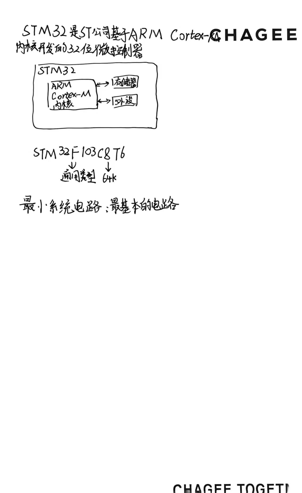

## 1. STM32 芯片简介

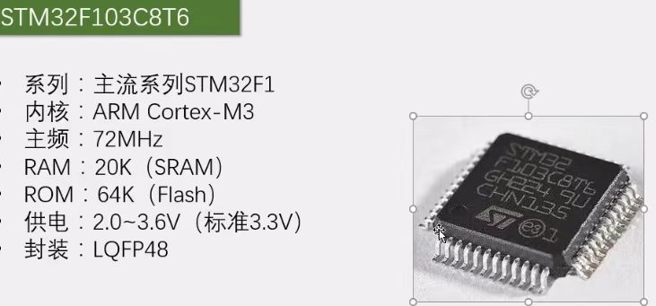

以 STM32F103C8T6 为例：

● 系列：主流系列 STM32F1
● 内核：ARM Cortex-M3
● 主频：72 MHz
● RAM：20K（SRAM）
● ROM：64K（Flash）
● 供电：2.0 ~ 3.6V（标准 3.3V）
● 封装：LQFP48

命名上，F103 中的 103 代表通用型，C8 中的 8 表示 Flash 容量为 64K，T 表示 LQFP 封装，6 表示工业级温度范围。
>重点:芯片的片上资源
## 2. 片上资源 / 外设

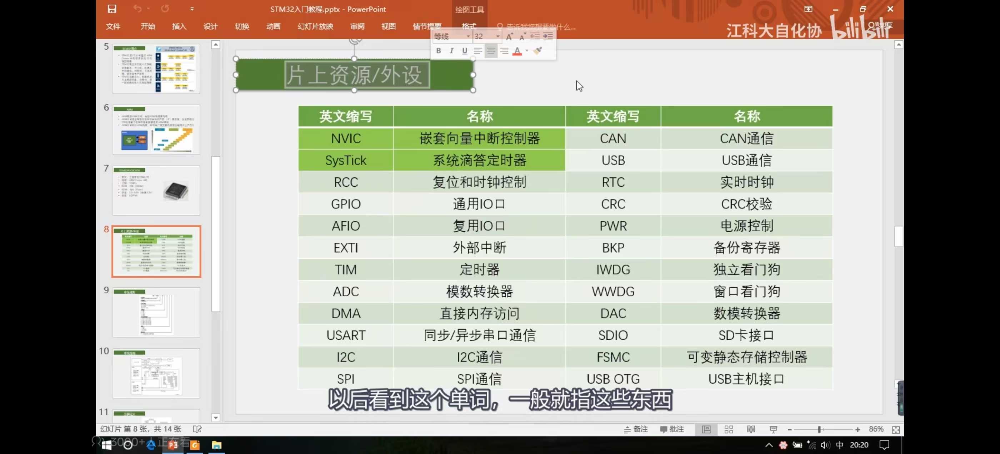

STM32 把常用外设都集成到了芯片内部，看到下面这些英文缩写，一般就是指这些外设：

● NVIC：嵌套向量中断控制器
● SysTick：系统滴答定时器
● RCC：复位和时钟控制
● GPIO：通用 IO 口
● AFIO：复用 IO 口
● EXTI：外部中断
● TIM：定时器
● ADC：模数转换器
● DMA：直接内存访问
● USART：同步/异步串口通信
● I2C：I2C 通信
● SPI：SPI 通信
● CAN：CAN 通信
● USB：USB 通信
● RTC：实时时钟
● CRC：CRC 校验
● PWR：电源控制
● BKP：备份寄存器
● IWDG：独立看门狗
● WWDG：窗口看门狗
● DAC：数模转换器
● SDIO：SD 卡接口
● FSMC：可变静态存储控制器
● USB OTG：USB 主机接口

## 3. 芯片引脚定义

STM32F103C8T6 采用 LQFP48 封装，共 48 个引脚。

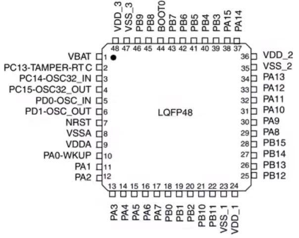

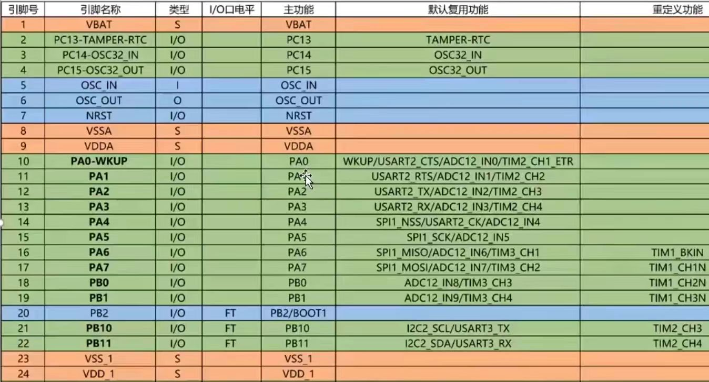

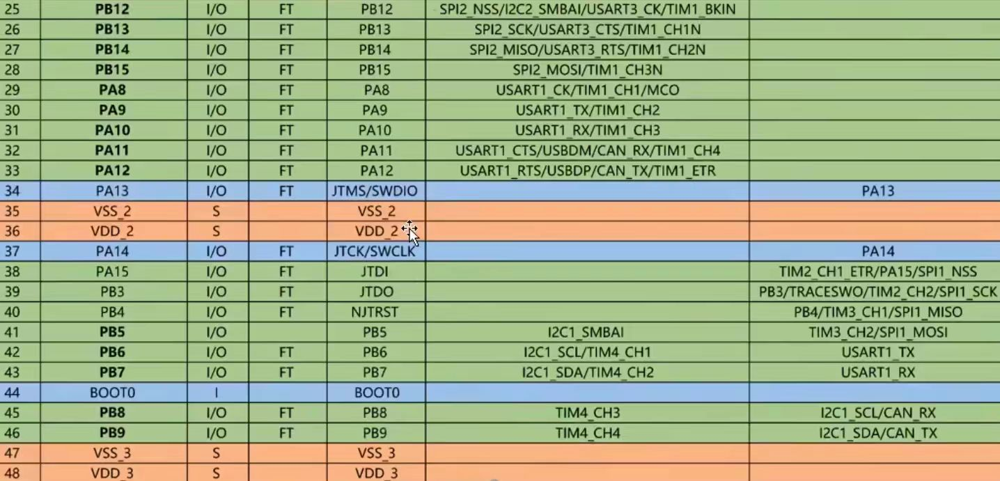

引脚定义表各列含义：

● 引脚号：芯片封装上的引脚编号，从左上角（1 号脚，有个小圆点标记）开始逆时针排列。
● 引脚名称：芯片手册中的引脚名，如 PA0、PB5、VDD_1、VSS_1 等。
● 类型：S 表示电源引脚，I/O 表示输入/输出引脚，I 表示仅输入，O 表示仅输出。
● I/O 电平：FT 表示该引脚可耐 5V 电平（Five-volt Tolerant），其余引脚只能承受 3.3V。
● 主功能：引脚的默认功能，例如 PA0~PA7 是普通 GPIO，VBAT、VDD、VSS 是电源。
● 默认复用功能：引脚复位后默认连接的片上外设功能，例如 PA9 默认复用为 USART1_TX，PA10 默认复用为 USART1_RX。
● 重定义功能：通过 AFIO 重映射后可以切换到的其他外设功能，例如 TIM2_CH1 可以重映射到 PA15。

常见引脚分组：

● 电源引脚：VBAT（备份电源）、VDD（3.3V 数字电源）、VDDA（模拟电源）、VSS/VSSA（地），多个 VDD/VSS 需要全部连接。
● 时钟引脚：PD0-OSC_IN / PD1-OSC_OUT 接外部高速晶振（HSE），PC14-OSC32_IN / PC15-OSC32_OUT 接外部低速晶振（LSE）。
● 复位引脚：NRST，低电平复位。
● 调试引脚：PA13（JTMS/SWDIO）、PA14（JTCK/SWCLK），用于 SWD 下载和调试。
● 启动模式引脚：BOOT0（44 脚）、PB2/BOOT1（20 脚）。
● GPIO 口：PA0 ~ PA15、PB0 ~ PB15、PC13 ~ PC15 等，可按需配置为输入、输出或复用外设。

## 4. 启动模式

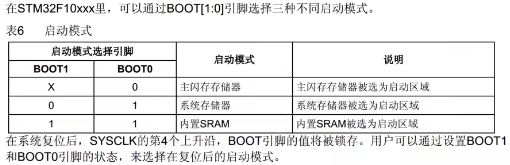

在 STM32F10xxx 中，可以通过 BOOT[1:0] 引脚选择三种不同的启动模式：

● 主闪存存储器：BOOT1 = X，BOOT0 = 0，主闪存存储器被选为启动区域（正常运行程序）。
● 系统存储器：BOOT1 = 0，BOOT0 = 1，系统存储器被选为启动区域（用于串口 ISP 下载）。
● 内置 SRAM：BOOT1 = 1，BOOT0 = 1，内置 SRAM 被选为启动区域（用于调试）。

要点：

● 系统复位后，SYSCLK 的第 4 个上升沿，BOOT 引脚的值会被锁存，之后再改变引脚状态不会影响本次启动。
● 正常运行时 BOOT0 接低电平（接地），从主 Flash 启动；需要串口下载程序时，把 BOOT0 接高电平、BOOT1 接低电平，复位后进入系统存储器中的 Bootloader。
● 若配置正确却无法下载，检查 BOOT0/NRST 的接线是否正确，以及是否已正确复位。

# 10月21日
今天学习了STM32的点灯，成功用寄存器和库函数都实现了点灯功能。

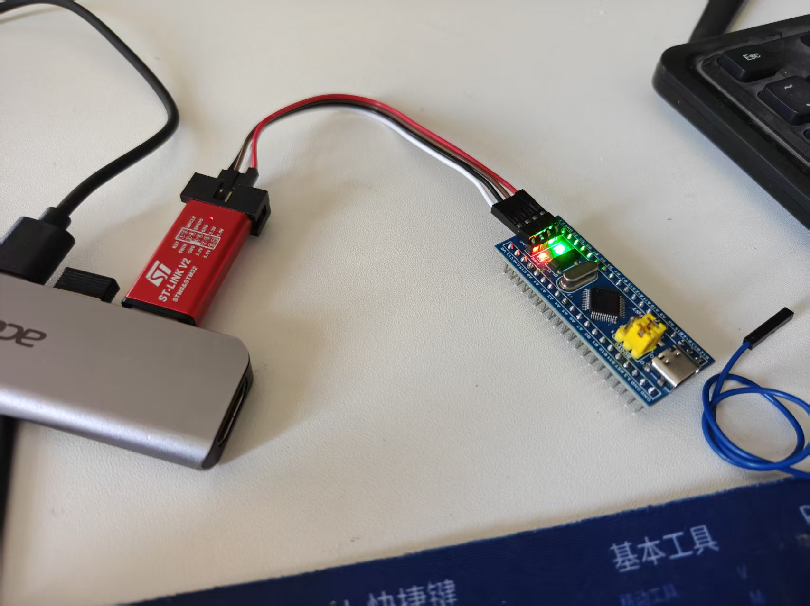

点灯效果：通过控制GPIO输出高低电平，驱动LED灯点亮和熄灭。

---

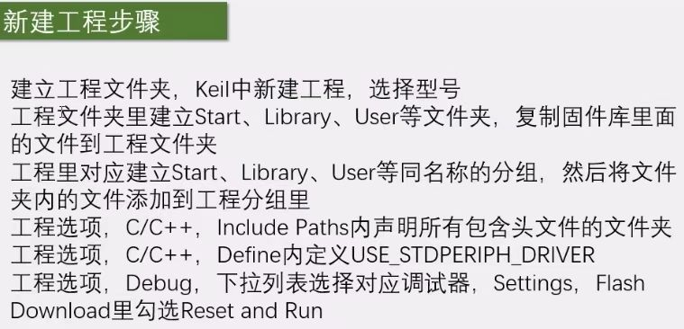

新建工程步骤：在Keil MDK中创建STM32工程，包含芯片选型、添加启动文件、配置调试器、添加库函数等关键步骤。

---

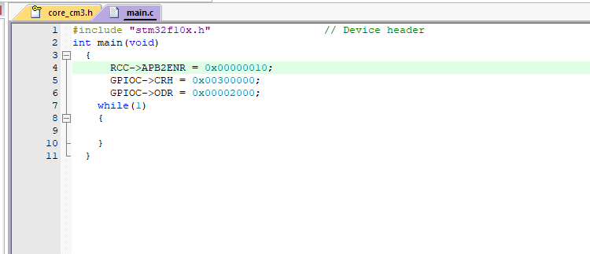

寄存器点灯代码：通过直接操作RCC（复位和时钟控制）寄存器使能GPIO时钟，再配置GPIO的CRL/CRH（端口配置寄存器）设置引脚模式，最后操作ODR（端口输出数据寄存器）控制引脚输出高低电平，实现LED的点亮和熄灭。

---

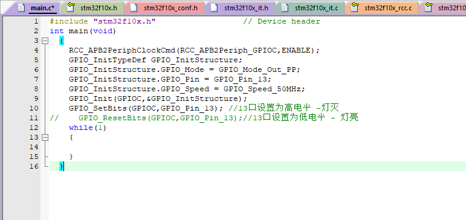

库函数点灯代码：使用STM32标准外设库中的函数，调用RCC_APB2PeriphClockCmd()使能GPIO外设时钟，GPIO_Init()初始化GPIO引脚的工作模式，GPIO_SetBits()/GPIO_ResetBits()设置引脚输出高/低电平，通过库函数封装简化了对寄存器的直接操作。

---

## 5. GPIO 输出详解

GPIO（General Purpose Input/Output，通用输入输出）是 STM32 最基础也是最常用的外设，编程时首先要了解如何控制引脚输出高低电平，才能驱动 LED、蜂鸣器等外部设备。

### 5.1 GPIO 输出基本原理

STM32F103 的 GPIO 引脚通过配置寄存器（CRL/CRH）来设置工作模式，并通过输出数据寄存器（ODR）或置位/复位寄存器（BSRR）来控制引脚输出电平：

● 输出高电平：引脚对外输出 3.3V，驱动能力由引脚最大灌/拉电流决定。
● 输出低电平：引脚对外输出 0V。
● 控制方式：写 GPIO 的输出数据寄存器 ODR，或使用 GPIO_SetBits()/GPIO_ResetBits() 库函数。

### 5.2 GPIO 输出流程（以库函数为例）

```
1. 使能 GPIO 时钟：RCC_APB2PeriphClockCmd(RCC_APB2Periph_GPIOA, ENABLE);
2. 配置引脚模式：GPIO_Init() 设置引脚为推挽输出
3. 控制引脚输出：GPIO_SetBits()/GPIO_ResetBits() 写高低电平
```

### 5.3 GPIO 八种工作模式

STM32 的 GPIO 可以配置为以下 8 种工作模式，每种模式对应输入/输出两种方向，以及不同内部结构（推挽/开漏、上拉/下拉/浮空）：

| 模式分类 | 模式名称 | 库函数宏定义 | 引脚方向 | 内部结构 | 适用场景 |
| --- | --- | --- | --- | --- | --- |
| 输入模式 | 浮空输入 | GPIO_Mode_IN_FLOATING | 输入 | 内部不上拉不下拉，高阻态 | AD 采样前配置、外部电平检测（由外部电路决定电平） |
| 输入模式 | 上拉输入 | GPIO_Mode_IPU | 输入 | 内部接上拉电阻 | 按键检测（按下接地）、读取高电平默认信号 |
| 输入模式 | 下拉输入 | GPIO_Mode_IPD | 输入 | 内部接下拉电阻 | 按键检测（按下接高电平）、读取低电平默认信号 |
| 输入模式 | 模拟输入 | GPIO_Mode_AIN | 输入 | 模拟通路，关闭数字输入 | ADC 采集、DAC 输出电压读取 |
| 输出模式 | 开漏输出 | GPIO_Mode_Out_OD | 输出 | 只能输出低电平，拉高需外部上拉 | 电平转换、I2C 通信、多设备总线共享（线与） |
| 输出模式 | 推挽输出 | GPIO_Mode_Out_PP | 输出 | 可输出高/低电平，驱动能力强 | 驱动 LED、蜂鸣器、普通信号输出 |
| 复用模式 | 复用推挽输出 | GPIO_Mode_AF_PP | 复用输出 | 推挽结构，由外设控制 | USART_TX、SPI_SCK/MOSI、定时器 PWM 输出 |
| 复用模式 | 复用开漏输出 | GPIO_Mode_AF_OD | 复用输出 | 开漏结构，由外设控制 | I2C_SCL/SDA、CAN_TX 等复用开漏信号 |

### 5.4 八种模式详细说明

**输入模式（4 种）**：引脚方向为输入，芯片内部通过施密特触发器读取外部电平信号。

● 浮空输入：内部既不上拉也不下拉，引脚呈高阻态，电平完全由外部电路决定，容易受外界干扰，常用于不会悬空的场景。
● 上拉输入：内部通过一个上拉电阻把引脚默认拉到高电平（3.3V），外部接地时读为低电平，适合按键接地的场景。
● 下拉输入：内部通过一个下拉电阻把引脚默认拉到低电平（0V），外部接高时读为高电平，适合按键接 VCC 的场景。
● 模拟输入：关闭数字输入缓冲器，引脚直接连接到 ADC/DAC 的模拟通道，用于采集模拟电压信号。

**输出模式（2 种）**：引脚方向为输出，由 ODR/BSRR 寄存器控制引脚电平。

● 推挽输出：内部有两个互补的 MOS 管，输出时一个导通、另一个截止，既能输出高电平（强驱动）也能输出低电平，输出电流大，驱动能力强，是最常用的输出模式。
● 开漏输出：输出端只有低边 MOS 管，只能主动输出低电平；要输出高电平必须外接上拉电阻。多个开漏输出可直接并联实现“线与”，常用于 I2C 等总线。

**复用模式（2 种）**：引脚的控制权交给片上外设（如定时器 PWM、串口、I2C），GPIO 寄存器不再直接控制。

● 复用推挽输出：由外设（如 TIM、USART、SPI）驱动推挽输出，如串口发送脚 TX、PWM 输出脚。
● 复用开漏输出：由外设驱动开漏输出，如 I2C、CAN 的收发引脚，同样需要外部上拉。

### 5.5 实际应用举例

● 驱动 LED：一般使用**推挽输出**，设置为 GPIO_Mode_Out_PP，速度可选 GPIO_Speed_50MHz，然后 GPIO_ResetBits() 输出低电平点亮共阳接法的 LED。
● 读取按键：一般使用**上拉输入**或**下拉输入**，让默认电平明确，避免悬空误触发。
● I2C 通信：SDA/SCL 必须使用**复用开漏输出**（GPIO_Mode_AF_OD），并外接上拉电阻，实现双向传输。
● PWM 输出：使用**复用推挽输出**（GPIO_Mode_AF_PP），由定时器产生 PWM 波形。

# 10月22日

## 6. 四大输出模式

GPIO 的输出部分，从**电平驱动方式**上可以分为推挽与开漏，从**控制来源**上可以分为通用与复用，两两组合就构成了四种输出模式：
推挽输出、开漏输出、通用输出、复用输出。
>重点:推挽输出和开漏输出的区别
### 6.1 什么是推挽（Push-Pull）

推挽输出内部由两个互补的 MOS 管（一个 P-MOS 管负责上拉、一个 N-MOS 管负责下拉）组成，工作特点是**既能主动输出高电平，也能主动输出低电平**：

● 输出高电平：P-MOS 导通、N-MOS 截止，引脚由 VDD 电源出电流，驱动能力强。
● 输出低电平：P-MOS 截止、N-MOS 导通，引脚对地放电，可灌入较大电流。
● 由于上下两个管子一个导通一个截止（一个"推"、一个"挽"）配合工作，所以叫推挽输出。
● 优点：驱动能力强、电平稳定、速度快，是点亮 LED、驱动蜂鸣器等最常用的输出模式。

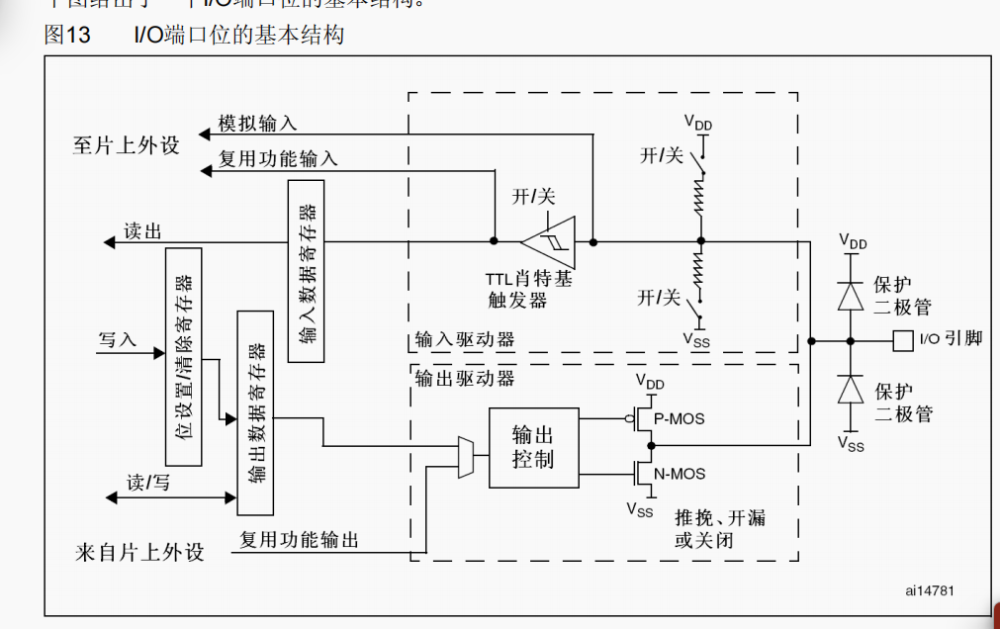

### 6.2 什么是开漏（Open-Drain）

开漏输出内部**只有一个 N-MOS 管**，没有上拉 P-MOS，因此**只能主动输出低电平**；要输出高电平，必须用**外部上拉电阻**或外部电路提供：

● 输出低电平：N-MOS 导通，引脚接地，正常输出 0V。
● 输出高电平：N-MOS 截止，引脚呈**高阻态**，电平由外部上拉电阻决定。
● 因为输出端是"漏极开路"（Drain 悬空），所以叫开漏输出。
● 优点：多个开漏引脚可直接并联实现"线与"；可通过不同上拉电压做电平转换。常用于 I2C、CAN 等总线。

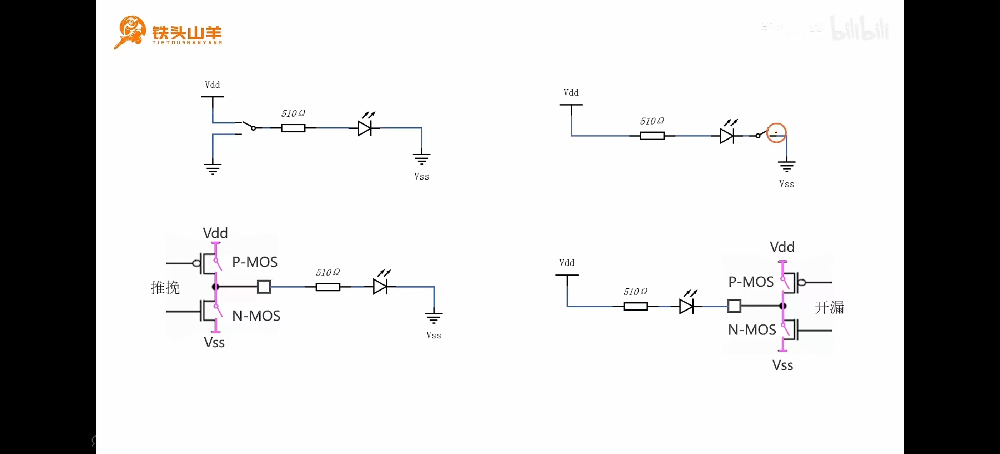

### 6.3 什么是通用（General Purpose）

通用模式指**引脚电平由 GPIO 寄存器（ODR/BSRR）直接控制**的普通 IO 口，即我们可以通过库函数把引脚拉高或拉低，用于点亮 LED、读取按键等基本功能。前面介绍的推挽/开漏输出在没有被外设接管时，就是通用输出。

### 6.4 什么是复用（Alternative Function）

复用模式指**引脚的控制权从 GPIO 移交给片上外设**（如 USART、SPI、I2C、定时器 TIM 等），引脚输出的波形不再由我们手动写寄存器决定，而是由外设自动产生。例如 PWM 输出、串口 TX 等都属于复用输出。

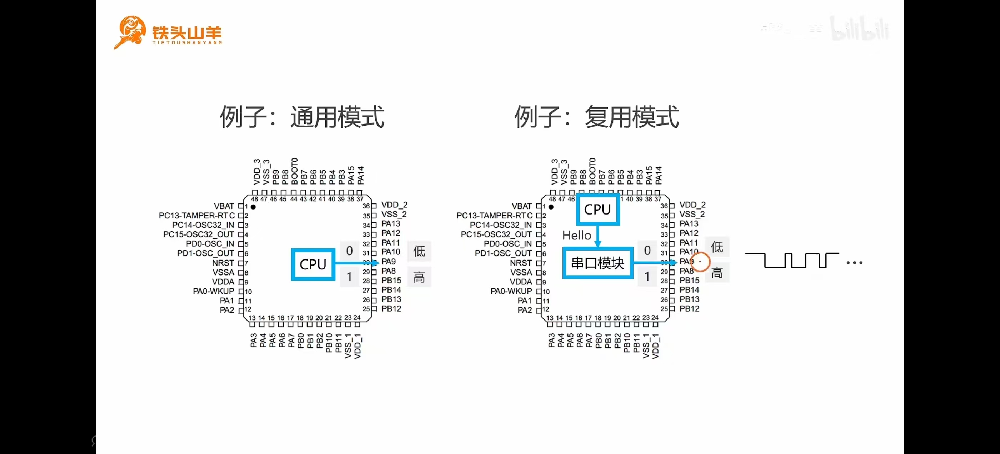

### 6.5 一图看懂四大输出模式

把四大输出模式放到一起对比，区别就在两个维度：**输入还是输出**（通用还是复用）以及**推挽还是开漏**。用"人体"来类比去理解 STM32 内部的协作关系，可以更直观地掌握这些概念。

| 模式 | 库函数宏定义 | 电平控制权 | 输出能力 | 特性 | 典型应用 |
| --- | --- | --- | --- | --- | --- |
| 通用推挽输出 | GPIO_Mode_Out_PP | GPIO 寄存器（ODR/BSRR） | 可主动输出高/低电平 | 驱动能力强、速度快、电平稳定 | 驱动 LED、蜂鸣器、普通信号输出 |
| 通用开漏输出 | GPIO_Mode_Out_OD | GPIO 寄存器（ODR/BSRR） | 只能主动输出低电平，高电平由外部上拉决定 | 可"线与"并联、支持电平转换、需外接上拉 | 电平转换、多设备总线共享 |
| 复用推挽输出 | GPIO_Mode_AF_PP | 片上外设（TIM、USART、SPI 等） | 可主动输出高/低电平 | 由外设自动产生波形、驱动能力强 | USART_TX、SPI_SCK/MOSI、定时器 PWM |
| 复用开漏输出 | GPIO_Mode_AF_OD | 片上外设（I2C、CAN 等） | 只能主动输出低电平，高电平由外部上拉决定 | 由外设自动产生波形、需外接上拉、支持"线与" | I2C_SCL/SDA、CAN_TX 等总线信号 |

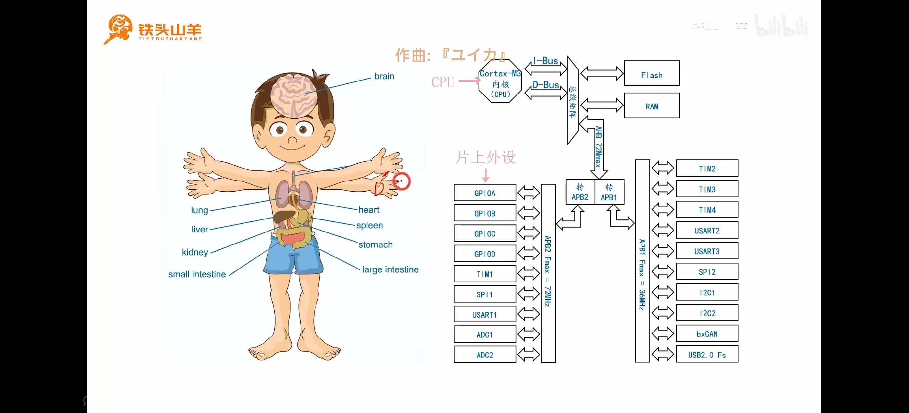

## 7. IO 的最大输出速度

### 7.1 什么是 IO 最大输出速度

IO 引脚电平在 0→1 或 1→0 翻转时，并不是瞬间完成的，而是需要一定时间。**最大输出速度**指的是 GPIO 引脚电平翻转所能支持的最快切换频率。STM32 常见档位有 2MHz、10MHz、50MHz，通过 GPIO_InitStructure.GPIO_Speed 设置。

### 7.2 上升时间、下降时间和保持时间的概念

● **上升时间（Rise Time）**：引脚从低电平上升到高电平（如从 0.1×VDD 到 0.9×VDD）所需的时间。
● **下降时间（Fall Time）**：引脚从高电平下降到低电平所需的时间。
● **保持时间（Hold Time）**：电平稳定在高/低状态所持续的时间，也就是两次翻转之间停留的时间。
● 输出速度越高，电平翻转越快，上升/下降时间越短，波形越接近理想方波。

### 7.3 什么原因限制了 IO 最大输出速度

IO 引脚内部 MOS 管的开关速度、寄生电容的充放电快慢、以及驱动电路的强度，都会限制电平翻转的快慢。可以这样理解：加快写 0/1 的速度、让保持时间越短，需要的上升/下降时间就越短；而上升/下降时间的长短，直接决定了 IO 最大输出速度的高低。

### 7.4 最大输出速度应该如何选择

并非速度越高越好，应根据实际需求选择合适的档位：

● 电平翻转频繁的场合（如高速通信、PWM）：选用 50MHz，保证波形完整。
● 翻转慢的场合（如点亮 LED、读取按键）：选用 2MHz 或 10MHz 即可，速度太高反而会产生电磁干扰（EMI）并增加功耗。
● 原则：够用就好，速度与外部负载匹配即可。

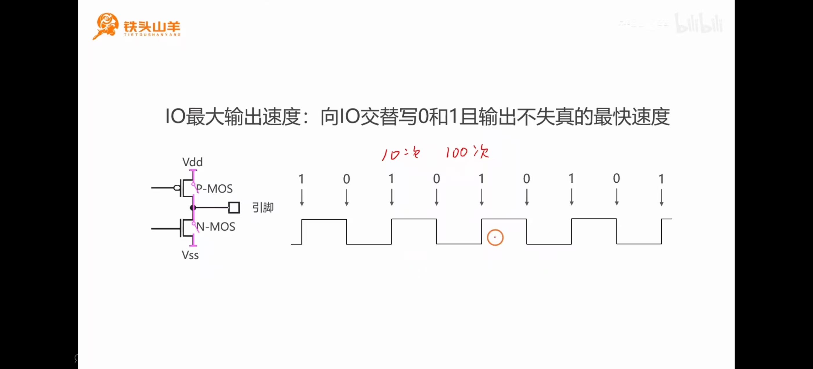

## 8. STM32 板 LED 灯交替闪烁

### 8.1 两种接通方式 - 推挽和开漏

LED 的接通方式有两种：

● **推挽接法**：LED 一端接引脚、另一端接地（共阴），引脚输出高电平点亮。
● **开漏接法**：LED 一端接 VCC、另一端接引脚（共阳），引脚输出低电平点亮。

通过原理图可知，STM32 板上的 LED 灯用的是**开漏接法**，因此写 0 点亮、写 1 熄灭。

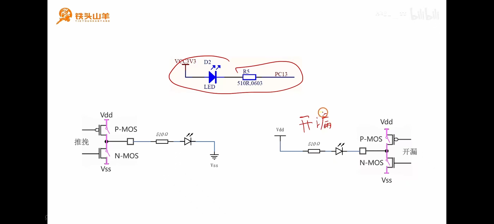

### 8.2 正式写代码

编写 LED 闪烁程序需要三步：**开时钟 → 初始化 IO → 写值**。首先开启时钟，时钟相当于人体的心跳，为引脚提供电平切换的信号，也就是相当于给各个外设部位"充血"，让它们能正常工作。

---

### 8.2.1 晶振——芯片的「心脏起搏器」

**晶振**（Crystal Oscillator）是一个物理元件，利用石英晶体的**压电效应**产生稳定的机械振动，再把振动转化为电信号输出。它的本质相当于人体的**窦房结（心脏起搏器）**：

- 窦房结是位于右心房顶端的一团特殊细胞，它不需要大脑指令，能**自发地、有节律地产生电脉冲**，驱动心脏跳动。同样，晶振只要通电，就能自发地、以固定频率振荡，产生时钟波形。
- 窦房结的放电频率决定了人的静息心率（约 60～100 次/分钟）；晶振的振荡频率则决定了芯片的基准节拍（如 8MHz、32.768kHz）。

**STM32 中的两颗晶振：**

| 晶振类型 | 频率 | 人体类比 | 作用 |
| --- | --- | --- | --- |
| HSE（外部高速晶振） | 8MHz | **运动时的心率** — 剧烈跳动，驱动全身高速运转 | 为 CPU 和外设提供高速工作时钟，经 PLL 倍频后可到 72MHz |
| LSE（外部低速晶振） | 32.768kHz | **睡眠时的心率** — 平稳缓慢，维持最低生命活动 | 为 RTC 实时时钟提供精确计时，保持系统掉电后的日历功能 |

HSE 和 LSE 同时存在，就好比人**运动时心跳加速**、**睡觉时心跳变慢**——STM32 在不同场景下选择不同晶振作为时钟源，既保证性能又节省功耗。

---

### 8.2.2 时钟——芯片的「血液循环系统」

如果说晶振是心脏起搏器，那**时钟**（Clock）就是由这个起搏器驱动的**整个血液循环系统**：

- **心跳产生脉搏波**，通过动脉传遍全身，为每个器官（大脑、肌肉、肾脏）供血供氧。
- **晶振产生时钟信号**，通过 RCC（复位和时钟控制）分频/倍频后，送到每个外设（GPIO、USART、TIM、ADC 等），为它们提供工作的节拍信号。

没有心跳，器官立即坏死；没有时钟，外设就不知道何时采样、何时翻转、何时传输数据——整个芯片陷入"静默"。

**时钟树 = 血管网络：**

| 时钟概念 | 人体类比 | 含义 |
| --- | --- | --- |
| **晶振** | 窦房结（心脏起搏器） | 产生最原始的节拍信号 |
| **HSE** | 运动心率 | 8MHz 高速原始信号 |
| **LSE** | 静息心率 | 32.768kHz 低速原始信号 |
| **PLL（锁相环）** | **肾上腺素** — 让心跳加速 | 把 HSE 的 8MHz 倍频到 72MHz（SYSCLK），使 CPU 全速运转 |
| **AHB 分频器** | **主动脉** | SYSCLK 经分频后送给高速总线上的外设（如 DMA） |
| **APB1 分频器** | **大动脉分支**（流向内脏） | 最高 36MHz，驱动低速外设：USART2-5、SPI2、TIM2-7 等 |
| **APB2 分频器** | **大动脉分支**（流向四肢） | 最高 72MHz，驱动高速外设：GPIO、USART1、SPI1、TIM1 等 |
| **RCC** | **自主神经系统**（调控心率分配） | 控制哪个外设的时钟打开/关闭、决定分频系数 |
| **外部低速晶振（LSE）** | 深度睡眠时的微弱脉搏 | 仅维持 RTC 走时，功耗极低 |

---

### 8.2.3 为什么写代码时必须「先开时钟」？

这就像做手术前必须**先让血液流到对应器官**，否则器官处于缺血坏死状态，任何操作都无效：

- `RCC_APB2PeriphClockCmd(RCC_APB2Periph_GPIOX, ENABLE)` —— 相当于给「手和脚」（GPIO）供血，让它有能量工作。
- 如果漏写这一句，程序的 `GPIO_Init()` 不会报语法错误，但引脚完全不会响应——因为 GPIO 外设根本没获得时钟信号，内部寄存器不工作。
- STM32 默认上电只开启少数必要的时钟，其他外设时钟全部关闭——这是为了**省电**，就像人在安静时四肢血流减少，血液优先供应大脑和心脏。

**一句话总结：晶振是心跳的源头，时钟是血液的流向，RCC 是调控血流的神经中枢。理解了这个人体的三重结构，就理解了 STM32 时钟系统的本质。**

```c
// 1. 开启 GPIOX 时钟
RCC_APB2PeriphClockCmd(RCC_APB2Periph_GPIOX, ENABLE);

// 2. 初始化 IO 引脚，PC13 通用输出开漏模式，2MHz
GPIO_InitStructure.GPIO_Pin   = GPIO_Pin_13;
GPIO_InitStructure.GPIO_Mode  = GPIO_Mode_Out_OD;   // 通用开漏输出
GPIO_InitStructure.GPIO_Speed = GPIO_Speed_2MHz;    // 2MHz
GPIO_Init(GPIOC, &GPIO_InitStructure);

// 3. 向 IO 引脚写值(0/1)，配合延时实现交替闪烁
while (1) {
    GPIO_WriteBit(GPIOC, GPIO_Pin_13, Bit_SET);   // 写 1，LED 灭
    Delay();                                       // 延时
    GPIO_WriteBit(GPIOC, GPIO_Pin_13, Bit_RESET); // 写 0，LED 亮
    Delay();                                       // 延时
}
```

初始化引脚时需要用到的通用结构体配置，以及对引脚写值的库函数，具体如下：

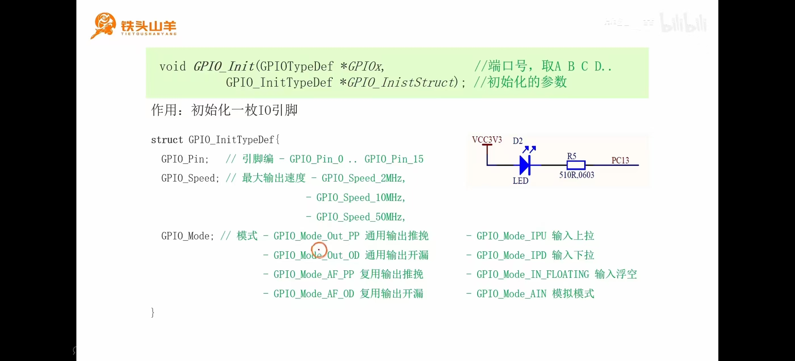

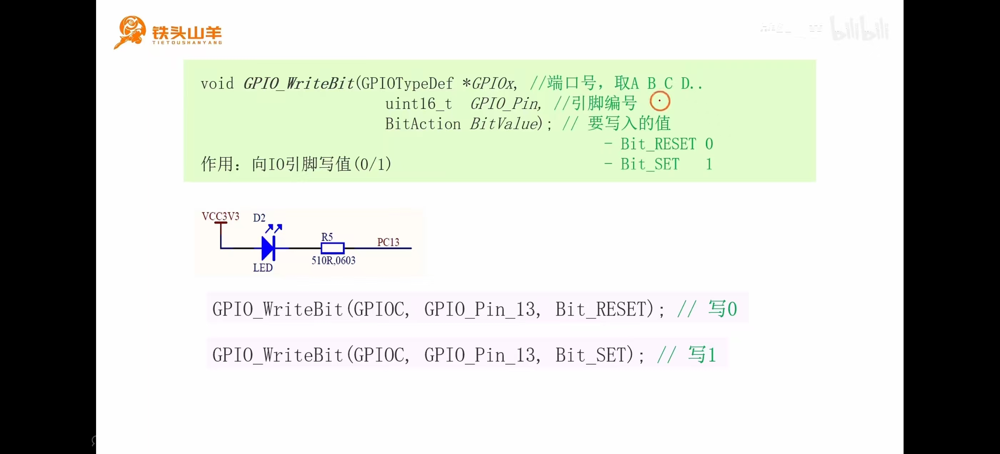

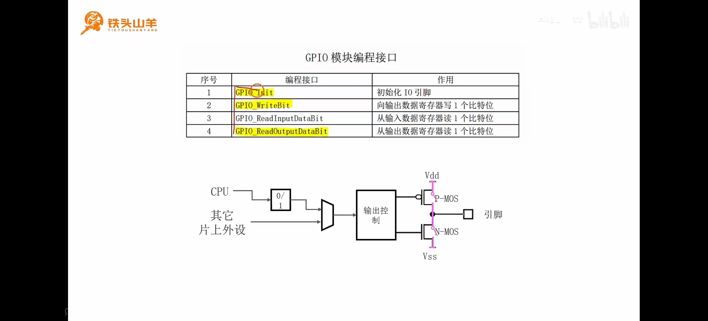

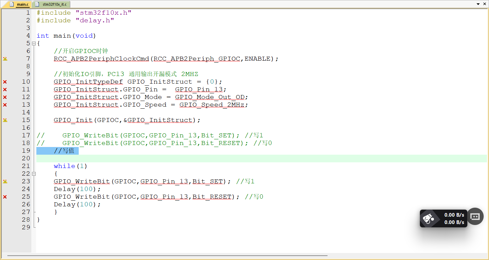

点亮和熄灭之间需要有明显的间隔，通常借助延时函数来控制节奏：

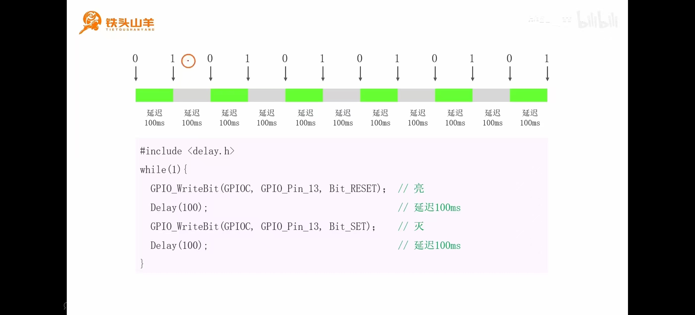

## 9. GPIO 四种输入模式

GPIO 的输入部分包含四种模式：浮空输入、上拉输入、下拉输入、模拟输入。它们的共同点是信号从引脚进入芯片，经过施密特触发器整形后由处理器读取。

>重点:施密特触发器
### 9.1 施密特触发器

施密特触发器是输入通路上的一个整形电路，具有**滞回特性**：上升到某一阈值才翻转输出高电平、下降到另一较低阈值才翻转回低电平。它能**消除信号边沿的抖动和噪声**，使电平判断更稳定、抗干扰能力更强。

### 9.2 浮空输入

浮空输入内部**既不接上拉也不接下拉电阻**，引脚呈高阻态，电平完全由外部电路决定，容易受外界干扰。因此要求外部必须明确给定电平，否则引脚悬空时读到的值不确定。

### 9.3 上拉电阻和下拉电阻

● **上拉输入**：内部通过上拉电阻把引脚默认拉到高电平（3.3V），外部接地时读为低电平。适合按键一端接地的场景。
● **下拉输入**：内部通过下拉电阻把引脚默认拉到低电平（0V），外部接高电平时读为高电平。适合按键一端接 VCC 的场景。
● 作用：让引脚在无外部信号时有一个确定的默认电平，避免悬空导致误触发。

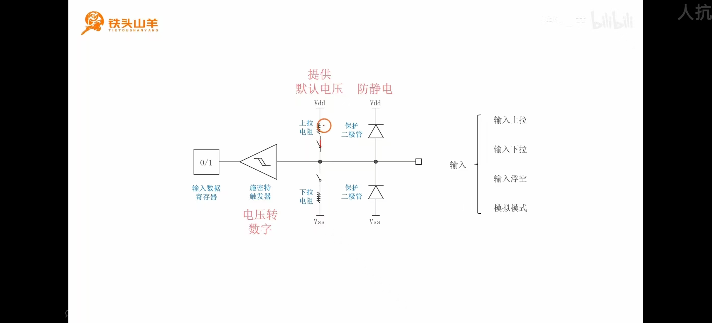

### 9.4 一表看懂四大输入模式

四种输入模式的共同点是信号从引脚进入芯片后，都要经过**施密特触发器**整形，再由处理器读取；它们的区别主要在于内部上拉/下拉电阻和是否连通模拟通路：

| 模式 | 库函数宏定义 | 内部电阻 | 引脚方向 | 数字/模拟通路 | 特性与应用 |
| --- | --- | --- | --- | --- | --- |
| 浮空输入 | GPIO_Mode_IN_FLOATING | 无上拉、无下拉 | 输入 | 走数字通路 | 高阻态、电平由外部电路决定，要求外部必须明确给定电平，易受干扰 |
| 上拉输入 | GPIO_Mode_IPU | 内部上拉电阻 | 输入 | 走数字通路 | 默认拉高到 3.3V，外部接地读低，适合按键一端接地的场景 |
| 下拉输入 | GPIO_Mode_IPD | 内部下拉电阻 | 输入 | 走数字通路 | 默认拉低到 0V，外部接高读高，适合按键一端接 VCC 的场景 |
| 模拟输入 | GPIO_Mode_AIN | 无 | 输入 | 走模拟通路（关闭数字输入） | 读取 ADC/DAC 模拟电压，常用于 AD 采样，一般用不到，不用重点记忆 |

## 10. GPIO 按钮实验

通过读取按键电平（按下引脚电平改变）来识别用户操作，是 GPIO 输入的典型应用。由于手头周边没有 LED 灯和按钮，本次实操没法实际做，代码直接参考截图的示例来理解按键扫描与防抖的逻辑。

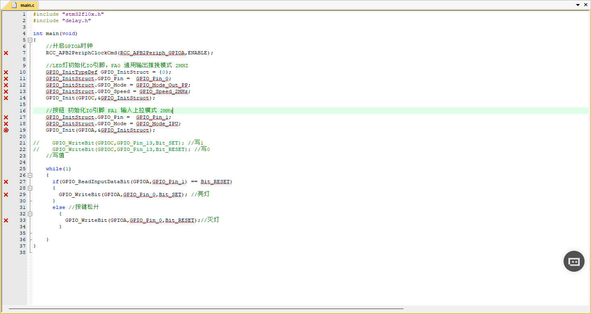
>重点:写代码的一些感想
## 写代码常见误区
首先是我自己的疏忽，代码调用的库函数经常有错误，这不可避免，毕竟我也只是一个初学者，代码需要多加练习，但是现在的我可以直接查看编译的错误信息，快速定位问题所在，从而修改错误的代码，第二个我需要重点的学习是调试函数，现在我没有自己写代码，都是学习视频中的代码，所以这个在后面作品的制作会重点的学习，今天我使用铁头的模板，发现我书写的代码在里面莫名的报错，但是编译和下载可以正常的执行，我也不知道是不是我电脑的问题。反正来日方长，学无止境。
我会把铁头的模板传输到我的github仓库里面，大家按需下载，也可以去铁头视频的连接下载模板解析。
模板下载链接:(https://github.com/xinkong-kew/STM32-Template)
# 10月23日

今天开始串口的学习，串口是 STM32 最重要的外设之一，用于与外部设备进行通信，比如 PC、手机、蓝牙模块、GPS 模块等。几乎所有嵌入式项目都离不开串口——调试打印日志、上位机通信、模块指令交互，都靠它。

> 重点：串口通信是**异步、全双工、点对点**的通信方式，只需要 **Tx（发送）** 和 **Rx（接收）** 两根线 + GND 共地即可通信。

---

## 11. 通信协议

### 11.1 串口通信的基本概念

串口通信（UART/USART）是一种**串行异步通信**协议，数据在一条线上**一位一位地依次传输**。相比并行通信（8 根线同时传 8 位），串口虽然速度慢，但接线简单、抗干扰能力强、成本低。

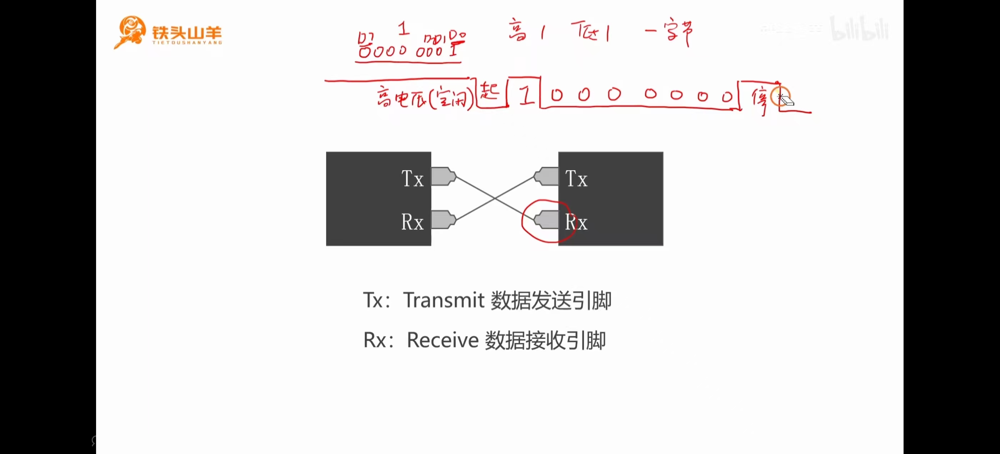

> **Tx（Transmit，发送引脚）**：芯片向外发送数据的引脚，连接到对方设备的 Rx。
>
> **Rx（Receive，接收引脚）**：芯片接收外部数据的引脚，连接到对方设备的 Tx。
>
> **交叉连接原则**：自己的 Tx 接对方的 Rx，自己的 Rx 接对方的 Tx，两边的 GND 必须共地。可以类比为两个人打电话——A 的嘴巴（Tx）对着 B 的耳朵（Rx），B 的嘴巴（Tx）对着 A 的耳朵（Rx）。

### 11.2 数据帧格式

串口通信的数据是按**帧**来组织的，每一帧包含若干个位：

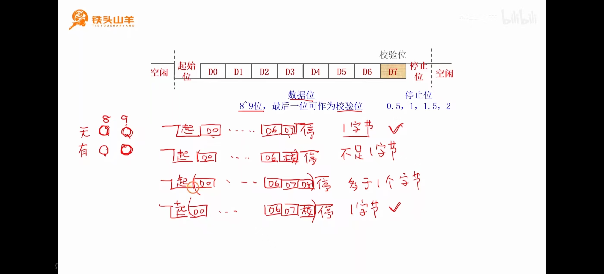

> **起始位（Start Bit）**：1 位，固定为低电平（0V）。当总线上出现一个从高到低的跳变时，表示一帧数据的开始。
>
> **数据位（Data Bits）**：通常为 8 位（也可配置为 9 位），由低位到高位（LSB → MSB）依次发送。1 为高电压，0 为低电压。十进制数会被转换为二进制数再发送；字符串则每个字符先转换为对应的 ASCII 码，再把 ASCII 码按二进制发送。
>
> **校验位（Parity Bit）**：可选，1 位，用于检测传输错误。
>
> **停止位（Stop Bit）**：通常为 1 位（也可配置为 0.5、1.5、2 位），固定为高电平，表示一帧数据结束。下一帧的起始位又会拉低，形成新的开始信号。
>
> **空闲状态**：没有数据传输时，总线保持高电平。

**一帧数据 = 起始位（1）+ 数据位（通常 8）+ 校验位（可选 1）+ 停止位（通常 1）**

### 11.3 校验位

校验位用于检测数据传输过程中是否发生了位翻转错误：

● **奇校验（Odd Parity）**：数据位 + 校验位中「1」的总个数为奇数。如果数据位中已经有奇数个 1，校验位填 0；如果是偶数个 1，校验位填 1。
● **偶校验（Even Parity）**：数据位 + 校验位中「1」的总个数为偶数。代码中 `Even` 表示偶校验，`Odd` 表示奇校验。
● **无校验（No Parity）**：不发送校验位，最常见、最省事的配置。

## 12. USART 模块

### 12.1 USART 模块结构

USART（Universal Synchronous/Asynchronous Receiver/Transmitter，通用同步/异步收发器）是 STM32 内部负责串口通信的外设模块。它可以类比为人体的**嘴巴和耳朵的结合体**——既能"说"（发送数据），也能"听"（接收数据）。

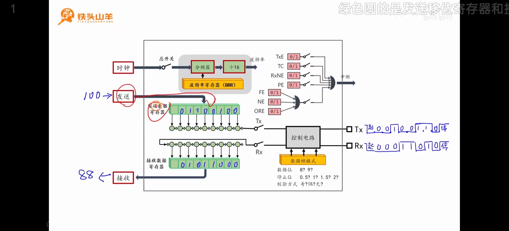

> **TDR（发送数据寄存器）**：用户把要发送的 8 位数据写入这里，硬件自动把它送到移位寄存器。
>
> **RDR（接收数据寄存器）**：移位寄存器接收完一帧后，把 8 位数据存入这里，用户从这儿读取。
>
> **发送移位寄存器**：把 TDR 中的并行 8 位数据，一位一位地串行移出到 Tx 引脚。
>
> **接收移位寄存器**：从 Rx 引脚一位一位地接收串行数据，攒够 8 位后一次性送入 RDR。
>
> **发送流程**：用户写 TDR → 移位寄存器逐位移出 → Tx 引脚发出
>
> **接收流程**：Rx 引脚进入 → 移位寄存器逐位移入 → 满 8 位后存入 RDR → 用户读取

### 12.2 移位寄存器与串并转换

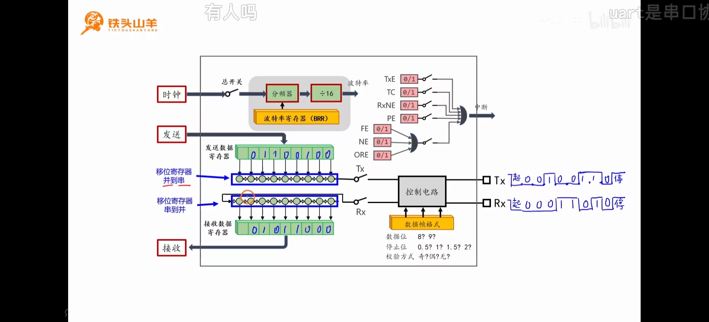

> **移位寄存器（Shift Register）**：USART 模块的核心部件，负责在并行数据和串行数据之间做转换。
>
> **并→串转换（发送时）**：CPU 一次写入 8 位并行数据到 TDR，移位寄存器在时钟驱动下，把 8 位数据从低位到高位逐位移出到 Tx 引脚。
>
> **串→并转换（接收时）**：Rx 引脚上的串行数据逐位进入移位寄存器，在一个个时钟边沿上「向右滑动」，攒满 8 位后，整个字节被一次性锁存到 RDR 中。
>
> **类比**：就像一个 8 节车厢的火车——发送时，8 节车厢里的货物（8 位数据）依次卸到一条传送带上（Tx）；接收时，传送带上的货物依次装入 8 节车厢（移位寄存器），装满后整车拉走（送入 RDR）。

### 12.3 波特率与分频器

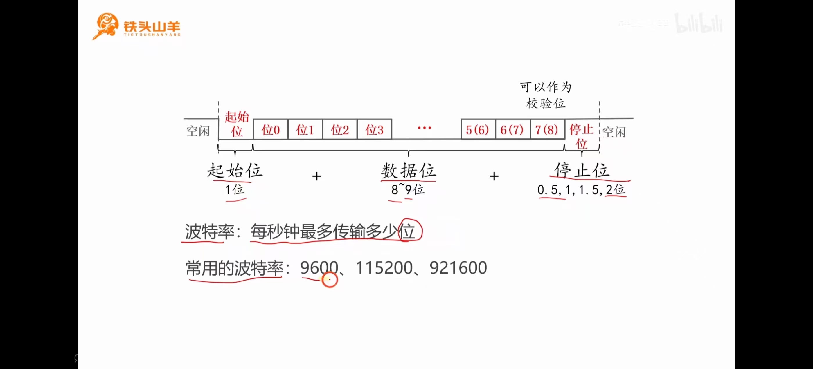

> **波特率（Baud Rate）**：每秒钟传输的码元（位）个数，单位是 bps（bits per second）。常见的波特率有 9600、115200 等。以 115200 为例，每秒能传输 115200 位，即每位占约 8.68μs。
>
> **波特率必须一致**：收发双方必须以相同的波特率通信，否则对方无法正确解析每一位数据。就像两个人用对讲机通话，必须规定好语速，说太快对方听不清，说太慢浪费带宽。
>
> **分频器（Divider）**：用于配置波特率的寄存器，本质上是一个除法器。它把时钟频率除以一个系数得到波特率时钟。公式为：**波特率 = 时钟频率 ÷ 分频系数**。例如 APB2 时钟为 72MHz，要得到 115200 的波特率，分频系数 = 72,000,000 ÷ 115200 ≈ 625。

### 12.4 UART 初始化

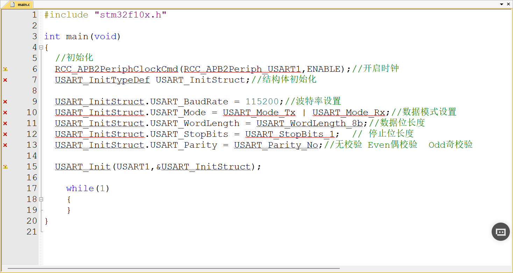

> **UART 初始化**：在使用串口之前，需要配置波特率、数据位长度、校验位、停止位等参数，并调用 `USART_Init()` 函数将这些参数写入 USART 模块的寄存器中。
>
> **关键参数**：波特率（如 115200）、字长（8 位或 9 位）、停止位（1 位或 2 位）、校验位（无/奇/偶）、硬件流控制（一般关闭）、模式（仅发送/仅接收/全双工）。

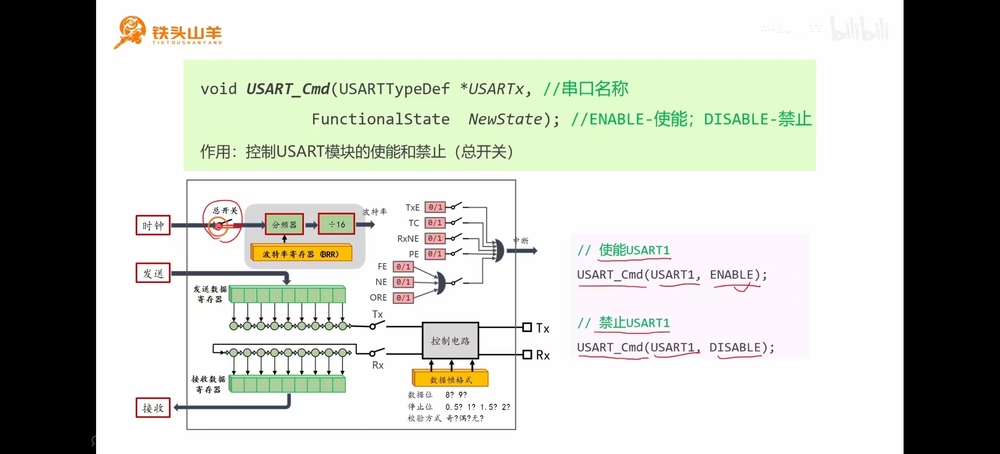

> **USART_Cmd() 库函数**：控制 USART 模块的使能和禁止。`USART_Cmd(USART1, ENABLE)` 相当于打开 USART1 的「总开关」，使能之后模块才能正常工作。类比：初始化配置了嘴巴和耳朵，但要真正开始说话/听声音，还得先按下「通话开关」。

## 13. 串口初始化 IO 口

### 13.1 引脚分布图

（详细可查阅本文档 3.芯片引脚定义部分的引脚分布图，重点关注 PA9/USART1_TX、PA10/USART1_RX 对应的引脚位置）

### 13.2 IO 配置表

串口通信是全双工的，所以 Tx 和 Rx 各有不同的模式要求：

| 引脚 | 模式 | 库函数宏定义 | 选择原因 |
| --- | --- | --- | --- |
| Tx（发送） | 复用推挽输出 | `GPIO_Mode_AF_PP` | 引脚控制权交给 USART 外设，外设自动控制高低电平，推挽保证驱动能力 |
| Rx（接收） | 输入上拉 | `GPIO_Mode_IPU` | 空闲时总线为高电平，上拉保证悬空/断线时读到确定的高电平，防止误接收 |

> **Tx 为什么选复用推挽输出？** 串口是全双工通信，Tx 引脚的电平不由用户手动控制，而是由 USART 外设的移位寄存器自动输出——所以必须用「复用」模式把控制权交给外设。选择推挽是因为 Tx 只需要单方面输出，不存在多设备共享的问题。
>
> **Rx 为什么选输入上拉？** 串口空闲时总线保持高电平，上拉输入保证在对方没有连接（断线）的情况下，Rx 读到的是确定的高电平，不会因为悬空而产生随机的干扰信号。

### 13.3 Rx/Tx 初始化代码

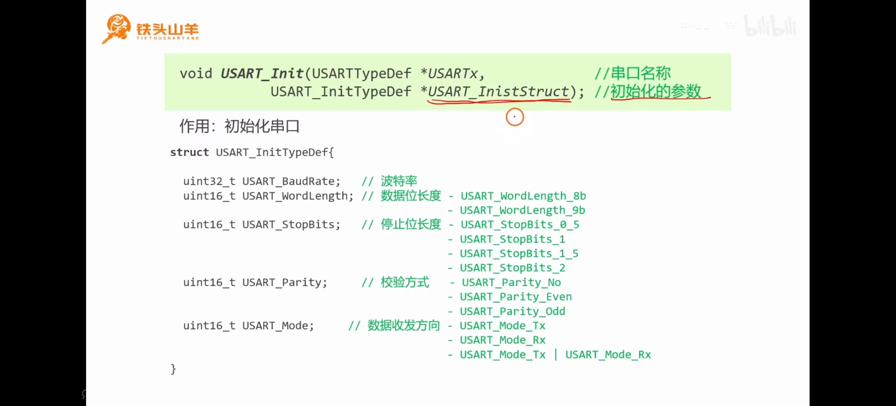

> **GPIO_Init() 初始化 Rx/Tx 引脚**：除了 USART 模块本身的配置外，还需要用 `GPIO_Init()` 把 PA9 和 PA10 两个引脚分别配置为复用推挽输出（Tx）和上拉输入（Rx）。同时要记得先开启 GPIOA 和 USART1 的时钟。三步走：**开启时钟 → GPIO 初始化 → USART 初始化**。

### 13.4 Rx/Tx 重映射

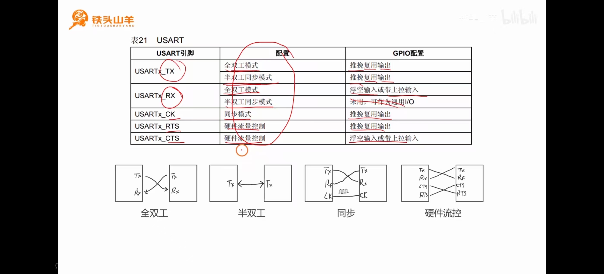

> **重映射（Remap）**：默认情况下 USART1 的 Tx/Rx 固定在 PA9/PA10，但 STM32 允许通过 AFIO 的「重映射」功能，把 USART1 的引脚映射到其他位置（如 PB6/PB7），以解决不同外设之间的引脚冲突。
>
> **重映像图表**：列出了各 USART 的默认引脚位置和重映射后的可选引脚位置，在画 PCB 或分配资源时非常实用。

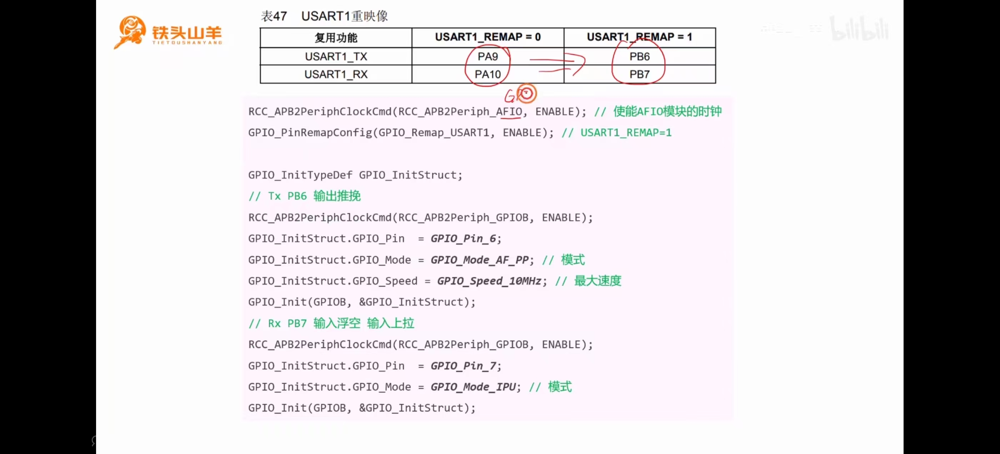

> **重映射代码**：调用 `GPIO_PinRemapConfig()` 函数将 USART1 的引脚功能重新映射到备用引脚。例如 `GPIO_PinRemapConfig(GPIO_Remap_USART1, ENABLE)` 将 USART1 从 PA9/PA10 重映射到 PB6/PB7。注意重映射前必须先使能 AFIO 时钟。

## 14. 串口发送数据

### 14.1 发送流程

数据发送是顺序进行的——每次只能发送一个字节，等这个字节发完之后才能发下一个：

**发送流程**：CPU 把 8 位数据写入 TDR → 移位寄存器自动把数据逐位移到 Tx 引脚 → 全部移出后硬件置位相关标志 → CPU 检测到标志后写入下一个字节。

### 14.2 两个重要标志位：TxE 和 TC

> 重点：发送数据时必须关注以下两个标志位

● **TxE（发送数据寄存器空，Transmit Data Register Empty）**：当 TDR 中的数据被转移到移位寄存器后，TDR 变为空，TxE = 1。此时可以向 TDR 写入下一个字节。这是最常用的发送判断标志。
● **TC（发送完成，Transmission Complete）**：当发送完成后，不仅 TDR 为空，而且移位寄存器也为空，即最后一个位已经发到了 Tx 引脚上，TC = 1。TC 比 TxE 更严格——TxE = 1 只说明 TDR 空了，但移位寄存器可能还在往外移位；TC = 1 表示真正「说完」了。
● **何时用 TxE，何时用 TC？** 连续发多个字节时用 TxE（流水线发，不等移位寄存器全部清空）；发完最后一句要确认结束或切换 RS485 收发方向时用 TC。

### 14.3 发送代码实现

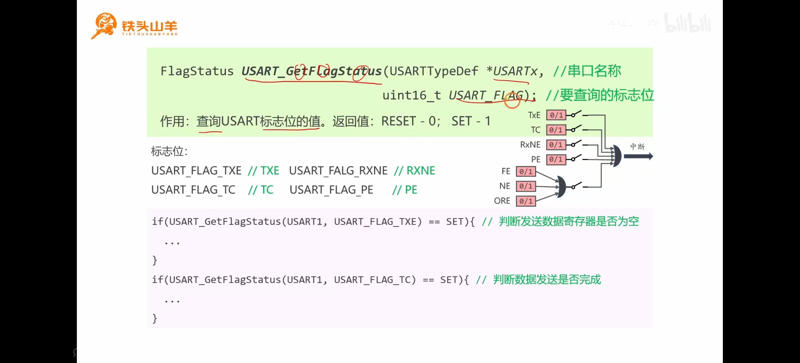

> **USART_GetFlagStatus()**：获取 USART 模块的标志位状态。`USART_GetFlagStatus(USART1, USART_FLAG_TXE)` 返回 TxE 是否为 1，以此判断是否可以发送下一个字节。
>
> **USART_SendData()**：将 8 位数据写入发送数据寄存器 TDR。`USART_SendData(USART1, data)` 把 `data` 发出去。注意：调用前必须先检查 TxE 标志位，确保 TDR 为空。

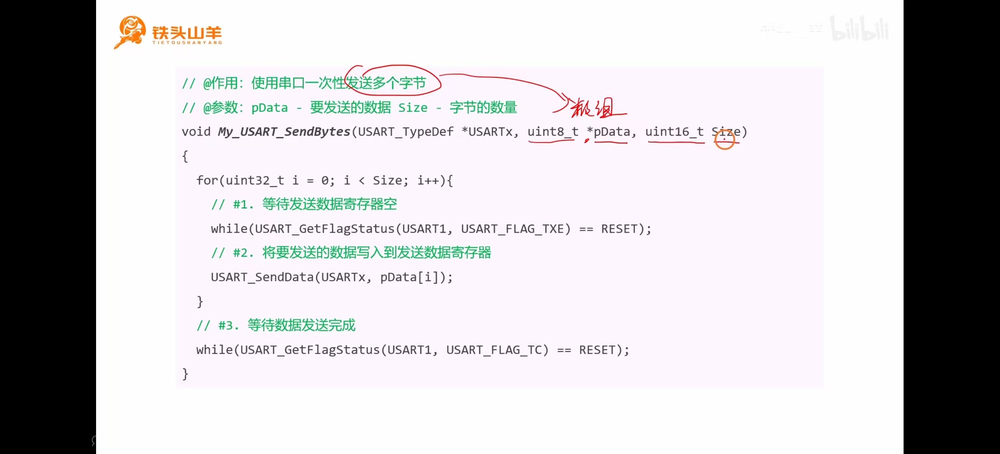

> **发送单字节**：`USART_SendData(USART1, 0x55)` 发送十六进制数 0x55（二进制 01010101），常用于测试波形。
>
> **发送字符串**：自己编写一个函数，逐字节遍历字符串，每次等待 TxE = 1 后写入一个字符，直到遇到字符串结束符 `\0`。这样可以一次性发送多个字节的多字符消息。

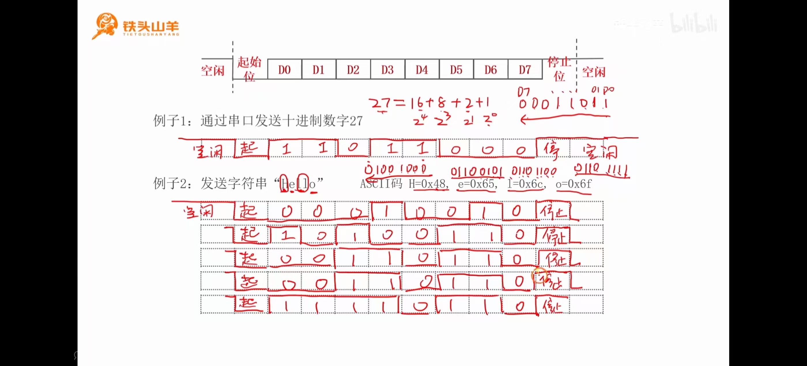

> **发送效果**：串口发送的数据可以在 PC 端的串口调试助手中显示。通过观察发送的原始数据和接收到的数据是否一致，可以验证串口通信是否正常。

### 14.4 uint8_t 数据类型详解

在串口发送函数中频繁见到 `uint8_t`，这里详细说明：

● **uint8_t**：定义在 `<stdint.h>` 中，表示**无符号 8 位整数**（0 ~ 255）。等价于 STM32 库中的 `u8` 或标准 C 的 `unsigned char`。
● **为什么用 uint8_t？** 串口每次发送的数据恰好是 8 位（一个字节），使用 `uint8_t` 能精确匹配数据宽度，避免隐式类型转换带来的不确定行为。
● **相关类型**：`uint16_t`（16 位）、`uint32_t`（32 位）、`int8_t`（有符号 8 位）等，都是跨平台的精确宽度整数类型。

## 15. 格式化打印字符串

在实际项目中，我们经常需要像 C 语言的 `printf()` 一样格式化输出调试信息（如变量值、状态提示）。STM32 上可以通过重写底层字符输出函数来实现这一功能。

### 15.1 重写 fputc 函数

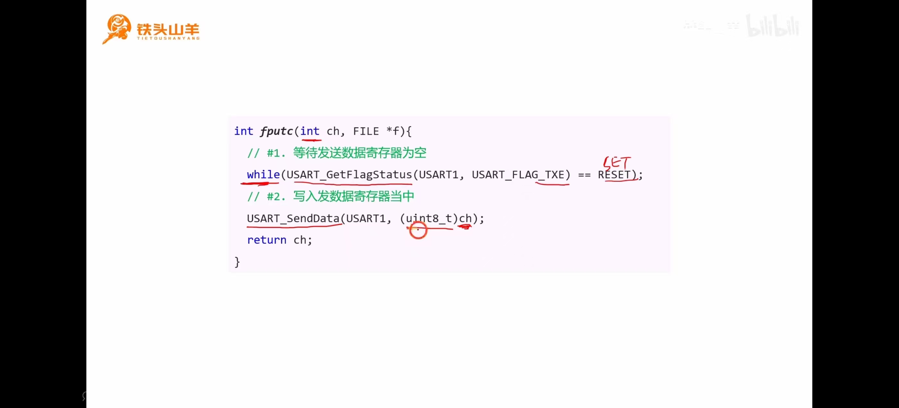

> **fputc() 函数**：标准 C 库中 `printf()` 最终会调用 `fputc()` 来输出每一个字符。重写 `fputc()`，让它把字符通过串口发出，就能在不改变 `printf()` 调用方式的前提下，把格式化字符串输出到串口。
>
> **实现方式**：在 `fputc()` 内部等待 TxE = 1，然后 `USART_SendData(USART1, ch)` 发送字符，最后 return ch。这样 `printf("Hello %d\r\n", 123)` 就能在串口助手上看到 "Hello 123"。
>
> **需勾选 MicroLIB**：在 Keil 工程选项 Target → Use MicroLIB，因为 MicroLIB 是简化的 C 库，配合重写的 `fputc()` 使用。

### 15.2 获取时间戳并输出当前时间

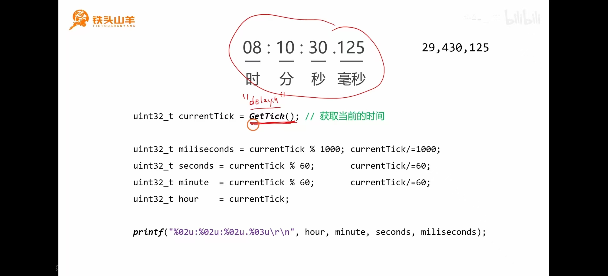

> **时间戳转换**：将时间戳（自 1970-01-01 以来的秒数）转换为可读的日期时间格式（年-月-日 时:分:秒），再通过串口 `printf()` 输出，方便在调试时为每条日志打上时间标记。

## 16. 串口接收数据

### 16.1 接收流程与 RxNE 标志位

接收也是依次进行的——每次接收一个字节，等这个字节接收完成后才能读取下一个：

**接收流程**：Rx 引脚电平变化 → 检测到起始位（下降沿）→ 逐位接收数据进入移位寄存器 → 满 8 位后转入 RDR → 硬件置位 RxNE → CPU 读取 RDR。

> 重点：RxNE 标志位

● **RxNE（接收数据寄存器非空，Receive Data Register Not Empty）**：当 RDR 中有新数据可以读取时，RxNE = 1。读取 RDR 后，RxNE 自动清 0。`RxNE = 1` 表示有新数据到了，`RxNE = 0` 表示已被读取或没有新数据。

### 16.2 接收数据代码实现

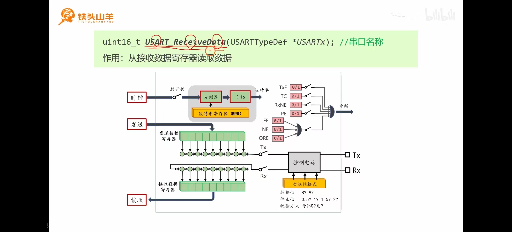

> **USART_ReceiveData()**：从 USART 模块的接收数据寄存器 RDR 中读取接收到的 8 位数据。`uint8_t data = USART_ReceiveData(USART1)` 获取一个接收字节。注意：调用前必须先检查 RxNE 标志位，确保 RDR 中有有效数据。

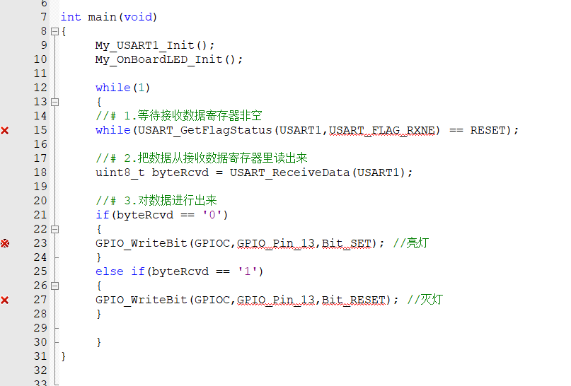

> **通过串口接收指令控制 LED 灯**：这是串口接收的典型应用。PC 端发送一个字符（如 `'1'` 开灯、`'0'` 关灯），STM32 接收后判断字符内容，控制 GPIO 引脚输出高低电平来点亮或熄灭 LED。这展示了「上位机指令 → 串口传输 → 下位机执行」的经典控制模式。

### 16.3 其余标志位一览

除 RxNE 外，还有以下标志位用于检测异常情况（一般用不到，不需要重点记忆）：

| 标志位 | 名称 | 含义 | 置位条件 |
| --- | --- | --- | --- |
| PE | 校验错误 | 接收数据的校验位与预期不符 | 检测到奇偶校验不匹配 |
| FE | 帧格式错误 | 接收到了无效的数据帧 | 停止位不是高电平 |
| NE | 噪声错误 | 接收线上检测到噪声干扰 | 采样时发现位中间有毛刺 |
| ORE | 溢出错误 | 因过载导致数据丢失 | 上一个接收数据未被读取，新数据又到了 RDR |

---

## 17. 封装

### 17.1 为什么要封装函数

● **避免重复性工作**：串口发送/接收的底层操作（检查标志位、调用寄存器函数）每次都要写相同的代码，封装成函数后一行调用即可。
● **提高代码复用性**：封装好的串口函数可以在不同项目中直接复用，不用每次都重写。
● **便于维护**：如果需要修改发送逻辑（如增加超时机制），只需改动封装函数内部，调用方不受影响。
● **提高可读性**：`USART_SendString("Hello")` 比三行 `while(USART_GetFlagStatus...` + `USART_SendData...` 清晰得多。

### 17.2 串口发送函数

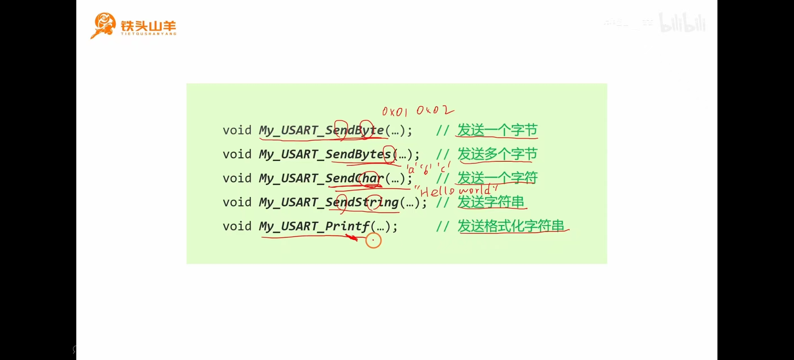

> **常用串口发送函数封装**：
> - `USART_SendByte()`：发送单个字节
> - `USART_SendString()`：发送字符串（逐字节发送直到 `\0`）
> - `USART_SendArray()`：发送指定长度的字节数组
> - `USART_SendNumber()`：发送整数的十进制字符串形式

### 17.3 串口接收函数

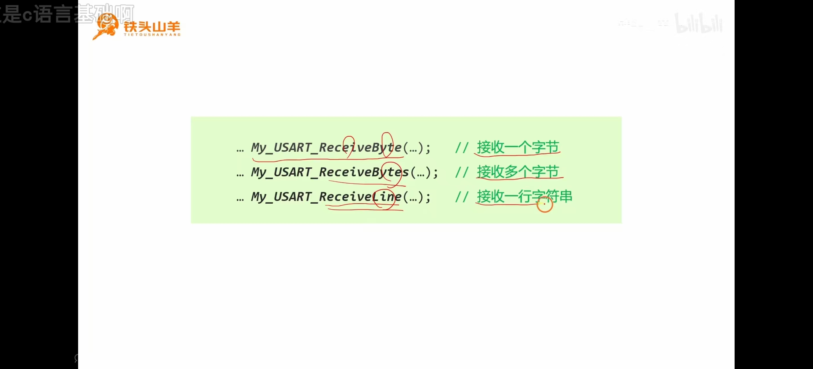

> **常用串口接收函数封装**：
> - `USART_ReceiveByte()`：接收单个字节（阻塞等待）
> - `USART_ReceiveString()`：接收字符串直到特定结束符
> - `USART_ReceiveWithTimeout()`：带超时的接收，避免程序一直卡在等待上

### 17.4 常见的串口发送函数

在实际开发中，常用的串口发送函数通常被封装为一个独立的模块（如 `serial.c` / `serial.h`），包含以下功能：

● **字节发送**：最基础的发送单位。
● **字符串发送**：发送调试信息、提示文本。
● **数组发送**：发送二进制数据块，适用于自定义协议。
● **格式化发送**：通过重写 `fputc()` 后直接使用 `printf()`，灵活度最高，开发调试最常用。

> 总结：串口通信贯穿整个嵌入式开发——调试用 `printf` 输出变量值、上位机下发指令控制硬件、蓝牙/WiFi 模块的 AT 指令交互，全都离不开它。今天的串口发送和接收是整个通信体系的基础，后续 DMA、中断等内容都会在此基础上展开。
# 10月27日

由于学校有事以及自身原因，给自己小放了三天假期。今天重新开始学习，进入 I2C 通信的世界。I2C 是嵌入式开发中极其重要的总线协议，几乎所有传感器、存储器、显示屏都通过它来与 MCU 交互。

> 重点：I2C 通信

---

## 18. I2C 通信概述

I2C（Inter-Integrated Circuit，集成电路间总线）是由 Philips（现 NXP）公司开发的一种**同步、半双工、多主多从**的串行通信总线。它仅用两根线就能连接数十上百个设备，是嵌入式领域使用最广泛的通信协议之一。

### 18.1 串口的缺点与 I2C 的优势

串口通信（UART）虽然简单易用，但存在明显的局限性：

| 对比维度 | UART（串口） | I2C |
| --- | --- | --- |
| 连接设备数量 | 仅能连接 3 个设备（一发一收一GND） | 理论上可连接 127 个设备（7 位地址） |
| 接线数量 | 最少 3 根（Tx、Rx、GND） | 仅需 2 根（SCL、SDA）+ GND |
| 通信方式 | 异步、全双工 | 同步、半双工 |
| 总线类型 | 点对点 | 多主多从，总线共享 |
| 典型应用 | 调试打印、蓝牙/串口模块 | 传感器、EEPROM、OLED 屏、RTC 等 |

> **I2C 的最大优势**：一根总线上可以挂载大量从设备，每个设备有唯一的 7 位地址，主机通过地址来选择与谁通信——就像快递员在一个小区（总线）里根据门牌号（地址）逐户送达包裹。

### 18.2 I2C 总线的电路结构

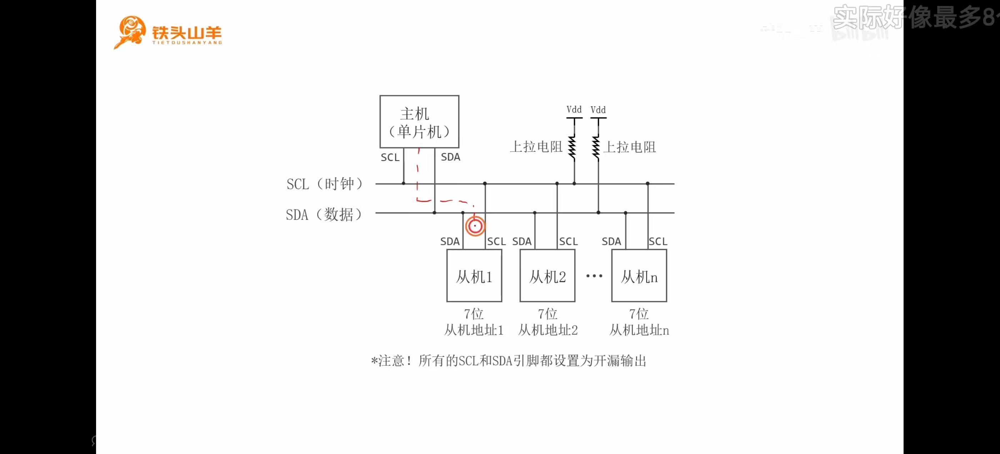

> **电路结构核心要点**：
>
> ● **SCL（Serial Clock，串行时钟线）**：由主机产生，单向传输时钟信号。所有设备共享同一根 SCL 线，在时钟的驱动下同步收发数据。
> ● **SDA（Serial Data，串行数据线）**：双向数据线，主机和从机都可以在这根线上发送或接收数据。但同一时刻只能有一个设备在发送。
> ● **上拉电阻 Rp**：SCL 和 SDA 必须各接一个上拉电阻到 VCC（通常 4.7kΩ）。这是 I2C 电路中最关键的元件——没有上拉电阻，总线完全无法工作。
> ● **所有设备的 SCL/SDA 引脚必须配置为开漏输出**：这是实现总线共享的核心设计，任何设备只能把总线拉低，不能强行拉高，拉高由上拉电阻完成。

### 18.3 时钟线与数据线

● **SCL（时钟线）**：单向的，由主机生成并发送给所有从机。从机在 SCL 的每个脉冲沿上采样 SDA 的电平。SCL 由主机控制，从机在某些情况下可以「拉住 SCL 为低」（Clock Stretching），告诉主机「我还没准备好，请等我一下」。
● **SDA（数据线）**：双向的，主机和从机都能在上面发送高低电平。总线空闲时，SDA 被上拉电阻拉到高电平，任何设备要发 0 就拉低 SDA，要发 1 就释放（高阻态，由上拉电阻拉高）。
● **重要提醒**：所有的 SCL 和 SDA 引脚都必须设置为**复用开漏输出**（`GPIO_Mode_AF_OD`），且必须外接上拉电阻。

### 18.4 逻辑「线与」——I2C 的精髓

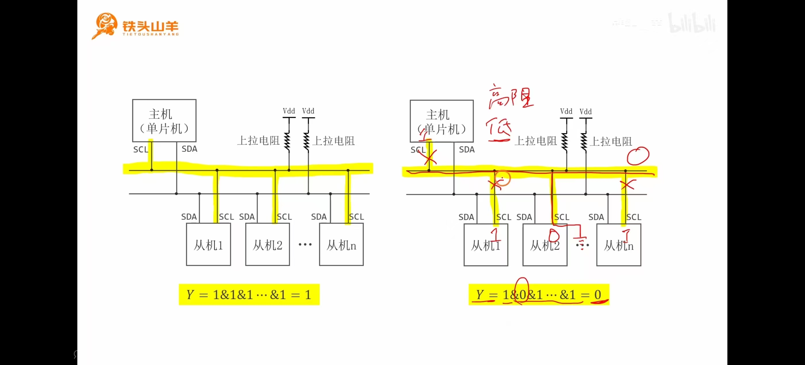

> **逻辑线与（Wired-AND）** 是理解 I2C 工作方式的关键概念：
>
> ● 总线上所有设备的 SDA（和 SCL）引脚都是**开漏输出**——只有拉低（N-MOS 导通）和高阻态（N-MOS 截止）两种状态，没有主动拉高的能力。
> ● 当所有设备都释放总线（高阻态），上拉电阻把总线拉高 → **总线呈高电平（1）**。
> ● 当总线上**任意一个**设备拉低总线，总线立即被拉低 → **总线呈低电平（0）**。
> ● 这形成了天然的逻辑与关系：**只要有一个设备输出 0，总线就是 0；必须全部设备输出 1，总线才是 1**。
>
> **为什么 I2C 必须用开漏？**
> 如果用了推挽输出，当两个设备同时一个输出高、一个输出低时，VCC 和 GND 之间会形成短路，瞬间烧毁引脚。开漏输出从根本上避免了这种「短路冲突」——谁都没本事拉高，只有拉低的能力，谁拉低总线跟谁走。

### 18.5 主机与从机如何相互发送数据

I2C 的数据发送机制可以这样理解：

● 总线上有多个设备，每个设备都有能力把 SDA 拉低（输出 0），但都没本事拉高。
● **谁想发数据，就把 SDA 在对应时刻拉低或释放**；不想发数据的设备，释放 SDA（高阻态），不参与。
● 由于「线与」逻辑的存在——任何设备拉低，总线就是低；全部释放，总线才被上拉电阻拉高——所以**总线最终呈现的电平，就是那个唯一在「说话」的设备输出的值**。
● 发送 0：主动拉低 SDA → 总线为低。
● 发送 1：释放 SDA（高阻态）→ 上拉电阻拉高 → 总线为高。

---

## 19. I2C 通信协议

### 19.1 数据帧格式

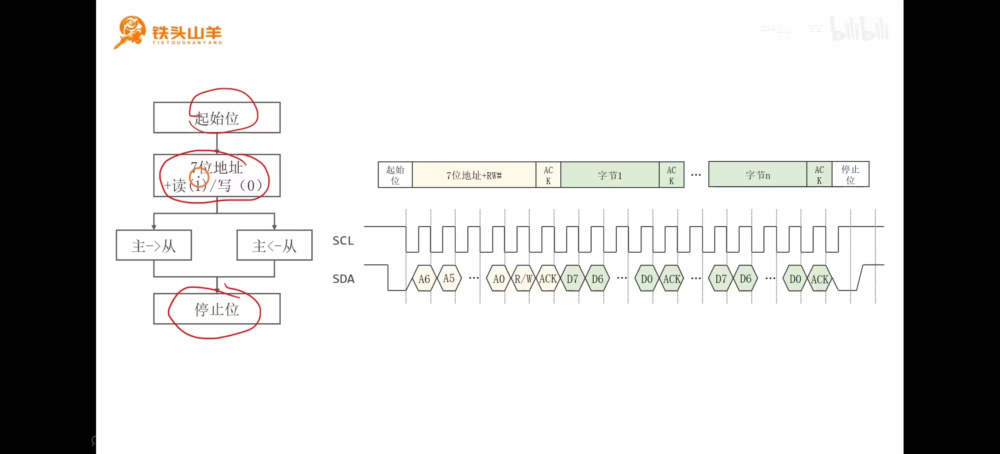

> **I2C 一帧完整数据的结构**：
>
> ```
> 起始位 | 从机地址(7位) + R/W(1位) | ACK | 数据1(8位) | ACK | 数据2(8位) | ACK | ... | 停止位
> ```
>
> ● **起始位（Start Condition）**：1 位，标志一次通信的开始。
> ● **地址帧**：7 位从机地址 + 1 位读写方向（R/W），共 8 位。R/W = 0 表示主机写数据到从机，R/W = 1 表示主机从从机读数据。
> ● **ACK/NACK**：每个地址帧和数据帧之后都有 1 位应答位，占第 9 个时钟周期。
> ● **数据帧**：每个数据帧 8 位，可以连续发送多个数据帧，每发一个都要等对方的 ACK。
> ● **停止位（Stop Condition）**：1 位，标志本次通信结束。
>
> **与串口的对比**：串口一次只能传输一个字节，发完就结束；I2C 一次通信可以传输多个字节，直到主机发出停止位才结束。

### 19.2 起始位和停止位

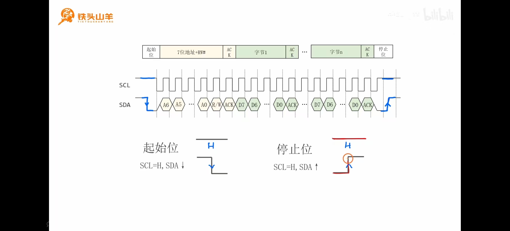

> **起始位（Start）**：当 SCL 为高电平时，SDA 从高电平切换到低电平（下降沿）。这是 I2C 总线上最重要的信号——它告诉所有从机：「注意了，通信开始！」产生起始位后，总线被认为「忙」（BUSY = 1）。
>
> **停止位（Stop）**：当 SCL 为高电平时，SDA 从低电平切换到高电平（上升沿）。它告诉所有从机：「本次通信结束，总线释放。」产生停止位后，总线恢复「空闲」（BUSY = 0）。
>
> **记忆口诀**：起始 = SCL 高时 SDA 降（↓），停止 = SCL 高时 SDA 升（↑）。起始像「绿灯亮」，停止像「红灯亮」。
>
> **注意**：起始位和停止位都由主机产生。在起始位和停止位之间，总线被主机「占用」，其他设备不能发起通信。

### 19.3 寻址与应答（ACK/NACK）

● **寻址**：位于起始位之后、数据传输之前。主机在总线上广播 7 位从机地址 + 1 位 R/W 位。所有从机都在监听，只有地址匹配的那个从机才会响应。
● **R/W 位（读写位）**：0 表示主机要写入数据到从机，1 表示主机要从从机读取数据。
● **ACK（Acknowledge，应答）**：接收方在第 9 个时钟周期把 SDA 拉低，表示「收到了」。有应答返回低电压（0）。
● **NACK（Not Acknowledge，非应答）**：接收方在第 9 个时钟周期保持 SDA 为高电平，表示「没收到」或「不想再接收了」。没有应答保持高电压（1）。

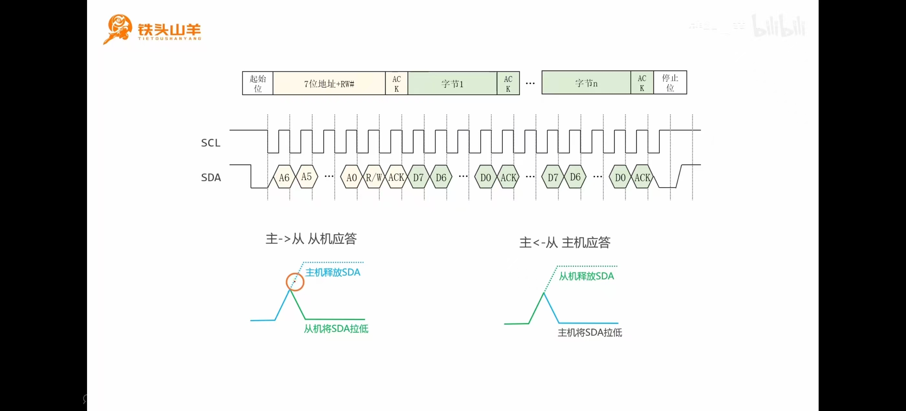

> **ACK 的工作流程**：
>
> 1. 发送方发送 8 位数据（地址或数据字节）
> 2. 发送方释放 SDA（设为高阻态），让接收方控制
> 3. 接收方在第 9 个 SCL 时钟周期内将 SDA 拉低 → ACK（应答成功）
> 4. 如果接收方不拉低 → NACK（应答失败或无应答）
>
> **NACK 的两种情况**：
> - 地址帧后收到 NACK：说明总线上没有该地址的从设备，主机应发停止位结束通信。
> - 数据帧后收到 NACK：说明从机不想再接收更多数据，主机应发停止位结束通信。

### 19.4 数据传输

● 数据传输紧跟地址帧之后，每个数据字节同样是 8 位，高位在前（MSB first）。
● 每发送完一个 8 位数据字节，接收方都必须回复一个 ACK 位。
● 主机可以连续发送多个数据字节，每个字节之间用 ACK 隔开，直到主机发出停止位。
● 数据传输末尾的应答位同样用来判断从机是否成功收到了数据。

---

## 20. I2C 模块的使用方法

### 20.1 I2C 模块介绍

I2C 是 STM32 的一个片上外设模块，不需要外部芯片，直接集成在 MCU 内部。STM32F103C8T6 包含 2 个 I2C 外设：I2C1 和 I2C2。

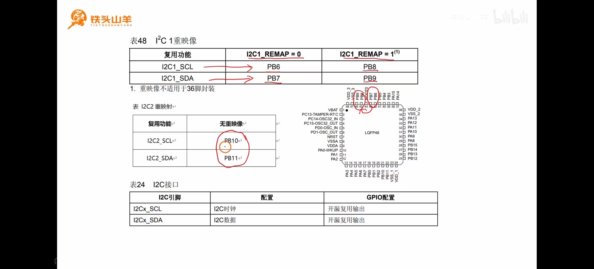

> **I2C 引脚分布**：
>
> - I2C1：SCL → PB6，SDA → PB7（默认引脚）
> - I2C2：SCL → PB10，SDA → PB11（默认引脚）
>
> **引脚重映射**：当默认引脚与其他外设冲突时，可以通过 AFIO 重映射功能将 I2C 的引脚切换到备用位置。上图为 I2C 的可选引脚映像图。

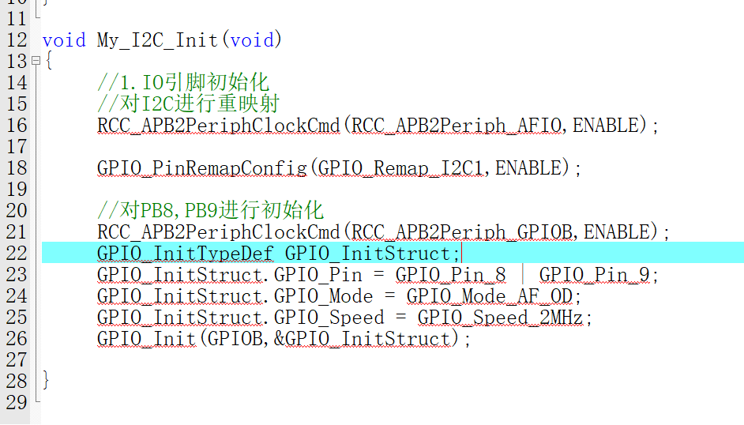

> **I2C 重映射代码**：
> ```c
> RCC_APB2PeriphClockCmd(RCC_APB2Periph_AFIO, ENABLE);   // 开启 AFIO 时钟
> GPIO_PinRemapConfig(GPIO_Remap_I2C1, ENABLE);           // 重映射 I2C1
> ```
> 重映射前必须先使能 AFIO 时钟，否则重映射不生效。`GPIO_Remap_I2C1` 将 I2C1 从 PB6/PB7 重映射到 PB8/PB9。

### 20.2 I2C 的几种模式


> I2C 协议定义了四种速度模式：

| 模式 | 最高速率 | STM32F103 支持 | 应用场景 |
| --- | --- | --- | --- |
| 标准模式（Standard） | 100 kbit/s | ✅ 支持 | 大多数传感器、RTC、EEPROM |
| 快速模式（Fast） | 400 kbit/s | ✅ 支持 | OLED 屏、高速传感器 |
| 快速增强模式（Fast Plus） | 1 Mbit/s | ❌ 不支持 | 高速数据传输 |
| 高速模式（High Speed） | 3.4 Mbit/s | ❌ 不支持 | 极高速数据传输 |

> **STM32F103 只支持标准模式和快速模式**。实际使用中，标准模式 100kHz 已满足绝大多数场景；OLED 屏幕等需要较高刷新率的设备才使用快速模式 400kHz。
>
> **快速模式下的时钟占空比**：在快速模式下，可以设置 SCL 时钟信号的高低电平时间比例（占空比）。STM32 提供两种占空比选项：
> - `I2C_DutyCycle_2`：T_low / T_high = 2:1（低电平时间长，更宽松）
> - `I2C_DutyCycle_16_9`：T_low / T_high = 16:9（接近 1:1，速度更快）
>
> 一般选择 `I2C_DutyCycle_2`，给从设备更充足的响应时间，兼容性更好。

### 20.3 I2C 模块的初始化


> **I2C_Init() 函数**：`void I2C_Init(I2C_TypeDef* I2Cx, I2C_InitTypeDef* I2C_InitStruct)`
>
> 该函数用于初始化 I2C 外设，需要传入 I2C 外设编号和初始化结构体。结构体成员包括：
>
> | 参数 | 含义 | 典型值 |
> | --- | --- | --- |
> | `I2C_Mode` | I2C 模式 | `I2C_Mode_I2C`（标准 I2C 模式） |
> | `I2C_ClockSpeed` | 时钟速度（波特率） | 100000（100kHz）或 400000（400kHz） |
> | `I2C_DutyCycle` | 占空比（仅快速模式有效） | `I2C_DutyCycle_2` |
> | `I2C_Ack` | 应答使能 | `I2C_Ack_Enable` |
> | `I2C_AcknowledgedAddress` | 本机应答地址长度 | `I2C_AcknowledgedAddress_7bit` |
> | `I2C_OwnAddress1` | 本机地址（从机模式时用到） | 0x00 ~ 0x7F |


> **完整的 I2C 初始化代码步骤**（与串口类似的三步走）：
>
> 1. **开启 GPIO 和 I2C 时钟**：`RCC_APB1PeriphClockCmd(RCC_APB1Periph_I2C1, ENABLE)` ——注意 I2C1 挂在 APB1 总线上（最高 36MHz），和 GPIO 挂在不同的时钟总线上。
> 2. **初始化 GPIO 引脚**：SCL 和 SDA 都配置为复用开漏输出（`GPIO_Mode_AF_OD`），这是 I2C 的硬件要求。
> 3. **初始化 I2C 外设**：配置 `I2C_InitStructure` 结构体，调用 `I2C_Init(I2C1, &I2C_InitStructure)`。
> 4. **使能 I2C**：`I2C_Cmd(I2C1, ENABLE)` 打开 I2C 外设的「总开关」。

---

## 21. I2C 写数据（主机发送）

I2C 主机发送数据的完整流程可以概括为：**起始 → 地址 → 数据 → 停止**，每一步都需要检查对应的标志位来确认操作是否完成。


> **I2C 模块内部结构图解析**：
>
> ● **数据寄存器（DR）**：收发共用的 8 位数据寄存器。发送时把数据写入 DR，硬件自动把数据送入移位寄存器逐位发出；接收时移位寄存器收完 8 位后存入 DR，用户从这里读取。
> ● **数据控制寄存器**：负责数据收发时的逻辑控制，管理数据的输入和输出流向。
> ● **时钟控制寄存器（CCR）**：配置 SCL 时钟频率。通过设置分频系数，把 APB1 时钟分频得到所需的波特率时钟。
> ● **自身地址寄存器（OAR）**：当 STM32 作为从机时，这个寄存器存储本设备的 I2C 地址，用于识别主机是否在呼叫自己。
> ● **状态寄存器（SR = Status Register）**：包含所有标志位（BUSY、SB、ADDR、AF、TxE、RxNE 等），用户通过读取 SR 来了解当前通信状态。每个标志位对应 SR 寄存器中的一个二进制位。

### 21.1 第一步：发送起始位


> **I2C_GenerateStart() 函数**：`void I2C_GenerateSTART(I2C_TypeDef* I2Cx, FunctionalState NewState)`
>
> 该函数用于在 I2C 总线上产生一个起始条件（SCL 高时 SDA 下降沿）。调用后，硬件自动在总线上产生起始信号。
>
> ● **BUSY 标志位（总线忙标志）**：0 = 总线空闲，1 = 总线忙。在发送起始位之前，应检查 BUSY 位确保总线空闲。
> ● **SB 标志位（起始位标志）**：0 = 不是起始位 / 起始位未产生，1 = 起始位已成功产生。调用 `I2C_GenerateStart()` 后，需要等待 `while(!I2C_CheckEvent(I2C1, I2C_EVENT_MASTER_MODE_SELECT))` 来确认 SB = 1。
>
> **写代码时的顺序**：
> ```c
> while(I2C_GetFlagStatus(I2C1, I2C_FLAG_BUSY));    // 等待总线空闲
> I2C_GenerateSTART(I2C1, ENABLE);                    // 发送起始位
> while(!I2C_CheckEvent(I2C1, I2C_EVENT_MASTER_MODE_SELECT)); // 等待 SB=1
> ```

### 21.2 第二步：发送从机地址


> **发送地址的代码**：`I2C_Send7bitAddress(I2C1, Addr, I2C_Direction_Transmitter)`
>
> 该函数发送 7 位从机地址 + R/W 位（共 8 位）。`I2C_Direction_Transmitter` 表示主机发送（R/W = 0）。
>
> **为什么用 `Addr & 0xFE`（I2C_SendData 方式时）？**
>
> 如果使用 `I2C_SendData()` 手动发送地址，地址值需要先清除最后一位（R/W 位）。因为 I2C 的地址帧中，7 位地址占据高 7 位（bit7~bit1），最低位（bit0）是 R/W 位。`Addr & 0xFE`（二进制 11111110）的作用就是把 bit0 清零：
> - 例如从机地址是 `0x78`（二进制 01111000），`0x78 & 0xFE = 0x78`（bit0 本就是 0，不变）
> - 例如从机地址是 `0x79`（二进制 01111001），`0x79 & 0xFE = 0x78`（bit0 从 1 变 0）
> - 简而言之：**清零 R/W 位，确保发送的是「写」指令**
>
> ● **ADDR 标志位（地址匹配标志）**：1 = 已发送完地址并且收到了从机的 ACK，0 = 尚未收到应答。等待 `while(!I2C_CheckEvent(I2C1, I2C_EVENT_MASTER_TRANSMITTER_MODE_SELECTED))` 来检测 ADDR = 1。
> ● **AF 标志位（应答失败）**：1 = 应答失败（从机没有拉低 SDA），0 = 应答成功（从机正确拉低了 SDA）。如果 AF = 1，说明总线上没有该地址的从设备，应发送停止位结束通信。

### 21.3 第三步：发送数据


> **I2C_SendData() 函数**：`void I2C_SendData(I2C_TypeDef* I2Cx, uint8_t Data)`
>
> 该函数把一个字节（8 位）写入 I2C 的数据寄存器 DR。写入后，硬件自动把数据逐位移出到 SDA 线上。
>
> ● **TxE 标志位（发送寄存器空）**：当数据寄存器 DR 中的数据被转移到移位寄存器后，DR 变空，TxE = 1。此时可以写入下一个字节。
> ● **发送多个字节时**：每发送一个字节，都要等待 TxE = 1（或使用 `I2C_EVENT_MASTER_BYTE_TRANSMITTED` 事件宏），然后再写下一个字节。
> ● **最后一个字节发送后**：除了等待 TxE，还要等待 **BTF（字节传输完成标志）**，确认移位寄存器也空了，数据真正发出去了。

### 21.4 第四步：发送停止位


> **I2C_GenerateStop() 函数**：`void I2C_GenerateSTOP(I2C_TypeDef* I2Cx, FunctionalState NewState)`
>
> 该函数在 I2C 总线上产生一个停止条件（SCL 高时 SDA 上升沿），标志本次通信结束。停止位发送后，BUSY 标志自动清零。
>
> **注意**：必须在上一个字节完全发送完成（包括 ACK）之后才能发送停止位，否则从机可能收不到最后一个数据。

### 21.5 自定义发送数据函数


> **自定义封装函数**：将上述四步（起始 → 地址 → 数据 → 停止）封装成一个统一的多字节发送函数，方便项目中复用：
>
> ```c
> void I2C_WriteBytes(uint8_t DevAddr, uint8_t RegAddr, uint8_t *pData, uint8_t len) {
>     // 1. 发送起始位
>     I2C_GenerateSTART(I2C1, ENABLE);
>     // 2. 发送从机地址（写方向）
>     I2C_Send7bitAddress(I2C1, DevAddr, I2C_Direction_Transmitter);
>     // 3. 发送寄存器地址
>     I2C_SendData(I2C1, RegAddr);
>     // 4. 循环发送数据
>     for (int i = 0; i < len; i++) {
>         I2C_SendData(I2C1, pData[i]);
>     }
>     // 5. 发送停止位
>     I2C_GenerateSTOP(I2C1, ENABLE);
> }
> ```
> 这个函数可以一次性向 I2C 设备的指定寄存器地址写入任意长度的数据，是操控 OLED 屏幕、传感器配置等场景中最常用的 I2C 函数模板。

### 21.6 OLED 屏配置


> **OLED 显示屏的 I2C 配置**：OLED 屏幕（如 0.96 寸 SSD1306）是最常见的 I2C 实践设备。通过 I2C 总线向 OLED 发送命令和数据，可以绘制文字、图形和动画。配置步骤包括：
> - 确定 OLED 的 I2C 从机地址（通常为 `0x78` 或 `0x7A`，取决于模块上的电阻焊接）
> - 初始化 OLED 的寄存器序列（对比度、显示模式、扫描方向等）
> - 将显示缓冲区的数据通过 I2C 逐字节发送给 OLED 的 GDDRAM
>
> OLED 的配置是 I2C 通信最直观的实战案例，把之前所学的起始位、地址发送、数据发送、停止位全流程串联起来。