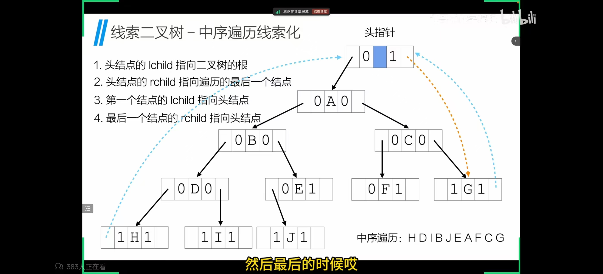
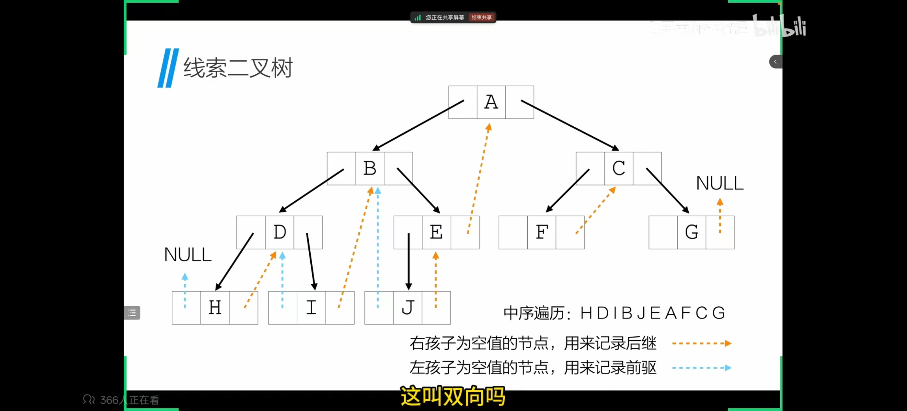

## 一、qsort 的比较函数

```c
int cmp(const char* e1, const char* e2);
```

- `e1` 的类型是 `const void*`，编译器只知道它指向一个地址，不知道它指向的是什么类型。
- 要用 `->` 访问成员，编译器必须知道“这个指针指向的结构体长什么样”（比如 `name` 在结构体里偏移多少字节）。
- 对 `void*` 来说这些信息都是空白的，所以无法访问任何成员。

## 二、offsetof 宏模仿详解

```c
struct S {
    int a;
    char b;
    double c;
};

struct S* p = (struct S*)0;
```

### 第 1 步：把 0 当作起始地址

把整数 `0` 强转成 `struct S*`，意思是：“假设有一个结构体，它放在内存地址 0 的位置”。

> 注意：这只是让编译器在编译期建立一个“假想布局”，并没有真的去读地址 0 的内存。指针 `p` 的值就是 `0`，仅此而已。

### 第 2 步：`->m_name` 配上 `&` —— 只算地址，不取内容

关键组合是 `&(((type*)0)->m_name)`：

- 单写 `p->b` → 编译器要生成“从地址 0 + 偏移处读数据”的指令 → 运行时崩溃。
- 但写 `&p->b` → 编译器只需要计算地址 `起始地址 + 成员偏移`，不生成任何读内存的指令。

地址计算发生在编译期 / 纯算术层面：

```c
&p->b = p 的值 + b 在结构体中的偏移
      = 0      + 偏移量
      = 偏移量本身
```

所以拿到的数值恰好等于偏移量，最后 `(size_t)` 把这个地址转成整数输出。

> 一句话：起始地址是 0，成员地址就等于偏移量。这是利用“0 作基准，相对距离即绝对位置”的数学技巧。

## 三、为什么换成 1，全体偏移量 +1？

`成员地址 = 基准地址 + 成员偏移量`

偏移量（成员之间的相对距离）由结构体布局决定，永远不变。变的是算出来的“地址数值”：

| 基准 | `&p->a` | `&p->b`（假设偏移 4） | `&p->c`（假设偏移 8） |
| --- | --- | --- | --- |
| `(type*)0` | 0 + 0 = 0（正确） | 0 + 4 = 4（正确） | 0 + 8 = 8（正确） |
| `(type*)1` | 1 + 0 = 1（多 1） | 1 + 4 = 5（多 1） | 1 + 8 = 9（多 1） |

图示（假设偏移为 4）：

```text
用 0 作基准:              用 1 作基准:
0 ─── 结构体起点          1 ─── 结构体起点
0+4 = 4 ← b 的位置        1+4 = 5 ← b 的位置
  ↑ 偏移 = 4               ↑ 拿到的是 5，不是 4
```

你算出来的 `5` = 基准(1) + 真实偏移(4)，所以每个值都多了 1 —— 多出来的正好是那个基准值本身。想还原偏移量就得减去基准：`&((T*)1)->m - 1` 才等价于原来的写法。

## 四、补充两点

1. 这是“驯服”过的未定义行为：标准 C 里把整数 0 转指针、对假空指针做 `->` 都算 UB，但因为从头到尾没有解引用（没有读内存），所有主流编译器都把它当作纯地址算术，安全可用。`offsetof(type, member)` 标准宏的常见实现就是这一招。
2. 建议直接用 `<stddef.h>` 里的 `offsetof`：它是标准提供的，语义明确，跨平台可靠。

```c
#include <stddef.h>

size_t off = offsetof(struct S, b);
```

## 五、结构体函数

```c
#include <stdio.h>

struct point { int x; int y; };   // 先定义结构体类型

struct point createpoint(int x, int y)   // 函数返回 struct point
{
    struct point p;
    p.x = x;              // 把参数装进结构体
    p.y = y;
    return p;             // 返回整个结构体（按值拷贝回去）
}

int main()
{
    struct point p1 = createpoint(3, 5);     // 接收返回的结构体
    struct point p2 = createpoint(10, 20);

    printf("p1 = (%d, %d)\n", p1.x, p1.y);   // p1 = (3, 5)
    printf("p2 = (%d, %d)\n", p2.x, p2.y);   // p2 = (10, 20)
    return 0;
}
```

返回类型可以是任何类型，结构体当然也可以。区别只是这个函数返回的不是单个数字，而是“打包”好的一组数据。

## 六、重点：反转链表

```c
struct node* first = NULL;
struct node* second = head;
struct node* third = NULL;

while (second != NULL)
{
    third = second->next;   // 先记住下一个结点，防止断链
    second->next = first;   // 调转链表方向
    first = second;         // first 往前挪一格
    second = third;         // second 往前挪一格
}
```

> 重点：最重要的一句是 `second->next = first;` —— 它负责调转链表方向，其余的代码都只是为了转移指针的位置，从而实现反转链表的功能。

## 七、结构体内部数据的解释

用“找房子”来理解指针：

- `d` = 一张纸条，上面写着“幸福路 100 号”
- `&d` = 这张纸条本身放在哪（抽屉第 3 格）← “d 的地址”
- `*d` = 走到幸福路 100 号，看到那栋房子（结构体）
- `(*d).next` = 走进房子，看到墙上贴着“下一户的地址：幸福路 200 号”

`*d` 不是 d 的地址，而是 d 指向的那个结点的内容；d 的地址是 `&d`。

下一个结点的地址，是先通过 `*d` 取到结点，再读它里面的 `next` 字段得来的，所以写成 `(*d).next` 或 `d->next`。

## 八、线索二叉树的实现

### 8.1 结点定义与建树

```c
typedef char ElemType;            // 树中数据的类型（这里用字符）

typedef struct TreeNode           // 二叉树结点结构体
{
    ElemType data;                // 数据域：存放结点数据
    struct TreeNode* lchild;      // 左指针：指向左孩子，或指向前驱线索
    struct TreeNode* rchild;      // 右指针：指向右孩子，或指向后继线索
    int ltag;                     // 左标志：0=左指针指向孩子，1=左指针指向前驱
    int rtag;                     // 右标志：0=右指针指向孩子，1=右指针指向后继
} TreeNode;                       // 结构体类型名 TreeNode

typedef TreeNode* ThreadTree;     // 类型别名：ThreadTree 就等价于 TreeNode*

char str[] = "ABDH##I##EJ###CF##G##";   // 先序序列，# 代表空结点，用来建树
int idx = 0;                            // 全局下标：指向 str 中当前读到的字符

ThreadTree prev;                        // 全局指针：线索化时保存“上一个访问过的结点”

// 创建树（按先序序列递归建树）
void createTree(ThreadTree* T)          // T 是二级指针：要改调用者的指针，必须传它的地址
{
    ElemType ch;                        // 存放当前读到的字符
    ch = str[idx++];                    // 取一个字符，下标后移

    if (ch == '#')                      // 读到 '#' 表示该位置是空结点
    {
        *T = NULL;                      // 把指针置空：这棵子树为空
    }
    else                                // 否则是真实结点
    {
        *T = (ThreadTree)malloc(sizeof(TreeNode));   // 申请一个新结点
        (*T)->data = ch;                             // 写入数据域

        createTree(&(*T)->lchild);                   // 递归创建左子树
        if ((*T)->lchild != NULL)                    // 若左孩子存在
        {
            (*T)->ltag = 0;                          // 左标志置 0：左指针指向孩子，不是线索
        }

        createTree(&(*T)->rchild);                   // 递归创建右子树
        if ((*T)->rchild != NULL)                    // 若右孩子存在
        {
            (*T)->rtag = 0;                          // 右标志置 0：右指针指向孩子，不是线索
        }
    }
}
```

### 8.2 具体线索化（中序递归，一边遍历一边穿线索）

```c
void threading(ThreadTree T)
{
    if (T != NULL)                               // 递归出口：空结点直接返回
    {
        threading(T->lchild);                    // ① 先线索化左子树

        if (T->lchild == NULL)                   // ② 若当前结点没有左孩子
        {
            T->ltag = 1;                         //    左标志置 1：左指针改作“前驱线索”
            T->lchild = prev;                    //    左指针指向中序前驱（上一个访问的结点）
        }

        if (prev->rchild == NULL)                // ③ 若前驱结点没有右孩子
        {
            prev->rtag = 1;                      //    前驱的右标志置 1：右指针改作“后继线索”
            prev->rchild = T;                    //    前驱的右指针指向当前结点（当前结点是它的后继）
        }

        prev = T;                                // ④ 更新 prev：当前结点成为“下一个结点的前驱”
        threading(T->rchild);                    // ⑤ 再线索化右子树
    }
}
```

### 8.3 线索化（建立带头结点的线索二叉树）

```c
void inOrderThreading(ThreadTree* head, ThreadTree T)   // head：用于返回头结点；T：树的根
{
    *head = (ThreadTree)malloc(sizeof(TreeNode));   // 创建头结点
    (*head)->ltag = 0;                              // 头结点左标志置 0：lchild 当普通指针用
    (*head)->rtag = 1;                              // 头结点右标志置 1：rchild 当线索用
    (*head)->rchild = (*head);                      // 头结点右指针先指向自己（空树时用）

    if (T == NULL)                                  // 情况一：空树
    {
        (*head)->lchild = (*head);                  // 头结点左指针也指向自己
    }
    else                                            // 情况二：非空树
    {
        (*head)->lchild = T;                        // 头结点左指针指向根结点
        prev = (*head);                             // prev 从头结点开始（中序首结点的前驱就是头结点）

        threading(T);                               // 调用线索化，把整棵树穿起来

        // 最后一个结点线索化
        prev->rchild = *head;                       // 中序最后访问的结点：右指针指向头结点
        prev->rtag = 1;                             //    它的右标志置 1（作为后继线索）

        // 头结点右孩子指向最后一个结点
        (*head)->rchild = prev;                     // 头结点右指针指向中序最后一个结点（形成循环）
    }
}
```

头结点的创建与两种情况：



### 8.4 基于线索遍历（利用线索，不用递归也不用栈）

```c
void inOrder(ThreadTree T)                      // 参数 T 是“头结点”
{
    ThreadTree curr;                            // curr：遍历用的游标指针
    curr = T->lchild;                           // 从头结点的左孩子出发（即根结点）

    while (curr != T)                           // 只要没回到头结点，就继续循环
    {
        while (curr->ltag == 0)                 // 沿左指针一路向左下走
        {
            curr = curr->lchild;                // ltag==0 说明有左孩子，继续往左
        }

        printf("%c", curr->data);               // 走到最左，访问中序第一个结点

        while (curr->rtag == 1 && curr->rchild != T)   // 只要右指针是“后继线索”且没到头结点
        {
            curr = curr->rchild;                // 顺线索直接跳到中序后继
            printf("%c", curr->data);           // 访问它
        }

        curr = curr->rchild;                    // 换到右孩子，进入下一轮
    }

    printf("\n");                               // 遍历结束，换行
}

int main()
{
    ThreadTree head;                            // 头结点指针
    ThreadTree T;                               // 树根指针

    createTree(&T);                             // 按先序序列建树
    inOrderThreading(&head, T);                 // 线索化，并得到头结点 head
    inOrder(head);                              // 利用线索做中序遍历并打印

    return 0;
}
```

叶结点没有右孩子，直接靠“后继线索”跳到中序后继，所以整个遍历不需要递归也不需要栈：

